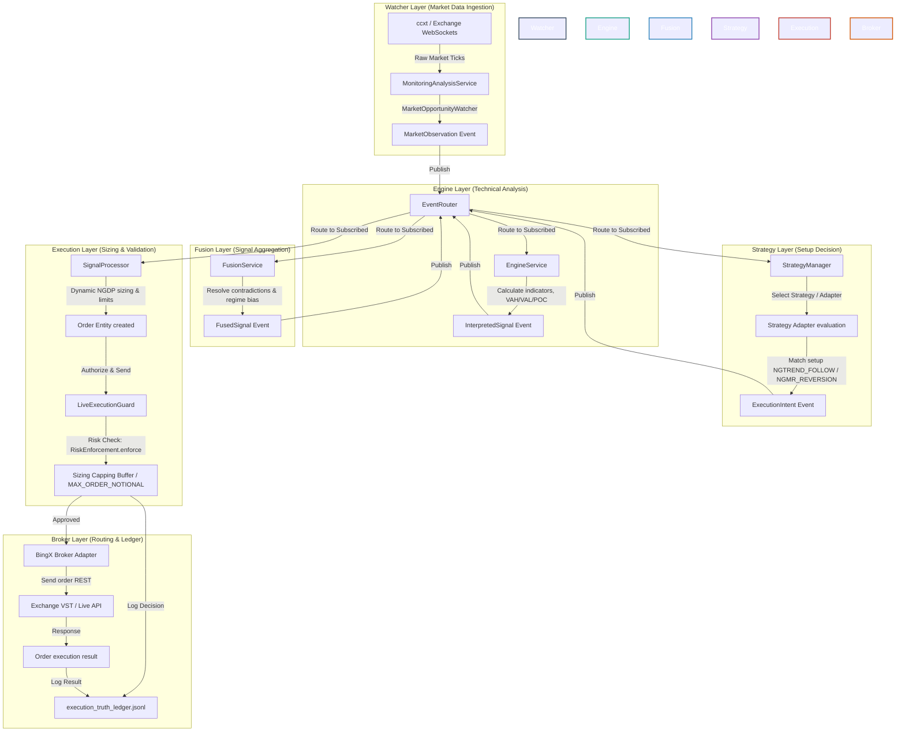

# Lynxion ETS - Event-Driven Architecture & Signal Processing Flow

This document details the event-driven architecture and real-time processing flow of the Lynxion Enterprise Trading System (ETS). It maps the hexagonal architecture layers to the pipeline: **Watcher → Engine → Fusion → Strategy → Execution → Broker**.

---

## 1. Architecture Flow Diagram

Below is the conceptual flowchart illustrating the unidirectional data flow from live market observation down to order routing and execution ledger logging.

---

## 2. Layer Walkthrough

### 2.1 Watcher Layer
* **Responsibility**: Ingest raw real-time price updates.
* **Component**: [MarketOpportunityWatcher](file:///Users/mojtaba.rahbari/Sites/python/lynxion-ets/infrastructure/watchers/market_opportunity_watcher.py) and [MonitoringAnalysisService](file:///Users/mojtaba.rahbari/Sites/python/lynxion-ets/infrastructure/watchers/monitoring_analysis_service.py).
* **Action**: Fetches order book updates, tickers, or candles periodically (30s interval). Emits a `MarketObservation` containing raw prices and volumes to the `EventRouter`.

### 2.2 Engine Layer
* **Responsibility**: Calculate statistical features, trends, and market structures.
* **Component**: `EngineService`, `MarketStructureEngine`.
* **Action**: Receives the `MarketObservation` and computes value area boundaries (VAL, VAH, POC), ATR, Bollinger Bands, and moving averages. Outputs an `InterpretedSignal` detailing local indicators.

### 2.3 Fusion Layer
* **Responsibility**: Synthesize indicators across timeframes and resolve conflicting biases.
* **Component**: `FusionService`.
* **Action**: Aggregates macro and micro data points. Determines a unified regime-adapted market bias (e.g. `BUY` dominance score, volatile regime). Outputs a single, cleaned `FusedSignal`.

### 2.4 Strategy Layer
* **Responsibility**: Assess setup eligibility and define protective bounds (Stop Loss / Take Profit).
* **Component**: [StrategyManager](file:///Users/mojtaba.rahbari/Sites/python/lynxion-ets/infrastructure/strategies/strategy_manager.py) and strategy adapters (e.g., [MTFTrendStrategyAdapter](file:///Users/mojtaba.rahbari/Sites/python/lynxion-ets/infrastructure/strategies/adapters/mtf_trend_strategy_adapter.py)).
* **Action**: Evaluates the `FusedSignal` against specific trading strategies. When a setup (such as `NGTREND_FOLLOW` or `NGMR_REVERSION`) is matched, it generates an `ExecutionIntent` with target parameters.

### 2.5 Execution & Risk Layer
* **Responsibility**: Position sizing, safety capping, validation, and final exchange submission.
* **Component**: [SignalProcessor](file:///Users/mojtaba.rahbari/Sites/python/lynxion-ets/infrastructure/messaging/event_system.py#L142), [MultiBrokerExecutionService](file:///Users/mojtaba.rahbari/Sites/python/lynxion-ets/infrastructure/adapters/broker_data_adapters.py), and [LiveExecutionGuard](file:///Users/mojtaba.rahbari/Sites/python/lynxion-ets/shared/live_execution_guard.py).
* **Action**: 
  1. Computes the optimal position size using NGDP sizing: `risk_amount / risk_per_unit`.
  2. Applies sizing controls before the authoritative VST risk boundary.
  3. Passes the order through `RiskEnforcement.enforce()`, which currently caps VST order notional
     at 21 USDT and aggregate portfolio notional at 1,000 USDT.
  4. For `./lynxion` entries, the BingX boundary establishes isolated 10x leverage and rejects
     missing, stale, malformed, cross-margin, or mismatched authoritative readback.
  4. Records the decision to the [Execution Truth Ledger](file:///Users/mojtaba.rahbari/Sites/python/lynxion-ets/logs/execution_truth_ledger.jsonl) and executes the REST call to the exchange via the broker adapter.
