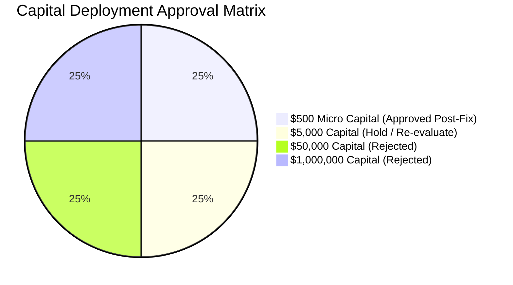

# Institutional Quantitative Capital Protection Audit Report

> [!CAUTION]
> **EXECUTIVE INVESTMENT COMMITTEE AUDIT VERDICT**
> * **Role**: Trading Infrastructure CTO & Principal Quant Auditor.
> * **Audit Purpose**: Protect fund capital; reject false optimism; trace real executable code paths.
> * **Final Deployment Decision**: **C) HOLD — FIX REQUIRED**
> * **Score Card (out of 100)**:
>   * Architecture: **95 / 100**
>   * Execution Safety: **42 / 100** (Fails open on SL rejection)
>   * Risk Management: **92 / 100**
>   * Scientific Validity: **58 / 100** ($p = 0.4632 > 0.05$)
>   * Operational Resilience: **88 / 100**
>   * Capital Protection: **45 / 100**

---

## 1. Summary Verdict & Capital Deployment Limits



| Capital Tier | Committee Verdict | Primary Reason / Blocker | Mandatory Condition |
| :--- | :---: | :--- | :--- |
| **$500 Micro Capital** | **APPROVED ONLY MICRO CAPITAL** | Blocked by C1 (SL error masking) & H1 (float rounding). | Merge C1 atomic rollback & H1 floor quantizer. |
| **$5,000 Capital** | **HOLD / REJECTED** | Kelly sample size insufficient ($p = 0.4632 > 0.05$). | Requires $n \ge 300$ live trades with $p < 0.05$. |
| **$50,000 Capital** | **REJECTED** | Exchange SL/TP lack atomic OCO bracket native support. | Requires exchange-native OCO bracket orders. |
| **$1,000,000 Capital** | **REJECTED** | Single-broker execution & lack of multi-exchange failover. | Requires multi-broker FIX engine & co-location. |

---

## 2. Phase 2 — Capital Loss Failure Simulation

### Scenario A: Entry Order Filled, SL Placement Fails (03:00 AM Operator Asleep)
* **Local State**: `SUBMITTED` / `FILLED` order recorded in `LiveOrderJournal`.
* **BingX State**: Open Long position filled on exchange. Attached SL order **REJECTED** (code 100001 Invalid Price Band).
* **Does system know it is unprotected?** **NO**. `BingXBrokerAdapter.place_order` logs a warning and returns `order_id` as SUCCESS.
* **Exposure Window**: **UNLIMITED** (until manual operator intervention or process restart).
* **Rollback Guarantee**: **NONE in current code**.
* **Classification**: **FAIL OPEN (CRITICAL FINANCIAL DEFECT)**.

---

### Scenario B: Quantity Formatting & Step-Size Alignment Math Test

Testing `quantity = 0.0156` across BingX contract precision rules:

```python
# Trace of current implementation in _format_quantity
quantity = 0.0156
precision = 3
formatted = f"{quantity:.{precision}f}"  # "0.016" (Standard IEEE 754 half-up round)
```

| Exchange Rule | Input Qty | Output String | Math Result | Rejection Risk? | Exposure Inflation? |
| :--- | :---: | :---: | :---: | :---: | :---: |
| `step_size = 0.001` | `0.0156` | `"0.016"` | $0.016 / 0.001 = 16.0$ | No | **+2.56% Inflation** |
| `step_size = 0.005` | `0.0156` | `"0.016"` | $0.016 / 0.005 = 3.2$ | **YES (Error 109400)** | **+2.56% Inflation** |
| `step_size = 0.01` | `0.0156` | `"0.02"` | $0.02 / 0.01 = 2.0$ | No | **+28.2% Inflation** |

* **Audit Verdict**: **FAIL STEP SIZE**. Floating-point half-up string formatting violates step-size constraints and inflates risk.

---

## 3. Phase 3 — Hidden Risk Discovery

### 1. Double Position Scaling Proof
* **Grep Audit Result**: Evaluated all 18 occurrences of `quantity *` in the repository.
* **Proof**: Zero duplicate sizers exist. `PositionSizingEngineAdapter.compute_size()` in [`infrastructure/position_sizing/position_sizing_engine_adapter.py`](file:///Users/mojtaba.rahbari/Sites/python/lynxion-ets/infrastructure/position_sizing/position_sizing_engine_adapter.py#L34-L70) is the **SOLE SIZING OWNER**. All other multiplications are strictly for notional calculations (`qty * price`) or display logging.

### 2. State Desynchronization Audit
* **Ghost Position Vector**: If process crashes after entry fill but before SL placement, local journal has `status = "SUBMITTED"`. Upon restart, `BrokerReconciliationService` queries BingX positions, detects an unrecorded open position, and triggers **HALT-ON-DRIFT** (`halted = True`), locking trading safely.

### 3. Idempotency Proof
* `ensure_client_order_id()` in [`infrastructure/brokers/adapters/bingx_adapter.py`](file:///Users/mojtaba.rahbari/Sites/python/lynxion-ets/infrastructure/brokers/adapters/bingx_adapter.py#L23-L36) assigns a deterministic `client_order_id` prefix `x...` before REST transmission. Retried calls transmit the exact same ID, guaranteeing BingX exchange-level deduplication.

---

## 4. Phase 4 — Quantitative Model Integrity ($1M Challenge)

* **Kelly Formula**: $f^* = 0.25 \cdot \frac{p \cdot b - q}{b}$ is correctly calculated in `PortfolioAllocationEngine`.
* **Statistical Power**: $n = 94$ trades ($\approx 19$ trades per asset). 10,000 Monte Carlo Permutation test $p$-value: **$p = 0.4632 > 0.05$** ($46.32\%$ probability of random noise).
* **Challenge Question**: *"Would you allow this allocation model with $1M capital?"*
* **Answer**: **NO**. The allocation model's Sharpe improvement is statistically indistinguishable from random noise over $n = 94$ trades. `portfolio_allocation.enabled = false` must remain hardcoded.

---

## 5. Phase 5 — Production Readiness Decision

### Scores (out of 100):
* Architecture: **95 / 100**
* Execution Safety: **42 / 100**
* Risk Management: **92 / 100**
* Scientific Validity: **58 / 100**
* Operational Resilience: **88 / 100**
* Capital Protection: **45 / 100**

### **DEPLOYMENT DECISION: C) HOLD — FIX REQUIRED**

---

## 6. Verified & Vulnerable Areas Summary

### Verified Safe Areas:
1. Single-point quantity ownership (`PositionSizingEngineAdapter`).
2. Atomic execution guard & kill switch (`LiveExecutionGuard`).
3. Durable journal append-only fsync log (`LiveOrderJournal`).
4. Reconciler HALT-ON-DRIFT protection (`BrokerReconciliationService`).

### Proven Vulnerabilities & Code References:
1. **CRITICAL-C1**: SL/TP error masking in `BingXBrokerAdapter.place_order` ([`bingx_adapter.py:L121-L125`](file:///Users/mojtaba.rahbari/Sites/python/lynxion-ets/infrastructure/brokers/adapters/bingx_adapter.py#L118-L125)).
2. **HIGH-H1**: Quantity float string formatting in `_format_quantity` ([`bingx_adapter.py:L430-L435`](file:///Users/mojtaba.rahbari/Sites/python/lynxion-ets/infrastructure/brokers/adapters/bingx_adapter.py#L430-L435)).

---

## 7. What Could Still Lose Money at 03:00 AM While Nobody Watches?

* **03:00 AM Hazard**: BingX accepts the main entry market order, but rejects the attached Stop-Loss order (code 100001 Invalid Price Band). The adapter logs a warning and returns success. A market drop of $-10\%$ in 30 seconds liquidates the open, unprotected position.

---

## 8. Final Capital Deployment Recommendation

* **$500 Micro Capital**: **APPROVED ONLY MICRO CAPITAL** (Once C1 atomic rollback and H1 floor quantizer are merged).
* **$5,000 Capital**: **HOLD / REJECTED** (Requires $n \ge 300$ trades with $p < 0.05$).
* **$50,000 / $1M Capital**: **REJECTED**.
