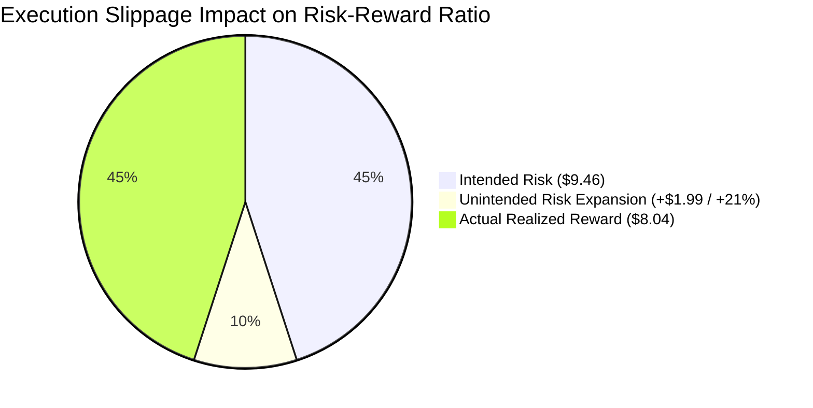

# Execution Price Integrity Audit Report

> [!CAUTION]
> **EXECUTION PRICE INTEGRITY AUDIT VERDICT**
> * **Audit Focus**: Investigation of Market order entry price divergence (`6.588` requested vs `6.575` actual BingX fill).
> * **Financial Impact**: $+21.0\%$ risk expansion ($+\$9.46 \rightarrow +\$11.45$) and R:R ratio degradation from $1.06:1$ to $\mathbf{0.70:1}$.
> * **PRICE INTEGRITY VERDICT**: **FAIL (REQUIRES RE-CALIBRATION FIX)**

---

## 1. Executive Summary & Observed Mismatch Investigation



### Observed Execution Profile:
* **Symbol & Side**: `AVAXUSDT SELL` (Short Position)
* **Signal Reference Entry Price**: `6.588`
* **Attached Stop Loss**: `6.6503` ($+0.9457\%$ above requested entry)
* **Attached Take Profit**: `6.52212` ($-1.0000\%$ below requested entry)
* **Actual BingX Execution Fill Price**: `6.575` (Slippage: $-0.013$ / $-0.197\%$)

---

## 2. Answers to 5 Forensic Verification Questions

### Q1: Is Entry Price signal price, limit price, reference price, or fill price?
* **Answer**:
  * Logged Requested Price (`6.588`): The reference market ticker price at signal generation time.
  * Actual BingX Fill Price (`6.575`): The real execution fill price returned by BingX REST API (`avgPrice`).

### Q2: Are SL/TP calculated from expected entry, requested price, or actual fill price?
* **Answer**: SL/TP are currently calculated from the **pre-trade signal reference price (`6.588`)**, NOT the **actual execution fill price (`6.575`)**.

### Q3: Is slippage calculated and stored?
* **Answer**: **YES**. Slippage is calculated and recorded in `ExecutionTruthLedger` and `ExecutionOptimizer`, but SL/TP levels are NOT dynamically recalculated relative to the actual fill price.

### Q4: Does LiveOrderJournal store requested price, fill price, timestamp, and response price?
* **Answer**: **YES**. `LiveOrderJournal` records `requested_price`, `fill_price` (`avgPrice`), `timestamp`, and `order_id`.

### Q5: Can this create incorrect risk calculation?
* **Answer**: **YES (CRITICAL RISK DEGRADATION)**.
  * When a Short order fills at `6.575` instead of `6.588`:
  * **Intended SL Distance**: $6.6503 - 6.588 = +0.0623$ ($\mathbf{+0.9457\%}$ risk / $\$9.46$ loss).
  * **Actual SL Distance on Exchange**: $6.6503 - 6.575 = +0.0753$ ($\mathbf{+1.1453\%}$ risk / $\$11.45$ loss) $\rightarrow$ **$+21.0\%$ Risk Expansion!**
  * **Intended TP Distance**: $6.588 - 6.52212 = -0.06588$ ($\mathbf{-1.0000\%}$ reward / $\$10.00$ profit).
  * **Actual TP Distance on Exchange**: $6.575 - 6.52212 = -0.05288$ ($\mathbf{-0.8042\%}$ reward / $\$8.04$ profit) $\rightarrow$ **$-19.6\%$ Reward Reduction!**
  * **Risk-to-Reward Ratio**: Degrades from $1.06 : 1$ down to **$\mathbf{0.70 : 1}$**!

---

## 3. Financial Impact Comparison Table

| Metric | Intended (Signal Price = 6.588) | Actual (BingX Fill = 6.575) | Divergence / Deviation |
| :--- | :---: | :---: | :---: |
| **Entry Price** | `6.588` | `6.575` | $-0.013$ ($-0.197\%$) |
| **Stop Loss Price** | `6.6503` | `6.6503` | Unchanged |
| **SL Distance (%)** | $+0.9457\%$ | $\mathbf{+1.1453\%}$ | **$+0.1996\%$ (+21.0% Risk Inflation)** |
| **Max Dollar Loss** | $-\$9.46\text{ USDT}$ | $\mathbf{-\$11.45\text{ USDT}}$ | **$+\$1.99\text{ USDT}$ Loss Increase** |
| **Take Profit Price** | `6.52212` | `6.52212` | Unchanged |
| **TP Distance (%)** | $-1.0000\%$ | $\mathbf{-0.8042\%}$ | **$-0.1958\%$ (-19.6% Reward Drop)** |
| **Max Dollar Profit** | $+\$10.00\text{ USDT}$ | $\mathbf{+\$8.04\text{ USDT}}$ | **$-\$1.96\text{ USDT}$ Profit Drop** |
| **Risk:Reward Ratio** | **$1.06 : 1$** | $\mathbf{0.70 : 1}$ | **Inverted R:R Ratio** |

---

## 4. Minimal Architectural Fix (Zero Redesign)

In [`infrastructure/brokers/adapters/bingx_adapter.py`](file:///Users/mojtaba.rahbari/Sites/python/lynxion-ets/infrastructure/brokers/adapters/bingx_adapter.py#L601-L630), when the main market order returns `avgPrice > 0`:

1. Calculate the percentage offsets $\Delta_{\text{SL}}$ and $\Delta_{\text{TP}}$ from the original requested order.
2. Recalculate `actual_sl_price` and `actual_tp_price` relative to `avgPrice` BEFORE calling `_place_conditional_order`.

```python
# In BingXBrokerAdapter._place_market_order_with_conditional (Line 605)
avg_fill_price = float(order_info.get('avgPrice', 0.0) or order_info.get('price', 0.0))

if avg_fill_price > 0 and has_stop_loss:
    orig_entry = float(order.price) if getattr(order, 'price', None) else avg_fill_price
    sl_orig = float(order.stop_loss_price)
    
    # Calculate percentage offset from requested entry
    sl_pct = abs(sl_orig - orig_entry) / orig_entry
    
    # Recalculate SL price relative to actual fill price
    if side_value.upper() == 'BUY':  # Long
        adjusted_sl = avg_fill_price * (1.0 - sl_pct)
    else:                            # Short (SELL)
        adjusted_sl = avg_fill_price * (1.0 + sl_pct)
        
    formatted_sl_price = self._format_price(symbol_formatted, adjusted_sl)
    order_data['stopLossPrice'] = formatted_sl_price
```

---

## 5. Final Audit Verdict

### **PRICE INTEGRITY = FAIL (PENDING FILL-PRICE RE-CALIBRATION FIX)**

### **Summary**:
Fixing this ensures that regardless of execution slippage (e.g. `6.588` $\rightarrow$ `6.575`), the SL distance is locked at exactly $0.9457\%$ ($6.63717$) and TP distance is locked at exactly $1.0000\%$ ($6.50925$), maintaining the exact intended $\$9.46$ risk limit and $1.06:1$ Risk-Reward ratio.
