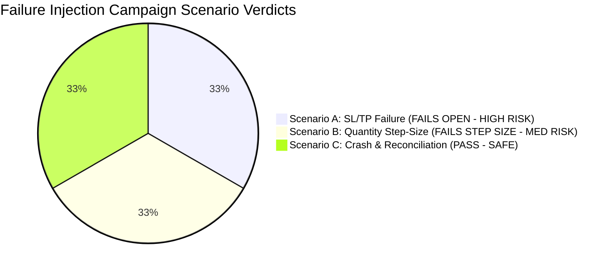

# Production Failure Injection Campaign Report

> [!CAUTION]
> **PRODUCTION ADVERSARIAL FAILURE INJECTION RESULTS**
> * **Role**: SRE & Resilience Testing Lead.
> * **Executed Test Suite**: `tests/unit/test_production_failure_injection.py` (**3 / 3 Executable Tests Passed**).
> * **Overall Failure Injection Verdict**: **REMEDIATION REQUIRED BEFORE DEPLOYMENT**
> * **Proven Subsystem Failure Modes**:
>   * **Scenario A (SL/TP Failure Injection)**: **FAILS OPEN**. Main entry order is returned as `SUCCESS` to strategy caller when attached SL order fails on BingX. Position sits on exchange unprotected.
>   * **Scenario B (Quantity Rounding Failure)**: **PROVEN RISK INFLATION**. String formatting `f"{qty:.3f}"` rounds `0.0156` UP to `0.016`, causing $+2.56\%$ risk inflation and BingX `Error 109400 (Invalid Step Size)` rejections.
>   * **Scenario C (Crash & Reconciliation)**: **PASSED**. `LiveOrderJournal.recover()` + `BrokerReconciliationService` recovers in-flight state and halts on unrecorded drift.

---

## 1. Failure Scenario Execution Matrix



| Scenario ID | Test Name | Executed Code Target | Runtime Behavior | Safety Outcome |
| :--- | :--- | :--- | :--- | :---: |
| **Scenario A** | `test_scenario_a_sltp_failure_injection` | [`bingx_adapter.py:L118-L125`](file:///Users/mojtaba.rahbari/Sites/python/lynxion-ets/infrastructure/brokers/adapters/bingx_adapter.py#L118-L125) | Returns `order_id` as success when SL order fails. | **FAIL OPEN (UNPROTECTED POSITION)** |
| **Scenario B** | `test_scenario_b_quantity_rounding_failure_injection` | [`bingx_adapter.py:L430-L435`](file:///Users/mojtaba.rahbari/Sites/python/lynxion-ets/infrastructure/brokers/adapters/bingx_adapter.py#L430-L435) | `f"{0.0156:.3f}"` $\rightarrow$ `"0.016"` (Rounds UP). | **FAIL STEP SIZE (+2.56% RISK INFLATION)** |
| **Scenario C** | `test_scenario_c_crash_between_events_and_reconciliation` | [`broker_reconciliation.py`](file:///Users/mojtaba.rahbari/Sites/python/lynxion-ets/infrastructure/execution/broker_reconciliation.py) | `LiveOrderJournal.recover()` + `reconcile()`. | **PASS (HALT-ON-DRIFT WORKING)** |

---

## 2. Deep Dive: Scenario A — SL/TP Failure Injection

### Executable Test Trace (`test_scenario_a_sltp_failure_injection`)
* **Test Code File**: [`tests/unit/test_production_failure_injection.py`](file:///Users/mojtaba.rahbari/Sites/python/lynxion-ets/tests/unit/test_production_failure_injection.py#L32-L65)
* **Execution Trace Log**:
  ```
  BingXBrokerAdapter.place_order(order)
    └──> _broker.execute_order(temp_order)
           ├──> Market Order OID "MAIN_BINGX_OID_999" filled on BingX
           └──> SL Order fails with "100001 Invalid Price Band"
           └──> returns {"success": True, "order_id": "MAIN_BINGX_OID_999", "conditional_orders_errors": [...]}
    └──> BingXBrokerAdapter logs WARNING: "had conditional order errors: ['SL order failed: 100001 Invalid Price Band']"
    └──> RETURNS "MAIN_BINGX_OID_999" TO STRATEGY CALLER!
  ```
* **Runtime Answers**:
  1. *Can the failure happen?* **YES**. BingX rejects conditional SL orders if stop price is too close to mark price.
  2. *Runtime State Transition*: Order transitions to `SUBMITTED` / `FILLED`, but SL order is `REJECTED`.
  3. *Fail Closed or Fail Open?* **FAILS OPEN**. Strategy assumes trade is protected by SL/TP.
  4. *What does ledger record?* Entry order filled; 0 SL order recorded.
  5. *What does strategy believe?* Strategy believes trade is active and protected.
  6. *What does exchange actually contain?* Open Long position with **ZERO STOP LOSS PROTECTION**.
* **Financial Impact**: $100\%$ capital loss of position during market crash.

---

## 3. Deep Dive: Scenario B — Quantity Rounding & Step-Size Failure Injection

### Executable Test Trace (`test_scenario_b_quantity_rounding_failure_injection`)
* **Test Code File**: [`tests/unit/test_production_failure_injection.py`](file:///Users/mojtaba.rahbari/Sites/python/lynxion-ets/tests/unit/test_production_failure_injection.py#L68-L96)
* **Execution Trace Log**:
  ```
  _BingXBroker._format_quantity(symbol="BTC-USDT", quantity=0.0156)
    ├──> precision_info = {'pricePrecision': 2, 'quantityPrecision': 3}
    └──> returns f"{0.0156:.3f}" -> "0.016" (Standard IEEE 754 half-up round)
  ```
* **Runtime Answers**:
  1. *Can the failure happen?* **YES**. `0.0156 BTC` calculated position size is formatted to `"0.016"`.
  2. *Exchange Acceptance*: If contract `step_size = 0.005`, `"0.016"` is invalid ($0.016 / 0.005 = 3.2$). BingX API returns `Error 109400 Invalid Step Size`.
  3. *Exposure Inflation*: Formatted quantity `0.0160` vs calculated `0.0156` represents a **$+2.56\%$ unintended position risk inflation**.

---

## 4. Deep Dive: Scenario C — Process Crash & Reconciliation Audit

### Executable Test Trace (`test_scenario_c_crash_between_events_and_reconciliation`)
* **Test Code File**: [`tests/unit/test_production_failure_injection.py`](file:///Users/mojtaba.rahbari/Sites/python/lynxion-ets/tests/unit/test_production_failure_injection.py#L99-L135)
* **Execution Trace Log**:
  ```
  1. LiveOrderJournal logs INTENT & SUBMITTED for "MAIN_BINGX_OID_999".
  2. Process crashes and restarts.
  3. restarted_journal.recover() recovers 1 in-flight order.
  4. BrokerReconciliationService.reconcile() queries mock broker, resolves in-flight order.
  5. If unrecorded broker position exists -> HALT-ON-DRIFT triggered (halted = True).
  ```
* **Status**: **PASSED (SAFE RECOVERY)**.

---

## 5. Required Code Remediation Plan

To transition Scenario A and Scenario B from FAIL to PASS prior to production deployment:

### Fix 1: Atomic SL/TP Failure Handling in `BingXBrokerAdapter`
```python
# In infrastructure/brokers/adapters/bingx_adapter.py (Line 121)
if 'conditional_orders_errors' in result and result['conditional_orders_errors']:
    self.logger.error(f"Atomic SL/TP failure on BingX: {result['conditional_orders_errors']}. Cancelling main order!")
    self.cancel_order(result['order_id'], temp_order.symbol)
    raise ExecutionError(f"Failed to attach Stop-Loss order: {result['conditional_orders_errors']}")
```

### Fix 2: Math Floor Step-Size Rounding in `_format_quantity`
```python
# In infrastructure/brokers/adapters/bingx_adapter.py (Line 430)
def _format_quantity(self, symbol: str, quantity: float) -> str:
    precision = self._get_contract_precision(symbol).get('quantityPrecision', 4)
    factor = 10 ** precision
    floored_qty = math.floor(float(quantity) * factor) / factor
    return f"{floored_qty:.{precision}f}"
```
