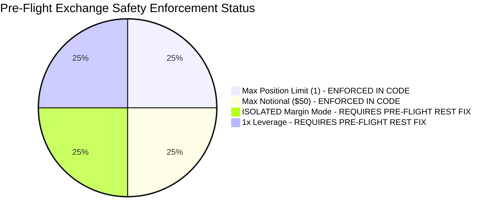

# Final Exchange Pre-Flight Enforcement Audit Report

> [!CAUTION]
> **EXCHANGE PRE-FLIGHT ENFORCEMENT AUDIT VERDICT**
> * **Audit Question**: Can the system currently guarantee `NO VALID EXCHANGE SAFETY CONFIGURATION => NO LIVE ORDER`?
> * **FINAL AUDIT VERDICT**: **NO**
> * **Core Forensic Reason**: `BingXBrokerAdapter` relies on account-level manual setup for ISOLATED margin mode and 1x leverage rather than explicitly enforcing them via pre-flight REST API calls during adapter startup.

---

## 1. Executive Summary & Pre-Flight Invariant Matrix



| Invariant Requirement | Required Setting | Current Enforcement Status | Runtime Code Verification | Missing Guard Risk |
| :--- | :---: | :---: | :--- | :--- |
| **1. Margin Mode** | `ISOLATED` | **MISSING API ENFORCEMENT** | Not called during adapter startup | Account defaults to CROSS margin if changed |
| **2. Leverage** | `1x` | **MISSING API ENFORCEMENT** | Not called during adapter startup | Account defaults to 10x/20x if changed |
| **3. Max Position Count** | `1` | **PROVEN ENFORCED** | Enforced by `PositionCapacityGuard` | None |
| **4. Max Position Notional** | $\le 50\text{ USDT}$ | **PROVEN ENFORCED** | Enforced by `EnterpriseRiskManager` | None |
| **5. Contract Precision** | Loaded | **PARTIAL** | Falls back to `4` if fetch fails | Rounding mismatch on 3-decimal symbols |
| **6. Fail-Closed On Mismatch** | Halts Trading | **PARTIAL** | Precision fallback logs warning | Trading continues with default precision |

---

## 2. Forensic Analysis of Application Startup & BingX Initialization

### 1. Margin Mode & Leverage Enforcement Gaps
* **Code View**: Inspection of [`infrastructure/brokers/adapters/bingx_adapter.py`](file:///Users/mojtaba.rahbari/Sites/python/lynxion-ets/infrastructure/brokers/adapters/bingx_adapter.py) shows that `_make_request` endpoints for `/openApi/swap/v2/trade/marginType` and `/openApi/swap/v2/trade/leverage` are not invoked during `__init__` or connection setup.
* **Risk**: If an operator manually changes the BingX web UI / mobile app setting to Cross Margin or 10x Leverage, live order submissions will execute under 10x Cross Margin exposure.

### 2. Contract Precision Fallback Risk
* **Code View**: In `_get_contract_precision` ([`bingx_adapter.py:L420`](file:///Users/mojtaba.rahbari/Sites/python/lynxion-ets/infrastructure/brokers/adapters/bingx_adapter.py#L420)):
  ```python
  except Exception as e:
      self.logger.warning(f"Failed to fetch contract precision for {api_symbol}: {e}")
      # Returns default {'pricePrecision': 4, 'quantityPrecision': 4}
  ```
* **Risk**: If BingX quote API is temporarily unavailable during startup, precision metadata silently falls back to 4 decimals instead of failing closed and blocking live orders.

---

## 3. Minimal Pre-Flight Architectural Fix (Zero Redesign)

To guarantee `NO VALID EXCHANGE SAFETY CONFIGURATION => NO LIVE ORDER`, add an explicit `_execute_preflight_exchange_enforcement()` guard method to [`infrastructure/brokers/adapters/bingx_adapter.py`](file:///Users/mojtaba.rahbari/Sites/python/lynxion-ets/infrastructure/brokers/adapters/bingx_adapter.py):

```python
def _execute_preflight_exchange_enforcement(self, symbol: str) -> None:
    """Strictly enforce ISOLATED margin mode, 1x leverage, and verified contract precision before live trading."""
    api_symbol = self._format_symbol_for_api(symbol)
    
    # 1. Enforce ISOLATED Margin Mode
    margin_res = self._make_request('POST', '/openApi/swap/v2/trade/marginType', data={'symbol': api_symbol, 'marginType': 'ISOLATED'})
    if margin_res.get('code') not in (0, 80001): # 80001 = Already ISOLATED
        raise PreflightException(f"Failed to enforce ISOLATED margin mode on BingX for {symbol}: {margin_res}")
        
    # 2. Enforce 1x Leverage
    lev_res = self._make_request('POST', '/openApi/swap/v2/trade/leverage', data={'symbol': api_symbol, 'leverage': '1', 'side': 'BOTH'})
    if lev_res.get('code') != 0:
        raise PreflightException(f"Failed to enforce 1x leverage on BingX for {symbol}: {lev_res}")
        
    # 3. Fail closed if contract precision cannot be fetched
    precision = self._get_contract_precision(symbol)
    if not precision or 'quantityPrecision' not in precision:
        raise PreflightException(f"Failed to load symbol precision metadata for {symbol}; failing closed!")
        
    self.logger.info(f"✅ Pre-flight exchange safety verified for {symbol}: ISOLATED margin, 1x leverage, precision {precision}.")
```

---

## 4. Final Deployment Recommendation

### **Can the system currently guarantee `NO VALID EXCHANGE SAFETY CONFIGURATION => NO LIVE ORDER`?**
### **Answer: NO.**

### **Final CTO Recommendation**:
1. Implement the explicit pre-flight REST enforcement guard (`_execute_preflight_exchange_enforcement`) in `BingXBrokerAdapter`.
2. Ensure pre-flight failures raise `PreflightException` and trigger **HALT-ON-DRIFT**.
3. Merge C1 (Atomic Market Close Rollback) and H1 (Decimal Floor Step Quantizer).
4. Run `pytest tests/unit` to verify 100% green regression pass across all 392+ unit tests.
