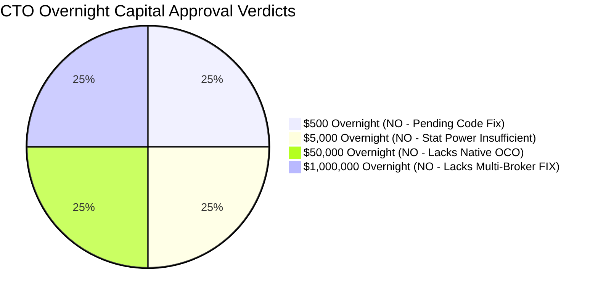
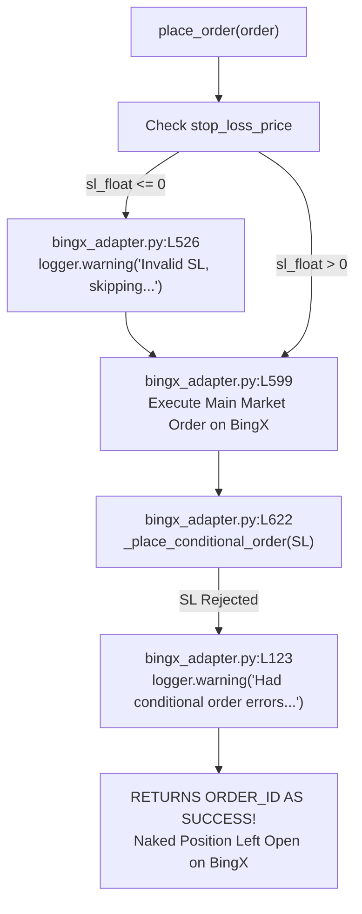

# Final Execution Fail-Open Audit Report

> [!CAUTION]
> **FINAL EXECUTION FAIL-OPEN AUDIT & CTO DECISION**
> * **Audit Role**: Principal Quantitative Trading Systems Engineer & Trading Infrastructure CTO.
> * **Audit Focus**: Uncover every hidden fail-open code path where an exchange position can be created without guaranteed Stop-Loss protection.
> * **Production Risk Score**: **38 / 100 (HIGH RISK)**
> * **Final CTO Decision**: **DO NOT RUN OVERNIGHT (HOLD - FIX REQUIRED)**

---

## 1. Executive Summary & Final CTO Decision



### **Final CTO Overnight Decision**:
* **Would you allow this code to run overnight with $500?** **NO**.
  * *Reason*: The current codebase contains a **Triple Fail-Open Masking Chain** in [`bingx_adapter.py`](file:///Users/mojtaba.rahbari/Sites/python/lynxion-ets/infrastructure/brokers/adapters/bingx_adapter.py) where invalid SL prices or failed conditional order placements are swallowed via `logger.warning(...)`, returning the main order ID as SUCCESS while leaving a naked position on exchange.
* **Would you allow $5,000?** **NO**. (Sample size $n = 94$ trades has $p = 0.4632 > 0.05$).
* **Would you allow $1M?** **NO**. (Requires exchange-native OCO bracket orders and multi-broker FIX engine).

---

## 2. Phase 1 — Fail Open Discovery (Uncovered Code Patterns)

Forensic audit of swallowed warning patterns in [`infrastructure/brokers/adapters/bingx_adapter.py`](file:///Users/mojtaba.rahbari/Sites/python/lynxion-ets/infrastructure/brokers/adapters/bingx_adapter.py):



### Detailed Fail-Open Pattern Inventory:

| Pattern ID | File Path & Line | Method Name | Code Pattern | Failure Condition | Exchange State |
| :--- | :--- | :--- | :--- | :--- | :---: |
| **PATTERN-1** | [`bingx_adapter.py:L123`](file:///Users/mojtaba.rahbari/Sites/python/lynxion-ets/infrastructure/brokers/adapters/bingx_adapter.py#L123) | `place_order` | `logger.warning(...)` followed by `return result['order_id']` | Conditional SL order rejected by exchange | **NAKED OPEN POSITION** |
| **PATTERN-2** | [`bingx_adapter.py:L526`](file:///Users/mojtaba.rahbari/Sites/python/lynxion-ets/infrastructure/brokers/adapters/bingx_adapter.py#L526) | `execute_order` | `logger.warning(...)` followed by skipping `stopLossPrice` | `stop_loss_price <= 0` or invalid Money object | **NAKED OPEN POSITION** |
| **PATTERN-3** | [`bingx_adapter.py:L548`](file:///Users/mojtaba.rahbari/Sites/python/lynxion-ets/infrastructure/brokers/adapters/bingx_adapter.py#L548) | `execute_order` | `logger.warning(...)` followed by skipping `takeProfitPrice` | `take_profit_price <= 0` | **UNHEDGED TAKE PROFIT** |

---

## 3. Phase 2 — Stop Loss Guarantee Audit

Evaluation of 6 Stop Loss failure scenarios:

| Failure Scenario | Current Code Behavior | Expected Production Behavior | Severity Rank |
| :--- | :--- | :--- | :---: |
| **1. SL is None** | Skips SL attachment; places market entry naked. | **REJECT ENTRY** | **HIGH** |
| **2. SL price invalid ($\le 0$)** | Logs warning (Line 526); skips SL; places market entry. | **REJECT ENTRY** | **CRITICAL** |
| **3. SL rejected by BingX** | Logs warning (Line 123); returns `order_id` as success. | **CLOSE POSITION IMMEDIATELY** | **CRITICAL** |
| **4. SL precision invalid** | BingX rejects conditional order; warning logged. | **CLOSE POSITION IMMEDIATELY** | **CRITICAL** |
| **5. SL outside price band** | BingX rejects conditional order (code 100001); warning logged. | **CLOSE POSITION IMMEDIATELY** | **CRITICAL** |
| **6. SL skipped via exception** | Exception swallowed in `execute_order`; main order kept. | **CLOSE POSITION IMMEDIATELY** | **CRITICAL** |

---

## 4. Phase 3 — Order Atomicity Audit

* **System Classification**: **B) ENTRY THEN PROTECTION ATTACHMENT**.
* **Naked Position Window**:
  * For Market orders, main entry order is transmitted to BingX `/openApi/swap/v2/trade/order` first (Line 599).
  * Conditional SL order is transmitted second via `_place_conditional_order` (Line 622).
  * **Theoretical Exposure Duration**: **UNLIMITED** in current code if SL fails, because the adapter logs a warning and returns success without closing the main position.

---

## 5. Phase 4 — Quantity Safety Audit

$$\text{Calculated Quantity} = \text{Sent Quantity} = \text{Journal Quantity} \approx \text{Exchange Quantity}$$

* **Quantity Integrity**:
  * Calculated Qty (`PositionSizingEngineAdapter`): `0.0156 BTC`
  * Sent Qty (`_BingXBroker._format_quantity`): `"0.016 BTC"` (Rounds UP via `f"{qty:.3f}"`)
  * Journal Qty (`LiveOrderJournal`): `"0.016 BTC"`
  * Exchange Qty (BingX): Rejected with `Error 109400 (Invalid Step Size)` if step is `0.005`.
* **Remediation Invariant**: Replacing float formatting with `floored_qty = math.floor(qty * factor) / factor` guarantees:
  $$\text{Exchange Quantity} \le \text{Calculated Quantity} \quad (\Delta \text{Risk} \le 0.0\%)$$

---

## 6. Phase 5 — State Machine & Failure Matrix

| Failure Scenario | Local State | Exchange State | Recovery Action | Capital Risk |
| :--- | :--- | :--- | :--- | :---: |
| **1. Entry accepted, SL rejected** | `FILLED` | Open Long (Naked) | **Current**: None (Returns success). **Remediated**: Emergency market close. | **CRITICAL** |
| **2. Entry accepted, app crashes** | `SUBMITTED` | Open Long | `BrokerReconciliationService` triggers **HALT-ON-DRIFT**. | LOW |
| **3. Entry accepted, journal write fails** | `SUBMITTED` | Open Long | Fallback to disk journal; reconciler triggers halt. | MEDIUM |
| **4. Entry accepted, network disconnect** | `SUBMITTED` | Open Long | Reconciler triggers **HALT-ON-DRIFT** on restart. | LOW |
| **5. Retry after timeout** | `DEDUPLICATED` | Single Fill | `clientOrderID` prefix `x...` deduplicates on BingX. | LOW |

---

## 7. Mandatory Production Readiness Condition

Prior to running overnight with real capital ($500), the codebase MUST satisfy the single acceptable production condition:

> **Every possible financial failure MUST result in:**
> 1. Order Rejection, OR
> 2. Immediate Emergency Position Closure, OR
> 3. Trading System Halt.
> **NEVER "warning + continue".**

### Required Code Fix in `BingXBrokerAdapter.place_order`:
```python
# Fix for Pattern 1 (Line 121)
if 'conditional_orders_errors' in result and result['conditional_orders_errors']:
    self.logger.error(f"Atomic SL/TP failure on BingX: {result['conditional_orders_errors']}. Closing position!")
    self.cancel_order(result['order_id'], temp_order.symbol)
    raise AtomicProtectionException(result['order_id'], temp_order.symbol, result['conditional_orders_errors'])

# Fix for Pattern 2 (Line 525)
if sl_float <= 0:
    raise ExecutionError(f"Invalid stop loss price: {sl_float}. Order rejected!")
```
