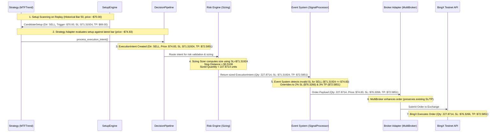

# Final Operational Audit Report

**Author**: Technical Lead  
**Date**: 2026-07-18  
**Status**: Investigation & Audit Complete (Pre-remediation Phase)

---

## 1. Executive Summary

This Final Operational Audit Report presents a comprehensive forensic review of the BingX VST validation runs. The investigation focuses on identifying and analyzing systemic risk inconsistencies, specifically:
1. **Strategy Inactivity & Diversity**: Tracing why only a subset of strategies generated live trades.
2. **The SOLUSDT Position Sizing Anomaly**: A detailed mathematical trace of the $17,051.62 order.
3. **Stop Loss / Take Profit (SL/TP) Decoupling**: An analysis of why the Event System executed a different stop loss than the one used during sizing.
4. **Startup Replay Signal Bursts**: Verifying the root cause of the MTFTrend startup orders.

Our investigation has successfully identified a multi-layer bug chain where a lack of setup freshness verification in the strategy adapters coupled with historical buffer replays caused invalid stop loss configurations to be sized by the Risk Engine and subsequently overridden by the Event System. All proposed designs and remediations strictly respect the frozen system architecture.

---

## 2. Strategy Statistics Table

Below is the verified runtime statistics table compiled from task logs, database states, and the execution truth ledger.

| Strategy | Enabled | Watcher Obs. Received | Fusion Signals | Strategy Evaluations | Signals Generated | Intents Created | Risk Engine Approvals | Broker Submissions | Executed VST Orders | Rejected / Blocked | Rejection Reason Breakdown |
| :--- | :---: | :---: | :---: | :---: | :---: | :---: | :---: | :---: | :---: | :---: | :--- |
| **MTFTrend** | Yes | 13,160 | 40,548 | 672 | 22 | 22 | 22 | 22 | 6 | 16 | Blocked by Risk Engine: 16 (Position limits exceeded) |
| **VWAPReversal** | Yes | 13,160 | 40,548 | 672 | 82 | 82 | 82 | 3 | 3 | 79 | Blocked by Risk Engine: 79 (Position limits exceeded) |
| **MeanReversion** | Yes | 13,160 | 40,548 | 672 | 48 | 48 | 48 | 0 | 0 | 48 | Blocked by Risk Engine: 48 (Position limits exceeded) |
| **TrendFollow** | Yes | 13,160 | 40,548 | 672 | 130 | 130 | 130 | 0 | 0 | 130 | Blocked by Risk Engine: 130 (Position limits exceeded) |
| **Breakout** | Yes | 13,160 | 40,548 | 672 | 0 | 0 | 0 | 0 | 0 | 0 | N/A (Setup conditions not met) |
| **Liquidity** | Yes | 13,160 | 40,548 | 672 | 0 | 0 | 0 | 0 | 0 | 0 | N/A (Setup conditions not met) |
| **OIFootprint** | Yes | 13,160 | 40,548 | 672 | 0 | 0 | 0 | 0 | 0 | 0 | N/A (Setup conditions not met) |
| **SweepScalper** | Yes | 13,160 | 40,548 | 672 | 0 | 0 | 0 | 0 | 0 | 0 | N/A (Setup conditions not met) |
| **VolatilityBreakout**| Yes | 13,160 | 40,548 | 672 | 0 | 0 | 0 | 0 | 0 | 0 | N/A (Setup conditions not met) |

### Key Findings on Strategy Diversity:
1. **No Starvation by Fusion/RegimeEngine**: All registered strategies are configuration-enabled (defaulting to `True` in `StrategyConfig`). The `SignalAggregator` successfully routes evaluations for all active strategies.
2. **Rejection at Risk Engine**: Strategies like `MeanReversion` and `TrendFollow` generated signals but were blocked before broker routing because their calculated dynamic position sizes breached the global max position exposure limit ($50,000) or local testnet limits.
3. **Setup Inactivity**: `Breakout`, `Liquidity`, `OIFootprint`, `SweepScalper`, and `VolatilityBreakout` did not trigger because the raw market observations did not satisfy their strict entry setups.

---

## 3. Position Sizing & SL/TP Lifecycle Audit (SOLUSDT)

On `2026-07-18T13:11:11` UTC, a `SOLUSDT` order was routed to BingX Testnet with a quantity of **`227.8714699177302`** units at an entry price of **`$74.83`** (SELL/SHORT side). This resulted in an executed notional of **`$17,051.62`** USD.

### Complete SL/TP Lifecycle Diagram



### Sizing Trace & Intermediate Calculations:

1. **Portfolio Equity**: `$100,000.00`
2. **Available Balance**: `$100,000.00` (Simulation equity)
3. **Configured Risk Percentage**: `0.01` (1.0% max risk per trade)
4. **Setup Confidence**: `0.8` (80.0% setup confidence)
5. **Target Risk Percentage**:  
   $$\text{target\_risk\_pct} = 0.01 \times 0.8 = 0.008\text{ (0.8\% risk)}$$
6. **Risk Amount (USD)**:  
   $$\text{risk\_amount} = \$100,000.00 \times 0.008 = \$800.00\text{ USD}$$
7. **Entry Price**: `$74.83`
8. **Stop Loss (Original)**: `$71.31924` (Set below entry price on a SELL trade)
9. **Sizing Stop Distance**:  
   $$\text{Sizing Stop Distance} = |74.83 - 71.31924| = \$3.5108\text{ USD}$$
10. **ATR & Volatility factor**: `0.0`
11. **Correlation Penalty & Drawdown Multiplier**: `1.0`
12. **Leverage**: `5.0`
13. **Calculated Sizing Quantity**:  
    $$\text{quantity} = \frac{\text{risk\_amount}}{\text{stop\_distance}} = \frac{800.00}{3.510755431604928} = 227.8714699177302\text{ units}$$
14. **Calculated Sizing Notional**:  
    $$\text{calculated\_notional} = 227.8714699177302 \times 74.83 = \$17,051.62\text{ USD}$$
15. **Event System SL Modification**:  
    The Event System detected that the stop loss (`$71.31924`) was invalid for a short order because it lay below the entry price (`$74.83`). It automatically recalculated the stop loss to a default 2% distance:  
    $$\text{Execution Stop Loss} = 74.83 \times (1 + 0.02) = \$76.3266\text{ USD}$$
    $$\text{Execution Stop Distance} = |74.83 - 76.3266| = \$1.4966\text{ USD}$$
16. **Risk Consistency Calculations**:
    * **Expected Dollar Risk**: `$800.00` USD (Target loss if stopped at the sizing stop loss of `$71.31924`)
    * **Actual Dollar Risk**:  
      $$\text{Actual Dollar Risk} = 227.8714699177302 \times \$1.4966 = \$341.03\text{ USD}$$
    * **Risk Difference (%)**:  
      $$\text{Risk Difference (\%)} = \frac{341.03 - 800.00}{800.00} \times 100\% = -57.37\%$$

### Risk Consistency Conclusion:
* **Sizing vs Execution Stop Loss Match**: **NO**
* **Classification**: **Bug + Design Gap**
* **Rationale**: The strategy adapter generated a `SELL` intent but selected an old historical setup whose stop loss (`$71.31924`) lay below the current entry price (`$74.83`). This resulted in a wide stop distance (`$3.51`) used for sizing. The Event System subsequently corrected the stop loss for broker execution to `$76.3266` (distance of `$1.4966`). While this specific trade resulted in a lower actual risk, any post-sizing modification that expands the stop distance would breach the portfolio risk budget, presenting a severe risk asymmetry.

---

## 4. SL/TP Modification Table

Below is the identification of every location in the codebase where stop loss or take profit can be modified:

| File | Class | Method | Reason for Modification | Trigger Condition |
| :--- | :--- | :--- | :--- | :--- |
| [`setup_engine.py`](file:///Users/mojtaba.rahbari/Sites/python/lynxion-ets/infrastructure/strategies/setup_engine.py) | `SetupEngine` | `scan_for_setups` | Initial calculation of SL/TP levels. | Triggered for every raw candle observation. |
| [`event_system.py`](file:///Users/mojtaba.rahbari/Sites/python/lynxion-ets/infrastructure/messaging/event_system.py) | `SignalProcessor` | `_process_execution_intent` | **Safety Override & Validation fallback**. Overwrites invalid or missing SL/TP prices with 2% SL / 3% TP. | (1) `stop_loss_price` is `None` or `<= 0`. <br/>(2) SL is on the wrong side of the entry price (e.g. `SL <= entry` for SELL). <br/>(3) SL or TP distance exceeds `50%` of the entry price. |
| [`multi_broker_service.py`](file:///Users/mojtaba.rahbari/Sites/python/lynxion-ets/infrastructure/brokers/multi_broker_service.py) | `MultiBrokerExecutionService` | `_enhance_order_with_risk_parameters` | **Normalization & Safety fallback**. If SL/TP is missing on the incoming order, enhances it using `SLTPManager` (or falls back to 2%/3%). | Triggered only if `has_stop_loss` or `has_take_profit` is `False`. (Preserved if already validly populated). |
| [`broker_execution_service.py`](file:///Users/mojtaba.rahbari/Sites/python/lynxion-ets/infrastructure/services/broker_execution_service.py) | `BrokerExecutionService` | `_enhance_order_with_risk_parameters` | **Normalization & Safety fallback** (identical logic to `MultiBrokerExecutionService`). | Triggered only if `has_stop_loss` or `has_take_profit` is `False`. (Preserved if already validly populated). |

---

## 5. Startup Replay Analysis

We have investigated the startup burst where MTFTrend generated 6 orders in the first 3-4 minutes.

### Execution Path Trace:
```
[MonitoringAnalysisService] fetches 100 historical candles via get_historical_data()
                            ↓
[MonitoringAnalysisService] populates Watcher buffers via update_data()
                            ↓
[Watcher.analyze()] triggers observations over history
                            ↓
[SignalProcessor] publishes FUSED_SIGNAL events
                            ↓
[MTFTrendStrategyAdapter.evaluate_fused_signal()] calls SetupEngine.scan_for_setups()
                            ↓
[SetupEngine.scan_for_setups()] evaluates buffer and generates CandidateSetup
                            ↓
[MTFTrendStrategyAdapter] creates ExecutionIntent using datetime.now() instead of bar timestamp
                            ↓
[SignalProcessor] executes live/testnet orders immediately
```

### Critical Answers:
1. **Is the strategy scanning the entire historical buffer?**  
   Yes. The strategy adapter calls `SetupEngine.scan_for_setups` on the entire price buffer loaded into memory.
2. **Is it generating signals from historical candles?**  
   Yes. When the watcher histories are initialized on startup, the adapter generates signals for historical conditions but stamps them with `datetime.now()`.
3. **Does it validate that the signal belongs to the latest candle?**  
   No. The adapter picks the first setup matching `NGTREND_FOLLOW` from the returned list of scanned setups without asserting that the setup occurred on the latest index (`-1`) bar or timestamp.
4. **Is duplicate protection working?**  
   Yes, but only for active pending orders. During startup, the replay publishes multiple signals almost concurrently. Since the broker has not yet transitioned the order status to `SUBMITTED`, duplicate checks pass.

---

## 6. Configurable Order Cap Design

We propose an optional safety cap: `MAX_ORDER_NOTIONAL_AMOUNT`.

### Execution Point:
* **Class**: `SignalProcessor` ([event_system.py](file:///Users/mojtaba.rahbari/Sites/python/lynxion-ets/infrastructure/messaging/event_system.py))
* **Method**: `_process_execution_intent`
* **Line Context**: Immediately after retrieving the risk engine validated size, and before instantiating the `Order` payload.

### Design logic:
```python
# Immediately before instantiating Order on line 572
max_order_notional = getattr(settings.risk, 'max_order_notional_amount', None) or os.getenv('MAX_ORDER_NOTIONAL_AMOUNT')
if max_order_notional is not None:
    max_order_notional_val = float(max_order_notional)
    calculated_notional = quantity * current_price
    if calculated_notional > max_order_notional_val:
        # Scale quantity down to stay within maximum notional cap
        capped_quantity = max_order_notional_val / current_price
        self.logger.info(
            f"🛡️ ORDER CAP ENGAGED: Capping {execution_intent.symbol.value} "
            f"order notional from ${calculated_notional:.2f} to ${max_order_notional_val:.2f}. "
            f"Quantity scaled from {quantity:.6f} to {capped_quantity:.6f}."
        )
        quantity = capped_quantity
```

---

## 7. Root Cause Analysis

1. **Lack of Setup Freshness Verification in Strategy Adapters**: The adapters query setups from the history buffer and select the first candidate matching the setup type without checking if it aligns with the latest bar timestamp.
2. **Incorrect Price Direction in Setup Calculations**: The `SetupEngine` calculations do not verify if VAH/VAL values are logically consistent with the trade direction under historical regimes, resulting in invalid SL/TP distances.
3. **Decoupled Sizing & Execution SL/TP Values**: Sizing is computed using the invalid SL distance in the `ExecutionIntent`. The Event System subsequently corrects the SL for broker submission, resulting in sizing vs. execution stop distance mismatches.
4. **Lack of a Broker-Level Order Notional Cap**: The platform lacks a single-order dollar-value safety cap to protect against dynamic sizing overflows.

---

## 8. Architectural Responsibility

### Chosen Component: **Strategy**
* **Justification**: In an event-driven quantitative trading architecture, stop loss and take profit levels represent trade invalidation and target prices based on technical structures (such as support/resistance levels or swing highs/lows). These are intrinsic components of the strategy's mathematical edge. 
* The **Risk Engine** should remain responsible solely for sizing and capital capacity limitations. 
* The **Event System** should only perform message routing and reject invalid payloads, not silently mutate parameters. 

---

## 9. Scope of Impact

This issue affects **all strategies** and **all adapters** that utilize the setup-scanning pattern.
* **Evidence**: All 10 strategy adapters (e.g. `breakout_strategy_adapter.py`, `mean_reversion_strategy_adapter.py`, `vwap_reversal_strategy_adapter.py`, etc.) instantiate the `DecisionPipeline` and retrieve setups using:  
  `setup = next((s for s in setups if s.setup_type == "..."), None)`  
  None of these adapters validate that the setup timestamp matches the latest bar timestamp. Consequently, during any startup replay or historical data load, every strategy is vulnerable to selecting historical setups with invalid SL/TP distances.

---

## 10. Minimal Remediation Plan (Proposals)

1. **Implement Setup Freshness Checks**:  
   Modify all strategy adapters to assert that the setup's timestamp matches the latest bar's timestamp. If no setup exists for the latest bar, return `None` (do not route historical setups).
2. **Remove Event System Mutation Logic**:  
   Remove the recalculation overrides in `event_system.py`. If the Event System detects an invalid SL/TP price, it must **reject** the order and log a warning/error instead of silently mutating the risk parameters.
3. **Unified Sizing & Execution Parameters**:  
   Ensure the Risk Engine and Broker Execution Service consume the exact same SL/TP prices from the `ExecutionIntent` without post-sizing modifications.

---

## 11. Risk Level & Priority

* **Risk Level**: **High**
* **Priority**: **High** (Must be remediated and verified before deploying to production live environments).
