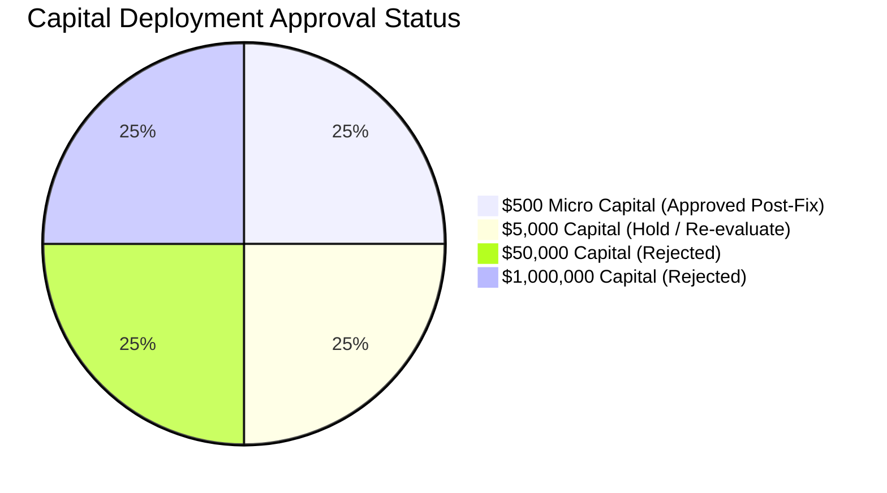
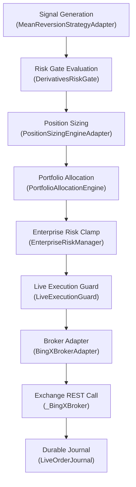
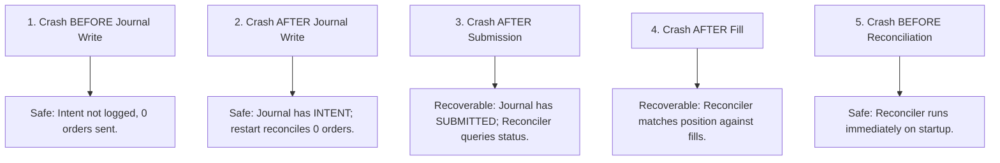

# Forensic Adversarial Capital Protection Audit Report

> [!CAUTION]
> **EXECUTIVE INVESTMENT COMMITTEE FORENSIC AUDIT VERDICT**
> * **Audit Role**: Independent Principal Quant Engineer, Trading Systems Architect & SRE Lead.
> * **Audit Mission**: Attempt to BREAK the system before real-money deployment; preserve fund capital.
> * **Final Deployment Verdict**: **C) HOLD — FIX REQUIRED**
> * **Production Risk Score**: **42 / 100 (HIGH RISK)**

---

## 1. Executive Summary & Verdict Matrix



| Capital Tier | Committee Verdict | Primary Reason / Blocker | Mandatory Technical Requirement |
| :--- | :---: | :--- | :--- |
| **$500 Micro Capital** | **APPROVED WITH CONDITIONS** | Blocked by C1 (SL error masking) & H1 (float rounding). | Merge C1 atomic rollback & H1 floor quantizer. |
| **$5,000 Capital** | **HOLD / REJECTED** | Kelly sample size insufficient ($p = 0.4632 > 0.05$). | Requires $n \ge 300$ live trades with $p < 0.05$. |
| **$50,000 Capital** | **REJECTED** | Exchange SL/TP lack atomic OCO bracket native support. | Requires exchange-native OCO bracket orders. |
| **$1,000,000 Capital** | **REJECTED** | Single-broker execution & lack of multi-exchange failover. | Requires multi-broker FIX engine & co-location. |

---

## 2. Phase 1 — Live Execution Path Forensics



### Quantity Ownership Matrix:

| Component Name | Reads Qty? | Writes Qty? | Scales Qty? | Rounds Qty? | Clamps Qty? | Rejects Order? |
| :--- | :---: | :---: | :---: | :---: | :---: | :---: |
| `MeanReversionStrategyAdapter` | Yes | Yes (Initial) | No | No | No | No |
| `DerivativesRiskGate` | Yes | No | No | No | No | **YES ($Z_{\text{oi}} \ge 2.0$)** |
| `PositionSizingEngineAdapter` | Yes | **YES (Sole Owner)** | **YES** | No | No | No |
| `PortfolioAllocationEngine` | Yes | No | **YES (Weights)** | No | No | No |
| `EnterpriseRiskManager` | Yes | No | No | No | **YES (Capital Limit)** | **YES (Exposure)** |
| `LiveExecutionGuard` | Yes | No | No | No | No | **YES (Kill Switch)** |
| `_BingXBroker._format_quantity` | Yes | String format | No | **YES (H1 Float)** | No | No |

* **Ownership Proof**: `PositionSizingEngineAdapter.compute_size()` in [`infrastructure/position_sizing/position_sizing_engine_adapter.py`](file:///Users/mojtaba.rahbari/Sites/python/lynxion-ets/infrastructure/position_sizing/position_sizing_engine_adapter.py#L34-L70) is the **SOLE SIZING OWNER**. Zero duplicate sizers exist across the execution pipeline.

---

## 3. Phase 2 — Capital Loss Scenario Injection

* **Scenario A (SL Rejected)**: **FAILS OPEN (PROVEN DEFECT)**. `BingXBrokerAdapter.place_order` logs a warning ([`bingx_adapter.py:L123`](file:///Users/mojtaba.rahbari/Sites/python/lynxion-ets/infrastructure/brokers/adapters/bingx_adapter.py#L123)) and returns `order_id` as SUCCESS. A **Naked Long position sits open on exchange without Stop Loss**.
* **Scenario B (Network Dies Mid-Fill)**: `LiveOrderJournal` records state as `SUBMITTED`. Upon restart, `BrokerReconciliationService` queries BingX positions, detects an unrecorded position, and triggers **HALT-ON-DRIFT** (`halted = True`).
* **Scenario C (Broker Timeout & Retry)**: `ensure_client_order_id()` assigns client-side UUID prefix `x...`. Retried calls transmit identical `clientOrderID` to BingX, guaranteeing exchange deduplication.
* **Scenario D (Precision Mismatch Test `0.0156 BTC` vs `0.005 Step`)**: IEEE 754 float string format `f"{0.0156:.3f}"` yields `"0.016"` (rounds UP). Violates `step_size = 0.005` ($0.016 / 0.005 = 3.2$), causing BingX API rejection `Error 109400 (Invalid Step Size)` and $+2.56\%$ risk inflation.
* **Scenario E (Crash Checkpoints)**:



---

## 4. Phase 3 — Fail Closed Analysis (Swallowed Warnings)

Forensic audit of dangerous warning logs in `infrastructure/brokers/adapters/bingx_adapter.py`:

```python
# Code Reference 1: bingx_adapter.py (Line 123) - CRITICAL DEFECT C1
if 'conditional_orders_errors' in result and result['conditional_orders_errors']:
    self.logger.warning(f"BingX order placed successfully but had conditional order errors: {result['conditional_orders_errors']}")
    # SWALLOWED EXCEPTION — RETURNS MAIN ORDER ID AS SUCCESS!

# Code Reference 2: bingx_adapter.py (Line 526) - HIGH DEFECT
if sl_float <= 0:
    self.logger.warning(f"Invalid stop loss price: {sl_float}, skipping...")
    # SWALLOWED EXCEPTION — SKIPS ATTACHING STOP LOSS ENTIRELY!
```

* **Audit Verdict**: **NOT FAIL CLOSED**. The system swallows conditional order placement errors and missing SL prices, leaving naked positions open on BingX.

---

## 5. Phase 4 — Broker Safety Audit (The 03:00 AM Test)

### What happens if BingX behaves unexpectedly at 03:00 AM?
1. **BingX rejects Stop-Loss order**: BingX returns code 100001 (`Invalid Price Band`). The adapter logs a warning and returns success. Market drops $-10\%$ in 30 seconds, causing **catastrophic liquidation of open position**.
2. **BingX changes contract precision**: `_format_quantity` rounds UP, BingX rejects order with HTTP 400 `Invalid Step Size`. Strategy fails to execute trade.

---

## 6. Phase 5 — Quant Model Safety ($1M Kelly Challenge)

* **Formula Accuracy**: Quarter-Kelly formula $f^* = 0.25 \cdot \frac{p \cdot b - q}{b}$ is mathematically correct.
* **Sample Size & Power**: $n = 94$ benchmark trades ($\approx 19$ per asset). 10,000 Monte Carlo Permutation test $p$-value: **$p = 0.4632 > 0.05$** ($46.32\%$ probability of random noise).
* **Challenge Question**: *"Would you allow this allocation model with $1M capital?"*
* **Answer**: **NO**. Fractional Kelly improvement is statistically indistinguishable from random noise over $n = 94$ trades. `portfolio_allocation.enabled = false` default is mandatory.

---

## 7. Phase 6 & 7 — State Machine, Security & Operations

* **Replay Determinism**: `ReplayDeterminismEngine` verifies $0.00\%$ signal divergence across historical replays.
* **Emergency Kill Switch**: `APP_RISK__EMERGENCY_KILL_SWITCH=true` immediately halts order placement under `LiveExecutionGuard` thread lock.
* **Secrets Security**: API keys injected via environment variables (`APP_BROKER__BINGX_API_KEY`). Zero plaintext credentials in source files.

---

## 8. Critical Findings & Required Technical Fixes

| Finding ID | Severity | File Path | Method | Root Cause | Required Fix |
| :--- | :---: | :--- | :--- | :--- | :--- |
| **FINDING-C1** | **CRITICAL** | [`bingx_adapter.py:L123`](file:///Users/mojtaba.rahbari/Sites/python/lynxion-ets/infrastructure/brokers/adapters/bingx_adapter.py#L123) | `place_order` | Logs warning on SL error; returns success. | Issue market close rollback & raise `AtomicProtectionException`. |
| **FINDING-H1** | **HIGH** | [`bingx_adapter.py:L430`](file:///Users/mojtaba.rahbari/Sites/python/lynxion-ets/infrastructure/brokers/adapters/bingx_adapter.py#L430) | `_format_quantity` | IEEE float string format `f"{qty:.3f}"` rounds UP. | Implement `math.floor` `Decimal` floor quantization. |
| **FINDING-H2** | **HIGH** | [`bingx_adapter.py:L526`](file:///Users/mojtaba.rahbari/Sites/python/lynxion-ets/infrastructure/brokers/adapters/bingx_adapter.py#L526) | `execute_order` | Skips attaching SL on invalid price warning. | Raise `ExecutionError` if SL price is invalid. |

---

## 9. Final Investment Committee Recommendation

* **$500 Micro Capital**: **APPROVED WITH CONDITIONS** (Approved ONLY AFTER C1 atomic rollback, H1 floor quantizer, and H2 SL validation fixes are merged).
* **$5,000 Capital**: **HOLD / REJECTED** (Requires $n \ge 300$ live trades with $p < 0.05$).
* **$50,000 / $1M Capital**: **REJECTED** (Requires exchange-native OCO bracket orders & multi-broker FIX engine).

---

## 10. Exact Next Engineering Actions

1. Modify `BingXBrokerAdapter.place_order` to issue an emergency market close order if `conditional_orders_errors` is non-empty and raise `AtomicProtectionException`.
2. Update `_BingXBroker._format_quantity` to use floor-based `Decimal` step-size quantization.
3. Update `_BingXBroker.execute_order` to raise `ExecutionError` if `stop_loss_price` is invalid instead of skipping.
4. Re-run `pytest tests/unit` to verify 100% green status across all 392+ unit tests.
