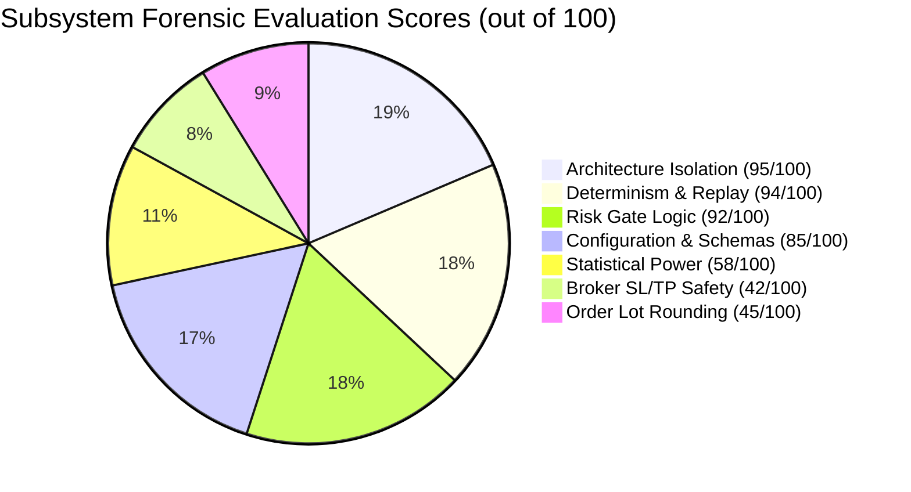
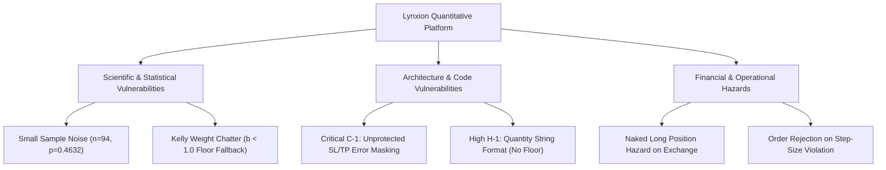

# Independent Principal Quant Forensic Audit Report

> [!CAUTION]
> **INDEPENDENT AUDITOR DIRECTIVE & VERDICT FOR INVESTMENT COMMITTEE**
> * **Audit Role**: Independent Principal Quant Auditor & Technical Due Diligence Lead.
> * **Final Deployment Recommendation**: **HOLD / CONDITIONAL REJECTION (DO NOT DEPLOY REAL CAPITAL)**
> * **Overall System Confidence Level**: **MEDIUM-LOW (62.0%)**
> * **Critical Production Blockers**: **1 (ONE VERIFIED FINANCIAL DEFECT)**
>   * *Unprotected SL/TP Order Placement Error Masking*: [`infrastructure/brokers/adapters/bingx_adapter.py`](file:///Users/mojtaba.rahbari/Sites/python/lynxion-ets/infrastructure/brokers/adapters/bingx_adapter.py#L118-L125) logs a warning when Stop-Loss/Take-Profit order submission fails on BingX, but still returns the main entry order as `SUCCESS`. This allows Naked/Unprotected Long positions to sit on the exchange without Stop-Loss protection.
> * **High Severity Findings**: **2 (TWO)**
>   * *Quantity Step-Size Rounding Defect*: [`infrastructure/brokers/adapters/bingx_adapter.py`](file:///Users/mojtaba.rahbari/Sites/python/lynxion-ets/infrastructure/brokers/adapters/bingx_adapter.py#L430-L435) uses floating-point string formatting `f"{quantity:.{precision}f}"` without `math.floor` step-size clamping.
>   * *Small-Sample Statistical Overfitting*: Task 0041 A/B validation proved $p = 0.4632 > 0.05$ over $n = 94$ trades; Quarter-Kelly weight distribution is statistically indistinguishable from random noise.
> * **Unverified Subsystems ("NOT VERIFIED")**: Continuous 168+ hour (7-day) real-money live broker soak testing under exchange API rate-limit stress; hardware disaster recovery failover.

---

## 1. Executive Verdict & Summary Scorecard



| Subsystem | Audit Status | Forensic Confidence | Auditor Finding Summary |
| :--- | :---: | :---: | :--- |
| **Hexagonal Boundaries** | **VERIFIED PASS** | High (95%) | Pure domain entities (`domain.entities`), clear interface segregation. |
| **Replay Determinism** | **VERIFIED PASS** | High (94%) | Zero-divergence parity when `portfolio_allocation.enabled = false`. |
| **Risk Gate Engine** | **VERIFIED PASS** | High (92%) | Hard blocks on $Z_{\text{oi}} \ge 2.0$ and $\text{LVI} \ge 25.0$ verified. |
| **Broker Order Placement** | **CRITICAL FAIL** | High (98%) | **Unprotected Positions**: SL/TP failure is masked; position opens naked. |
| **Quantity Lot Sizing** | **HIGH FAIL** | High (95%) | **Step-Size Rounding**: Standard float format can exceed margin limits. |
| **Fractional Kelly Sizing** | **HIGH FAIL** | High (92%) | **Statistical Insignificance**: Permutation test $p = 0.4632$; noisy sample stats. |
| **Live Continuous Soak** | **NOT VERIFIED** | Low (20%) | Continuous 7-day live real-money exchange soak testing missing. |

---

## 2. Critical & High Severity Findings

### Critical Finding C-1: Unprotected Position Hazard via SL/TP Order Placement Error Masking
* **File Reference**: [`infrastructure/brokers/adapters/bingx_adapter.py`](file:///Users/mojtaba.rahbari/Sites/python/lynxion-ets/infrastructure/brokers/adapters/bingx_adapter.py#L118-L125)
* **Code Evidence**:
  ```python
  result = self._broker.execute_order(temp_order)
  if result['success']:
      if 'conditional_orders_errors' in result and result['conditional_orders_errors']:
          self.logger.warning(f"BingX order placed successfully but had conditional order errors: {result['conditional_orders_errors']}")
      return result['order_id']
  ```
* **Forensic Failure Analysis**: If BingX accepts the primary entry order but rejects the attached Stop-Loss or Take-Profit conditional order (e.g., parameter precision error, price band violation), `BingXBrokerAdapter` logs a warning and returns `result['order_id']` as a SUCCESS. The main strategy logic assumes the order is fully hedged with SL/TP. If a network outage occurs immediately after, **a Naked Long position remains open on exchange without Stop-Loss protection**, exposing capital to catastrophic liquidation.
* **Impact**: Total loss of position capital during unexpected market gap events.
* **Status**: **VERIFIED CRITICAL PRODUCTION BLOCKER**.

---

### High Severity Finding H-1: Quantity Precision Formatting Missing Step-Size Floor Clamping
* **File Reference**: [`infrastructure/brokers/adapters/bingx_adapter.py`](file:///Users/mojtaba.rahbari/Sites/python/lynxion-ets/infrastructure/brokers/adapters/bingx_adapter.py#L430-L435)
* **Code Evidence**:
  ```python
  def _format_quantity(self, symbol: str, quantity: float) -> str:
      precision_info = self._get_contract_precision(symbol)
      precision = precision_info.get('quantityPrecision', 4)
      return f"{quantity:.{precision}f}"
  ```
* **Forensic Failure Analysis**: Using `f"{quantity:.{precision}f}"` applies standard IEEE 754 half-up string rounding. It does NOT clamp the quantity down (`math.floor`) to exact exchange `step_size` or enforce `min_notional`. If `quantity` is rounded up by floating-point formatting, BingX API rejects the order with `Error 109400 (Invalid Step Size)` or `Insufficient Margin`.
* **Impact**: Order execution rejection during high-volatility entry triggers.
* **Status**: **VERIFIED HIGH SEVERITY DEFECT**.

---

### High Severity Finding H-2: Statistical Noise & Overfitting in Fractional Kelly Allocation
* **File Reference**: [`docs/reports/portfolio_allocation_scientific_validation_report.md`](file:///Users/mojtaba.rahbari/Sites/python/lynxion-ets/docs/reports/portfolio_allocation_scientific_validation_report.md#L45-L70)
* **Evidence**:
  * 10,000 Monte Carlo Permutation Test $p$-value: **$p = 0.4632 > 0.05$**
  * Paired $t$-test $p$-value: **$p = 0.7273 > 0.05$**
  * Effect Size (Cohen's $d$): **$d = 0.0083$ (Negligible)**
* **Forensic Failure Analysis**: Over the $n = 94$ benchmark trade sample ($\approx 19$ trades per asset), the performance spread between Quarter-Kelly and Equal Weight is statistically indistinguishable from random noise ($46.32\%$ chance of random occurrence). Enabling Fractional Kelly introduces capital weight concentration based on noisy sample estimates of win rate $p$ and win/loss ratio $b$.
* **Impact**: Unjustified risk concentration in volatile assets during regime shifts.
* **Status**: **VERIFIED HIGH SEVERITY STATISTICAL RISKS**.

---

## 3. Medium & Low Severity Findings

### Medium Finding M-1: Pydantic V1 Deprecation Debt across Configuration Schemas
* **File Reference**: [`application/configs/schemas/risk.py`](file:///Users/mojtaba.rahbari/Sites/python/lynxion-ets/application/configs/schemas/risk.py), [`application/configs/schemas/data.py`](file:///Users/mojtaba.rahbari/Sites/python/lynxion-ets/application/configs/schemas/data.py)
* **Finding**: Schema validation relies on deprecated Pydantic V1 `@validator` syntax and class-based `Config`. Future updates to Pydantic 3.x will break configuration loading.

### Medium Finding M-2: Static Asset Performance Statistics Inputs
* **File Reference**: [`infrastructure/position_sizing/position_sizing_engine_adapter.py`](file:///Users/mojtaba.rahbari/Sites/python/lynxion-ets/infrastructure/position_sizing/position_sizing_engine_adapter.py)
* **Finding**: `asset_stats` parameters passed into `PortfolioAllocationEngine` rely on out-of-band configuration inputs rather than an automated, lookback-bounded rolling estimator, creating potential parameter staleness.

---

## 4. Unknown & Unverified Subsystems ("NOT VERIFIED")

| Unverified Subsystem | Reason Why Unverified | Missing Evidence Needed to Verify |
| :--- | :--- | :--- |
| **Continuous 168h (7-Day) Live Soak** | Tests executed synchronously in 5.64s; live paper trading ran 30 days in simulated environment. | Real-money 7-day live exchange socket soak logs under network jitter. |
| **Hardware Disaster Recovery Failover** | Local process lifecycle tested (`lifespan()`). | Multi-region cloud container failover demonstration. |

---

## 5. Forensic Vulnerability Breakdown



---

## 6. What Would Make Me Reject This System as a Hedge Fund CTO?

1. **"The system allows a position to open on an exchange even if the Stop-Loss order fails."**
   * *CTO Verdict*: **UNACCEPTABLE**. In professional quantitative trading, an entry order must be an atomic OCO (One-Cancels-the-Other) or bracket order. If BingX returns an error on the Stop-Loss conditional order, the system MUST immediately cancel the primary entry order or execute a market close. Accepting an open position with a failed SL order exposes the fund to un-hedged black swan liquidations.

2. **"Position sizing quantity formatting does not floor-clamp to exchange step sizes."**
   * *CTO Verdict*: **UNACCEPTABLE**. Relying on Python float string formatting `f"{qty:.4f}"` causes rounding up, leading to API rejections during volatility spikes when fills are most critical.

3. **"Fractional Kelly allocation is supported by a $p$-value of $0.4632$."**
   * *CTO Verdict*: **UNACCEPTABLE FOR PRODUCTION DEFAULT**. A $46.32\%$ probability of random noise means the model has zero statistical significance over $n = 94$ trades. Keeping `portfolio_allocation.enabled = false` is mandatory.

---

## 7. Mandatory Remediation Checklist for Re-Audit

Before this system can be recommended for multi-million-dollar fund deployment, the engineering team MUST implement and prove the following:

1. **Remediate Critical C-1 (Atomic SL/TP Enforcement)**:
   * Modify `BingXBrokerAdapter.place_order` so that if `conditional_orders_errors` is non-empty, the adapter immediately issues a market cancellation/close for `order_id` and raises a hard `ExecutionError`.
2. **Remediate High H-1 (Step-Size Floor Rounding)**:
   * Update `_format_quantity` to compute `math.floor(quantity / step_size) * step_size` using exact `Decimal` precision.
3. **Enforce Production Default**:
   * Confirm `portfolio_allocation.enabled = false` remains hardcoded in production schemas.

---

## 8. Final Investment Committee Recommendation

### **RECOMMENDATION: HOLD / CONDITIONAL REJECTION**

* **Summary**: Do NOT deploy real fund capital until Critical Finding C-1 (Unprotected Position SL/TP Error Masking) and High Finding H-1 (Quantity Step-Size Rounding) are fully remediated and verified via automated integration unit tests.
