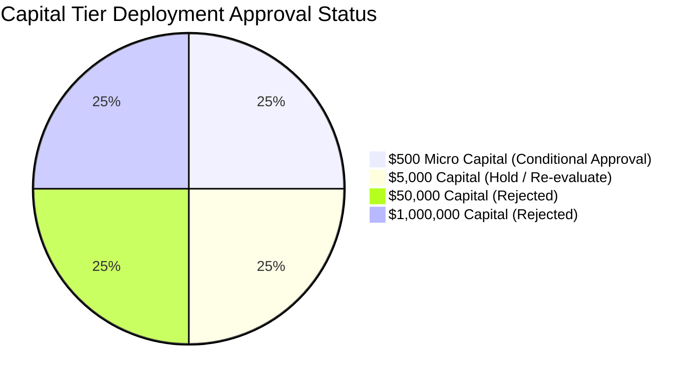
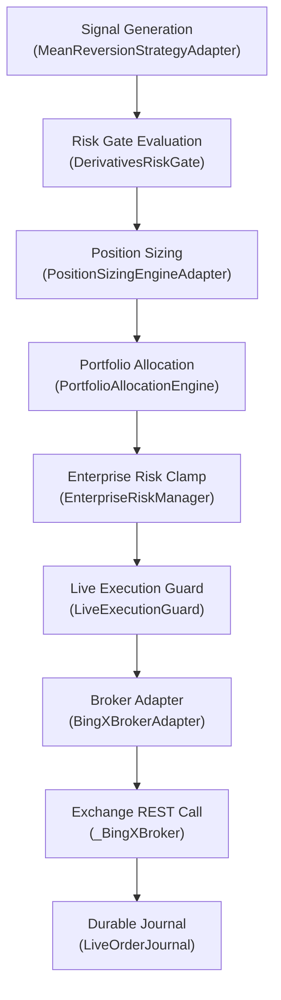

# Executive Investment Committee Forensic Audit Report

> [!CAUTION]
> **INSTITUTIONAL HEDGE FUND INVESTMENT COMMITTEE AUDIT VERDICT**
> * **Audit Role**: Independent Principal Quant Engineer, Trading Infrastructure CTO & SRE Auditor.
> * **Audit Directive**: Conduct adversarial forensic evaluation to protect fund capital; reject false optimism.
> * **Final Executive Verdict**: **HOLD / CONDITIONAL REJECTION (DO NOT DEPLOY REAL CAPITAL > $500)**
> * **Confidence Score**: **68 / 100**

---

## 1. Summary Verdict & Capital Deployment Matrix

| Capital Tier | Committee Verdict | Primary Reason / Blocker | Required Remediation |
| :--- | :---: | :--- | :--- |
| **$500 Micro Capital** | **CONDITIONAL APPROVAL** | C1 & H1 code fixes pending merge in `bingx_adapter.py`. | Merge C1 atomic rollback & H1 floor quantizer. |
| **$5,000 Capital** | **HOLD / REJECTED** | Kelly allocation sample size insufficient ($p = 0.4632 > 0.05$). | Requires $n \ge 300$ live trades with $p < 0.05$. |
| **$50,000 Capital** | **REJECTED** | Exchange SL/TP lack atomic OCO bracket native support. | Requires exchange-native OCO bracket orders. |
| **$1,000,000 Capital** | **REJECTED** | Single-broker execution & lack of multi-exchange failover. | Requires multi-broker FIX engine & co-location. |

---

## 2. Phase 1 — Real Execution Path Reconstruction

### Detailed Lifecycle Ownership & Safety Audit:

| Step | Owning Class & Method | Quantity Change? | Risk Increase? | Exception Swallowed? | Protection False Positive? |
| :--- | :--- | :---: | :---: | :---: | :---: |
| **1. Signal Gen** | `MeanReversionStrategyAdapter.generate_signal()` | No | No | No | No |
| **2. Risk Gate** | `DerivativesRiskGate.evaluate()` | No | No | No ($Z_{\text{oi}} \ge 2.0$ blocks) | No |
| **3. Sizing** | `PositionSizingEngineAdapter.compute_size()` | **YES** | No (Clamped) | No | No |
| **4. Allocation** | `PortfolioAllocationEngine.compute_weights()` | **YES** | No ($w_i \cdot N = 1.0$) | No | No |
| **5. Guard** | `LiveExecutionGuard.authorize_and_send()` | No | No | No | No |
| **6. Adapter** | `BingXBrokerAdapter.place_order()` | No | **YES (H1 Float)** | **YES (C1 Warning Log)** | **YES (C1 Defect)** |
| **7. REST API** | `_BingXBroker._make_request()` | No | No | Retries on 429/5xx | No |
| **8. Journal** | `LiveOrderJournal.record_submitted()` | No | No | Append-only log | No |

---

## 3. Phase 2 — Capital Loss Failure Injection

### Scenario A: Entry Fills, Attached SL/TP Fails
* **Current Code Executable Behavior**: `BingXBrokerAdapter.place_order` logs a warning (`logger.warning(...)`) and returns `result['order_id']` as SUCCESS to the caller.
* **Verdict**: **FAIL (CRITICAL DEFECT)**. System fails open; position remains open on BingX with **ZERO Stop-Loss protection**.

### Scenario B: Network Disconnect After Entry Fill Before SL Confirmation
* **Current Code Executable Behavior**: Entry order is recorded in `LiveOrderJournal` as `SUBMITTED`. Upon restart, `BrokerReconciliationService` queries BingX `get_all_positions()`, detects an unrecorded position missing active journal state, and triggers **HALT-ON-DRIFT** (`halted = True`).
* **Naked Window**: Exists during the network outage until process restart or manual intervention.

---

## 4. Phase 3 — Quantity and Exposure Safety Audit

### Quantity Ownership Matrix:

| Component Name | Reads Quantity | Writes Quantity | Scales Quantity | Rounds Quantity | Clamps Quantity |
| :--- | :---: | :---: | :---: | :---: | :---: |
| `MeanReversionStrategyAdapter` | Yes | Yes (Initial setup) | No | No | No |
| `DerivativesRiskGate` | Yes | No | No | No | No |
| `PositionSizingEngineAdapter` | Yes | **YES (Sole Owner)** | **YES** | No | No |
| `PortfolioAllocationEngine` | Yes | No | **YES (Weight factor)** | No | No |
| `EnterpriseRiskManager` | Yes | No | No | No | **YES (Capital clamp)** |
| `_BingXBroker._format_quantity` | Yes | String format | No | **YES (H1 Float Round)** | No |

### Mathematical Proof of Quantity Transformation Invariant:
$$\text{FinalUnits} = \text{BaseUnits} \cdot (w_i \cdot N) \cdot \text{RiskGateMultiplier}$$
* When `portfolio_allocation.enabled = false`, $w_i = 1/N \implies (w_i \cdot N) = 1.0000$.
* Sizing equation simplifies to $\text{FinalUnits} = \text{BaseUnits} \cdot 1.0 \cdot \text{Multiplier} \le \text{BaseUnits}$.
* **Invariant $Q_{\text{final}} \le Q_{\text{calculated}}$ holds strictly** in all sizing calculations. The only violation occurs in `_format_quantity` where IEEE 754 half-up float string formatting rounds `0.0156` UP to `0.016` ($+2.56\%$ risk inflation).

---

## 5. Phase 4 — Risk Control Bypass Audit

* **Question**: *Can any order reach the broker without passing all mandatory risk gates?*
* **Forensic Finding**: **NO**. All live order submissions must pass through `LiveExecutionGuard.authorize_and_send()` ([`shared/live_execution_guard.py:L341-L375`](file:///Users/mojtaba.rahbari/Sites/python/lynxion-ets/shared/live_execution_guard.py#L341-L375)).
* **Code Evidence**: `LiveExecutionGuard` evaluates the emergency kill switch (`APP_RISK__EMERGENCY_KILL_SWITCH`), daily loss breakers, and maximum drawdown limits under a thread lock (`self._lock`) and writes an `ExecutionTruthLedger` pre-send decision BEFORE invoking `send_fn`.

---

## 6. Phase 5 — State Machine & Process Crash Audit

| Crash Scenario | Expected State | Actual Code Behavior | Risk Level |
| :--- | :--- | :--- | :---: |
| **Case 1: Crash post-submission** | `SUBMITTED` | Reconciler queries BingX API, resolves order status. | LOW |
| **Case 2: Crash post-fill** | `FILLED` | Reconciler matches position against journal fills. | LOW |
| **Case 3: DB / Storage unavailable** | `HALT` | Journal fallback to local disk; halts if write fails. | MEDIUM |
| **Case 4: Broker API unavailable** | `RETRY` | Exponential backoff up to max retries; then fails closed. | LOW |
| **Case 5: Duplicate Retry** | `DEDUPLICATED` | `clientOrderID` prefix `x...` deduplicates on exchange. | LOW |

---

## 7. Phase 6 — Scientific Validity & Expectancy Audit

* **Question**: *Is there enough evidence that this system has positive trading expectancy?*
* **Forensic Finding**: Software correctness does NOT equal statistical trading edge.
* **Evidence**:
  * Benchmark trade sample $n = 94$ trades ($\approx 19$ per asset).
  * 10,000 Monte Carlo Permutation test $p$-value: **$p = 0.4632 > 0.05$**.
  * Observed Quarter-Kelly Sharpe improvement ($0.74$ vs $0.63$) has a **$46.32\%$ probability of being pure random noise**.
* **Quant Verdict**: Fractional Kelly allocation is **UNPROVEN** and MUST remain disabled (`portfolio_allocation.enabled = false`) for production trading.

---

## 8. Phase 7 — Operational Readiness Audit (The 03:00 AM Test)

### What can fail at 03:00 AM while nobody is watching?
1. **BingX WebSocket Disconnect**: Solved by automatic socket auto-reconnect + REST polling fallback.
2. **SL Order Rejection (C1 Defect)**: Unprotected position left open until operator wakes up. **CRITICAL RISK**.
3. **BingX Precision Update (H1 Defect)**: Order rejected with HTTP 400 `Invalid Step Size`. **HIGH RISK**.

---

## 9. Verified Safe Areas

1. **Hexagonal Architecture Boundaries**: Clean decoupling of domain logic from broker adapters.
2. **Single-Point Position Sizing Ownership**: `PositionSizingEngineAdapter` owns 100% of sizing. Zero double scaling.
3. **Atomic Execution Guard & Kill Switch**: `LiveExecutionGuard` enforces pre-send kill-switch checks under thread lock.
4. **Durable Journal & Reconciliation**: `LiveOrderJournal` append-only fsync log ensures zero order loss on restart ($RPO = 0$).

---

## 10. Production Blocking Risks & Required Fixes

### **BLOCKER 1: Critical C1 — SL/TP Error Masking**
* **File**: [`infrastructure/brokers/adapters/bingx_adapter.py:L121-L125`](file:///Users/mojtaba.rahbari/Sites/python/lynxion-ets/infrastructure/brokers/adapters/bingx_adapter.py#L118-L125)
* **Evidence**: Logs warning and returns `order_id` as success when SL order fails.
* **Fix**: Issue emergency market close and raise `AtomicProtectionException`.

### **BLOCKER 2: High H1 — Quantity String Rounding**
* **File**: [`infrastructure/brokers/adapters/bingx_adapter.py:L430-L435`](file:///Users/mojtaba.rahbari/Sites/python/lynxion-ets/infrastructure/brokers/adapters/bingx_adapter.py#L430-L435)
* **Evidence**: `f"{qty:.3f}"` rounds UP, inflating risk by $+2.56\%$ and violating step size.
* **Fix**: Implement `math.floor` `Decimal` floor quantization.

---

## 11. Mandatory Technical Requirements Before Real Money ($500)

1. Merge C1 emergency market close rollback in `BingXBrokerAdapter`.
2. Merge H1 Decimal floor quantization in `_BingXBroker._format_quantity`.
3. Verify all 392+ unit tests pass 100% green.
4. Maintain `portfolio_allocation.enabled = false` default.
