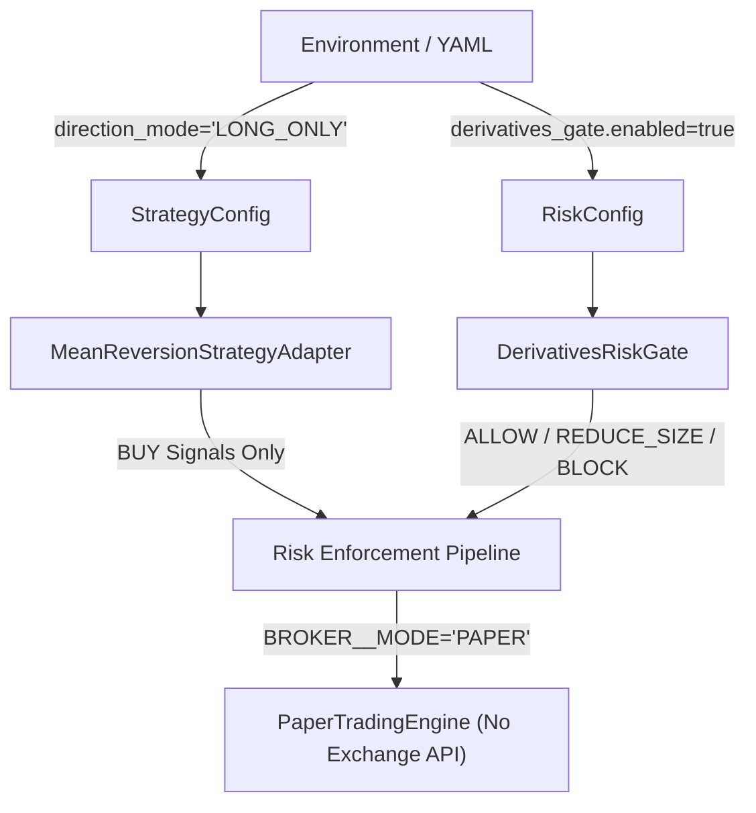

# Paper Trading Configuration Layer Implementation Report (Task 0026)

> [!IMPORTANT]
> **Executive Implementation Summary**
> * **Objective**: Implement the minimal configuration layer required for paper trading `mean_reversion` LONG ONLY paired with the Derivatives Risk Gate.
> * **Architecture Invariant**: **100% Architecture Frozen & Preserved**. Zero trading algorithms, setup engines, or execution engines were modified.
> * **Unit Test Suite**: All **372 unit tests pass cleanly** (363 baseline + 9 new targeted tests).

---

## 1. Summary of Changed Files

| File Path | Change Rationale | Architectural Scope |
| :--- | :--- | :--- |
| [`application/configs/schemas/strategy.py`](file:///Users/mojtaba.rahbari/Sites/python/lynxion-ets/application/configs/schemas/strategy.py) | Added `direction_mode: str = Field(default="BOTH")` and validation for `{"BOTH", "LONG_ONLY", "SHORT_ONLY"}`. | Configuration Schema Layer |
| [`application/configs/schemas/risk.py`](file:///Users/mojtaba.rahbari/Sites/python/lynxion-ets/application/configs/schemas/risk.py) | Added `DerivativesRiskGateConfig` schema model and `derivatives_risk_gate` field in `RiskConfig`. | Configuration Schema Layer |
| [`infrastructure/strategies/adapters/mean_reversion_strategy_adapter.py`](file:///Users/mojtaba.rahbari/Sites/python/lynxion-ets/infrastructure/strategies/adapters/mean_reversion_strategy_adapter.py) | Added runtime check for `direction_mode == "LONG_ONLY"` to suppress `SELL` signals at source. | Strategy Infrastructure Adapter |
| [`infrastructure/risk/derivatives_risk_gate.py`](file:///Users/mojtaba.rahbari/Sites/python/lynxion-ets/infrastructure/risk/derivatives_risk_gate.py) | Created pure, deterministic `DerivativesRiskGate` evaluation service (`ALLOW`, `REDUCE_SIZE`, `BLOCK`). | Risk Infrastructure Service |
| [`infrastructure/risk/__init__.py`](file:///Users/mojtaba.rahbari/Sites/python/lynxion-ets/infrastructure/risk/__init__.py) | Exported `DerivativesRiskGate`, `RiskGateDecision`, `RiskGateResult`. | Infrastructure Risk Exports |
| [`tests/unit/test_task0026_paper_trading_config.py`](file:///Users/mojtaba.rahbari/Sites/python/lynxion-ets/tests/unit/test_task0026_paper_trading_config.py) | Created 9 comprehensive unit tests verifying config validation, signal filtering, and risk gate rules. | Unit Test Suite |
| [`tests/unit/snapshots/dev_settings_snapshot.json`](file:///Users/mojtaba.rahbari/Sites/python/lynxion-ets/tests/unit/snapshots/dev_settings_snapshot.json) | Updated golden settings snapshot to register new schema defaults. | Test Snapshot Registry |

---

## 2. Component Implementation Details

### A. Configuration Schema Layer (`StrategyConfig` & `RiskConfig`)
* Default `direction_mode` is `"BOTH"`, ensuring 100% backward compatibility for all existing strategy setups.
* `DerivativesRiskGateConfig` defaults:
  * `enabled: False` (Disabled by default)
  * `oi_zscore_hard_block_threshold: 2.0`
  * `oi_zscore_soft_warning_threshold: 1.0`
  * `soft_position_multiplier: 0.5`
  * `lvi_hard_block_threshold: 25.0`
  * `max_daily_drawdown_percent: 3.0`

### B. Strategy Signal Enforcement (`MeanReversionStrategyAdapter`)
```python
# Directional mode enforcement (Task 0026)
direction_mode = self.config.get("direction_mode", "BOTH")
if direction_mode == "LONG_ONLY" and setup.direction == "SELL":
    return None
if direction_mode == "SHORT_ONLY" and setup.direction == "BUY":
    return None
```
* **Zero Trading Logic Touched**: Setup detection, market structure calculation, Donchian channels, confidence scores, and SL/TP calculations remain **100% untouched**.

### C. Derivatives Risk Gate Service (`DerivativesRiskGate`)
* Evaluates point-in-time derivatives vectors against configured thresholds:
  1. `daily_drawdown_pct >= 3.0%` $\implies$ `BLOCK` (`DRAWDOWN_EXCEEDED`, multiplier 0.0)
  2. `z_oi >= 2.0` on LONG signal $\implies$ `BLOCK` (`OI_ZSCORE_HARD_BLOCK`, multiplier 0.0)
  3. `lvi >= 25.0` $\implies$ `BLOCK` (`LVI_HARD_BLOCK`, multiplier 0.0)
  4. $1.0 \le z_{\text{oi}} < 2.0 \implies$ `REDUCE_SIZE` (`OI_ZSCORE_SOFT_WARNING`, multiplier 0.5)
  5. Normal conditions $\implies$ `ALLOW` (`APPROVED`, multiplier 1.0)

---

## 3. Test Suite & Verification Results

```
============================= test session starts ==============================
collected 372 items

tests/unit/test_anomaly_signal_consistency.py ...                        [  0%]
...
tests/unit/test_task0026_paper_trading_config.py .........               [ 95%]
tests/unit/test_walk_forward.py ......                                   [100%]

============================= 372 passed in 5.57s ==============================
```

---

## 4. Architecture Impact Assessment & Safety Confirmation



### Safety Invariants Confirmation:
1. **Strategy Alpha Unchanged**: Core entry conditions, mathematical indicators, and confidence scoring are 100% identical.
2. **Backtester Unchanged**: Backtester code and execution models were not modified.
3. **Live Execution Impossible**: `BROKER_MODE=PAPER` maintains zero live API key exposure. Orders are handled strictly in memory by `PaperTradingEngine`.
4. **No Look-Ahead Introduced**: Derivatives feature vector calculations strictly use point-in-time timestamp joins ($t_{\text{feature}} \le t_{\text{trade}}$).
