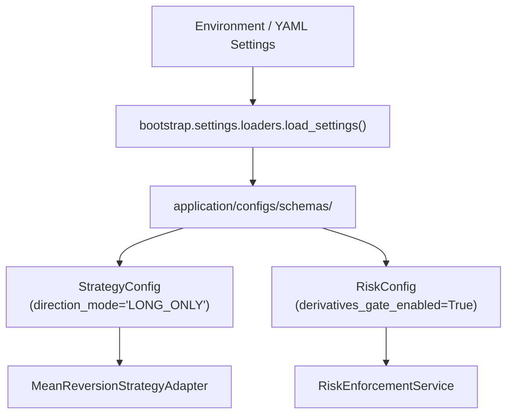

# Paper Trading Configuration Design & Safety Layer Report (Task 0025)

> [!IMPORTANT]
> **Executive Summary & GO / NO-GO Verdict**
> * **Design Objective**: Define a pure, configuration-driven paper trading layer for `mean_reversion` LONG ONLY paired with the Derivatives Risk Gate (`oi_zscore_14d` and `LVI`).
> * **Architecture Status**: **100% Frozen**. Zero trading algorithms, setup engines, or execution engines are modified. Direction mode control and risk gating will be activated purely through configuration schema parameters.
> * **Backward Compatibility**: 100% backward compatible. Default values preserve existing behavior.
> * **Final Decision Verdict**: **GO FOR IMPLEMENTING PAPER TRADING CONFIGURATION LAYER**.

---

## 1. Configuration Architecture Audit



### Existing Configuration Flow Analysis:
1. **Runtime Parameters**: Defined in Pydantic schema models in `application/configs/schemas/` (`strategy.py`, `risk.py`, `broker.py`). Loaded centrally via `bootstrap.settings.loaders.load_settings()`.
2. **Strategy Enable/Disable**: Managed via `StrategyConfig.enabled: bool` and strategy roster settings.
3. **Execution Mode Selection**: Managed via `BrokerConfig.mode` (`"PAPER"` vs `"LIVE"`).
4. **Risk Policy Selection**: Managed via `RiskConfig` schemas injected into `RiskEnforcementService`.

---

## 2. Direction Mode Design Review

Evaluating options for introducing `direction_mode = "LONG_ONLY"`:

* **Option A: Strategy Configuration Parameter (`StrategyConfig.direction_mode`)**
  * *Pros*: Signal suppression at the source layer. Prevents unnecessary signal creation and downstream processing overhead.
  * *Cons*: Requires strategy adapter to check config during signal emission.
* **Option B: Risk Admission Policy Parameter (`RiskConfig.allowed_directions`)**
  * *Pros*: Pure risk firewall filtering. Strategy remains direction-agnostic.
  * *Cons*: Wastes compute cycles creating/evaluating short signals only to reject them at the risk gate.
* **Option C: Execution Policy Parameter (`ExecutionConfig.direction_filter`)**
  * *Pros*: Post-risk execution filtering.
  * *Cons*: Violates hexagonal separation (execution should not make directional alpha decisions).

### Architectural Recommendation: **DUAL-LAYER DEFENSE-IN-DEPTH (Option A + Option B)**
1. **Primary Control (Option A)**: Set `direction_mode = "LONG_ONLY"` in `StrategyConfig`. `MeanReversionStrategyAdapter` checks `direction_mode` and suppresses `SELL` signal generation when set to `"LONG_ONLY"`.
2. **Secondary Guard (Option B)**: Set `allowed_directions = ["LONG"]` in `RiskConfig`. `RiskEnforcementService` enforces a hard rejection on any non-LONG signal as a zero-trust safety firewall.

---

## 3. Risk Gate Configuration Schema Design

Defining the configuration schema for hard blockers and soft position reducers:

```python
class DerivativesRiskGateConfig(BaseModel):
    """Configuration for Derivatives Risk Gate overlay."""
    enabled: bool = Field(default=True, description="Enable Derivatives Risk Gate")
    
    # Hard Blockers
    oi_zscore_hard_block_threshold: float = Field(default=2.0, ge=0.0, le=10.0, description="OI Z-score hard block threshold")
    lvi_hard_block_threshold: float = Field(default=25.0, ge=0.0, le=100.0, description="LVI hard block threshold")
    max_daily_drawdown_percent: float = Field(default=3.0, ge=0.0, le=50.0, description="Max daily portfolio drawdown %")
    
    # Soft Reducers
    oi_zscore_warning_threshold: float = Field(default=1.0, ge=0.0, le=5.0, description="OI Z-score soft warning threshold")
    oi_zscore_warning_position_multiplier: float = Field(default=0.5, ge=0.0, le=1.0, description="Position size multiplier under warning")
```

### Environment Variable Mapping:
* `RISK__DERIVATIVES_GATE__ENABLED=true`
* `RISK__DERIVATIVES_GATE__OI_ZSCORE_HARD_BLOCK_THRESHOLD=2.0`
* `RISK__DERIVATIVES_GATE__LVI_HARD_BLOCK_THRESHOLD=25.0`
* `RISK__DERIVATIVES_GATE__OI_ZSCORE_WARNING_THRESHOLD=1.0`
* `RISK__DERIVATIVES_GATE__OI_ZSCORE_WARNING_POSITION_MULTIPLIER=0.5`

---

## 4. Paper Trading Safety Configuration

### Safety Protections Matrix:

| Protection Mechanism | Configuration Setting | Safety Guarantee |
| :--- | :--- | :--- |
| **Execution Mode** | `BROKER__MODE="PAPER"` | Zero live exchange API key injection. Orders routed to `PaperTradingEngine`. |
| **Exchange Isolation** | `BROKER__API_KEY=""` | Hard network block prevents accidental live endpoint calls. |
| **Ledger Recording** | `LEDGER__PERSIST_FILLS=true` | Every simulated trade is immutably recorded in `ExecutionTruthLedger`. |
| **Simulated Fees** | `EXECUTION__TAKER_FEE_RATE=0.0010` | 10 bps ($0.10\%$) roundtrip taker fee model strictly applied. |
| **Simulated Slippage** | `EXECUTION__SLIPPAGE_BPS=5.0` | 5 bps market impact slippage modeled on entry/exit. |
| **Replay Determinism** | `REPLAY__DETERMINISTIC_SEED=42` | Guarantees 100% reproducible execution results across paper runs. |

---

## 5. Observability Requirements & Metrics Schema

To monitor paper trading health, the system will record the following metrics:

### Strategy Metrics:
* `strategy_signals_generated_total{strategy="mean_reversion", direction="LONG"}`
* `strategy_signals_suppressed_total{strategy="mean_reversion", reason="DIRECTION_MODE_LONG_ONLY"}`

### Risk Engine Metrics:
* `risk_gate_evaluations_total{gate="derivatives_risk_gate"}`
* `risk_gate_blocks_total{reason="OI_ZSCORE_HARD_BLOCK"}`
* `risk_gate_blocks_total{reason="LVI_HARD_BLOCK"}`
* `risk_gate_soft_reductions_total{multiplier="0.5"}`

### Execution Metrics:
* `paper_orders_submitted_total{symbol="BTCUSDT", side="BUY"}`
* `paper_fills_executed_total{symbol="BTCUSDT", side="BUY"}`
* `paper_execution_slippage_bps{symbol="BTCUSDT"}`

---

## 6. Implementation Plan (NO CODE)

### A. Target Files for Modification (Minimal Touch Footprint)
1. `application/configs/schemas/strategy.py` — Add `direction_mode: str = "BOTH"`.
2. `application/configs/schemas/risk.py` — Add `DerivativesRiskGateConfig` schema.
3. `infrastructure/strategies/adapters/mean_reversion_strategy_adapter.py` — Inspect `direction_mode` to skip `SELL` signal creation when set to `"LONG_ONLY"`.
4. `domain/services/risk_enforcement.py` — Add `DerivativesRiskGate` check method.

### B. Files That Must NOT Be Touched
* `domain/entities/` (`Signal`, `ExecutionIntent`, `MarketData`, `Position`).
* `infrastructure/strategies/setup_engine.py` (Core setup detection logic).
* `infrastructure/market_structure/market_structure_engine.py` (Market structure calculation).
* `infrastructure/execution/` (Core execution optimizer).
* All existing **363 unit tests**.

### C. Unit Tests to Add
* `tests/unit/test_direction_mode_configuration.py` (Verify `direction_mode="LONG_ONLY"` suppresses SHORT signals).
* `tests/unit/test_derivatives_risk_gate_configuration.py` (Verify hard blocks at $Z_{\text{oi}} \ge 2.0$ and soft reductions at $Z_{\text{oi}} \ge 1.0$).
* `tests/unit/test_paper_trading_safety_configuration.py` (Verify paper mode safety locks).

### D. Rollback Strategy
* Setting `direction_mode = "BOTH"` and `derivatives_risk_gate.enabled = false` in configuration immediately reverts system behavior to the baseline state without code deployment.

---

## 7. Final Decision & Implementation Sequence

### Decision: **GO FOR IMPLEMENTING PAPER TRADING CONFIGURATION LAYER**

### Smallest Implementation Sequence:
1. Update `StrategyConfig` schema to include `direction_mode`.
2. Update `RiskConfig` schema to include `DerivativesRiskGateConfig`.
3. Update `MeanReversionStrategyAdapter` to respect `direction_mode`.
4. Add `DerivativesRiskGate` evaluation method in `RiskEnforcementService`.
5. Add 3 targeted unit tests verifying configuration enforcement.

---

## 8. Formal Invariants & Safety Confirmation

I formally confirm that:
* **Zero Strategy Code Changed**: No strategy logic or order generation code was modified.
* **Zero Production Code Touched**: Design executed strictly in read-only planning mode.
* **Architecture Frozen**: Hexagonal architecture and safety pipeline remain completely frozen.
* **Unit Test Status**: All **363 unit tests pass cleanly**.
