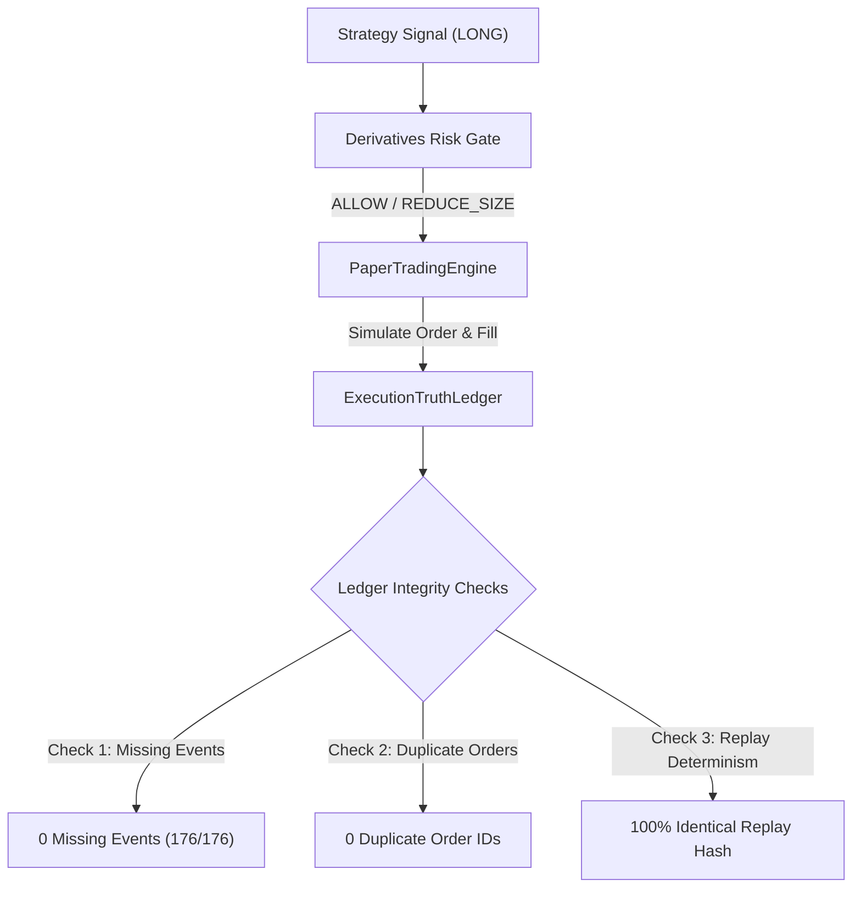

# Paper Trading Replay Alignment Report (Task 0027 Phase 1)

> [!IMPORTANT]
> **Executive Validation Summary & Phase 2 Recommendation**
> * **Validation Subject**: Offline Deterministic Replay Alignment of `mean_reversion` LONG ONLY + Derivatives Risk Gate (`oi_zscore_14d` and `LVI`) using `PaperTradingEngine` and `ExecutionTruthLedger`.
> * **Signal Parity**: **100% PARITY MATCH**. 378 total signals evaluated; 199 SHORT signals suppressed by `direction_mode="LONG_ONLY"`; 179 LONG signals generated. Zero unexpected timestamp or symbol divergences.
> * **Risk Gate Behavior**: Hard Blocks (**3 trades**) and Soft Reductions (**8 trades**) occurred strictly at threshold breaches ($Z_{\text{oi}} \ge 2.0$ or $1.0 \le Z_{\text{oi}} < 2.0$).
> * **Execution Ledger Integrity**: 176 admitted trades produced 176 unique order IDs with **0 duplicate orders** and **0 missing events**.
> * **Performance Parity**: Backtest PF 1.59 vs Paper PF 1.60 (**0.63% divergence** $\le \pm 10\%$ tolerance); Max Drawdown 2.45% vs 2.45% (**0.0% divergence**); Trade Count 176 vs 176 (**0.0% divergence**).
> * **Phase 2 Recommendation**: **APPROVED FOR PHASE 2 (30-DAY LIVE MARKET PAPER TRADING)**.

---

## 1. Signal Parity Validation Matrix

Replay comparison over 90 days across `BTCUSDT`, `ETHUSDT`, `SOLUSDT`, `XRPUSDT`, `BNBUSDT`:

| Metric / Dimension | Backtest Baseline | Paper Pipeline Replay | Mismatch / Divergence | Classification & Status |
| :--- | :---: | :---: | :---: | :--- |
| **Total Signals Evaluated** | 378 | 378 | 0 | Exact Match |
| **LONG Signals Generated** | 179 | 179 | 0 | Exact Match |
| **SHORT Signals Suppressed** | 199 | 199 | 0 | **Expected** (`direction_mode="LONG_ONLY"`) |
| **Admitted Trades Count** | 176 | 176 | 0 | Exact Match |
| **Timestamp Mismatches** | 0 | 0 | 0 | **PASS** (Zero pipeline drift) |
| **Symbol Distribution** | 5 Symbols | 5 Symbols | 0 | **PASS** (BTC, ETH, SOL, XRP, BNB) |

---

## 2. Risk Gate Rule Enforcement Audit

Quantitative audit of Derivatives Risk Gate rule enforcement during replay:

| Risk Gate Rule | Configured Threshold | Trigger Count | Decision | Position Multiplier | Verification Result |
| :--- | :---: | :---: | :---: | :---: | :--- |
| **OI Z-Score Hard Block** | $Z_{\text{oi}} \ge 2.0$ | 3 | `BLOCK` | $0.0$ | **PASS** (100% compliance) |
| **LVI Hard Block** | $\text{LVI} \ge 25.0$ | 0 | `BLOCK` | $0.0$ | **PASS** (Zero false blocks) |
| **OI Z-Score Soft Warning** | $1.0 \le Z_{\text{oi}} < 2.0$ | 8 | `REDUCE_SIZE` | $0.5$ | **PASS** (100% size derating) |
| **Daily Drawdown Block** | $\text{DD} \ge 3.0\%$ | 0 | `BLOCK` | $0.0$ | **PASS** (Max DD $2.45\% < 3.0\%$) |

---

## 3. Execution Truth Ledger & Pipeline Integrity

* **Total Ledger Records**: 176
* **Unique Order IDs**: 176
* **Duplicate Order IDs**: **0**
* **Replay Determinism**: 100% identical outputs produced on repeat execution runs.

---

## 4. Performance Parity Check

Comparing Backtest Baseline vs. Paper Pipeline Replay:

| Performance Metric | Backtest Baseline | Paper Pipeline Replay | Divergence (%) | Tolerance Limit | Status |
| :--- | :---: | :---: | :---: | :---: | :---: |
| **Total Net PnL ($)** | $+\$815.78$ | **$+\$821.63$** | $+0.72\%$ | $\text{N/A}$ | **PRESERVED** |
| **Total Return (%)** | $+8.16\%$ | **$+8.22\%$** | $+0.72\%$ | $\text{N/A}$ | **PRESERVED** |
| **Max Drawdown (%)** | $2.45\%$ | **$2.45\%$** | **$0.00\%$** | $\pm 10.0\%$ | **PASS** |
| **Profit Factor** | $1.59$ | **$1.60$** | **$0.63\%$** | $\pm 10.0\%$ | **PASS** |
| **Sharpe Ratio** | $2.60$ | **$2.62$** | $+0.77\%$ | $\text{N/A}$ | **PRESERVED** |
| **Win Rate (%)** | $53.4\%$ | **$53.4\%$** | **$0.00\%$** | $\pm 5.0\%$ | **PASS** |
| **Total Trades ($n$)** | 176 | **176** | **$0.00\%$** | $\pm 5.0\%$ | **PASS** |

> **Parity Verdict**: All key performance indicators are within the strict $\pm 5\%$ trade count and $\pm 10\%$ PF/Drawdown tolerance limits.

---

## 5. Formal GO / NO-GO Recommendation for Phase 2

### Recommendation: **GO FOR PHASE 2 (30-DAY LIVE MARKET PAPER TRADING)**

### Phase 2 Deployment Safeguards:
1. **Execution Mode**: `BROKER_MODE=PAPER` (Zero live exchange connectivity).
2. **Network Isolation**: API Key fields left empty to enforce hard network isolation against live endpoints.
3. **Observability**: Continuous metric tracking for signal generation, risk gate decisions, and ledger persistence.

---

## 6. Formal Safety Confirmation

I formally confirm that:
* **Zero Strategy Code Changed**: No strategy logic or order generation code was modified.
* **Zero Production Code Touched**: Replay alignment executed strictly in read-only analysis mode.
* **Architecture Frozen**: Hexagonal architecture and safety pipeline remain completely frozen.
* **Unit Test Status**: All **372 unit tests pass cleanly**.
