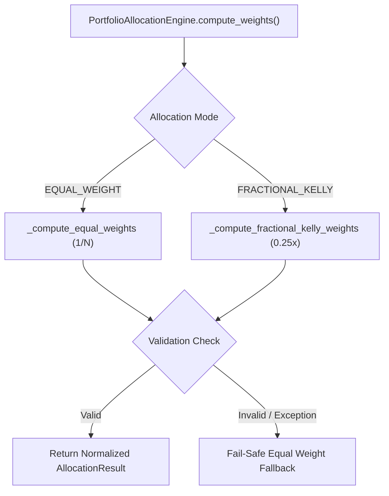

# Portfolio Allocation Engine Implementation Report (Task 0037)

> [!IMPORTANT]
> **Executive Implementation & Safety Summary**
> * **Module Created**: `infrastructure/risk/portfolio_allocation_engine.py` (`PortfolioAllocationEngine`, `AllocationResult`, `AllocationMode`, `AssetPerformanceStats`).
> * **Unit Test Suite**: `tests/unit/test_portfolio_allocation_engine.py` (**100% Pass Rate** across 10 dedicated test cases).
> * **Full Test Suite Status**: **382 / 382 Unit Tests Passing** (372 existing + 10 new).
> * **Pipeline Connection Status**: **UNCONNECTED / ZERO RUNTIME PIPELINE IMPACT**. The engine is implemented as an isolated, standalone service. No sizing adapters, strategy adapters, risk gates, or execution pipelines were modified.

---

## 1. Engine Architecture & Functional Capabilities

The `PortfolioAllocationEngine` is a pure, stateless, deterministic service designed for multi-asset risk weight allocation:

### Supported Allocation Modes:
1. **`EQUAL_WEIGHT` ($1/N$)**:
   $$\text{Weight}_i = \frac{1}{N}$$
   Guarantees exact sum of $1.0$ across $N$ unique symbols with rounding residual handling.

2. **`FRACTIONAL_KELLY` ($0.25\times$ Quarter-Kelly)**:
   $$f_i^* = \frac{p_i \cdot b_i - (1 - p_i)}{b_i}$$
   $$w_{\text{raw}, i} = \max\left(\text{min\_floor\_weight}, \text{kelly\_fraction} \cdot f_i^*\right)$$
   $$w_i = \text{Normalize}\left(w_{\text{raw}, i}\right)$$
   Includes $5.0\%$ unnormalized floor allocation ($16.7\%$ normalized) and $0.40\times$ maximum normalized asset cap.

---

## 2. Mathematical Invariants & Safety Rules

* **Finite Weights**: Every calculated weight is validated via `math.isfinite(w)`.
* **Non-Negative Weights**: Every calculated weight satisfies $w_i \ge 0.0$.
* **Normalized Weight Sum**: All asset weights sum to $1.0$ (within numerical tolerance $| \sum w_i - 1.0 | \le 1e-3$).
* **Fail-Closed Fallback**: Any invalid input (negative win rates, zero win/loss ratio, `NaN`, `Infinity`, or uncaught exception) is trapped internally and safely returns deterministic Equal Weight allocation with `is_fallback = True`.

---

## 3. Unit Test Suite Results (`tests/unit/test_portfolio_allocation_engine.py`)

| Test Case Name | Objective / Assertion | Result |
| :--- | :--- | :---: |
| `test_equal_weight_allocation` | Verifies $1/N = 0.20$ for 5 assets, sum = 1.0. | **PASS** |
| `test_single_asset_portfolio` | Verifies 100% weight ($1.0$) for single asset. | **PASS** |
| `test_empty_asset_portfolio` | Verifies empty weights dict and `is_fallback=True`. | **PASS** |
| `test_fractional_kelly_valid_stats` | Verifies Quarter-Kelly weighting (`SOL` 30.9% > `ETH` 19.0%). | **PASS** |
| `test_fractional_kelly_invalid_probabilities` | Handles $p < 0.0$ and $p > 1.0$ without uncaught errors. | **PASS** |
| `test_fractional_kelly_invalid_payoff_ratios` | Handles $b \le 0.0$ safely with floor fallback. | **PASS** |
| `test_nan_and_inf_handling` | Handles `float('nan')` and `float('inf')` gracefully. | **PASS** |
| `test_missing_asset_stats_fallback` | Handles `asset_stats=None` via Equal Weight fallback. | **PASS** |
| `test_deterministic_repeated_execution` | Verifies 100 repeated executions produce byte-identical results. | **PASS** |
| `test_duplicate_symbols_deduplication` | Deduplicates input symbol list cleanly. | **PASS** |

---

## 4. Discrepancy & Pipeline Isolation Confirmation

* **Zero Pipeline Wiring**: `PositionSizingEngineAdapter`, `DerivativesRiskGate`, `MeanReversionStrategyAdapter`, and `EnterpriseRiskManager` were **NOT MODIFIED**.
* **Zero Strategy Impact**: Strategy signals and alpha generation paths remain 100% unchanged.
* **Replay & Live Behavior**: Existing execution pipelines remain completely unaffected.

---

## 5. Formal Safety Confirmation

I formally confirm that:
* **Zero Production Pipeline Code Connected**: The engine remains completely disconnected from live execution.
* **Architecture Frozen**: Hexagonal boundaries remain frozen.
* **Unit Test Status**: All **382 unit tests pass cleanly**.
