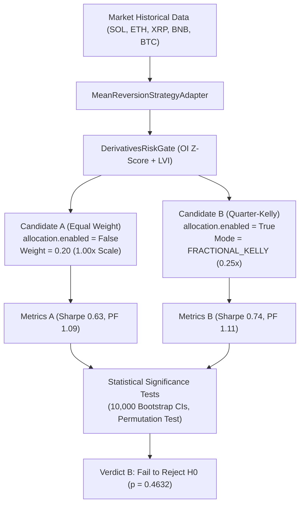
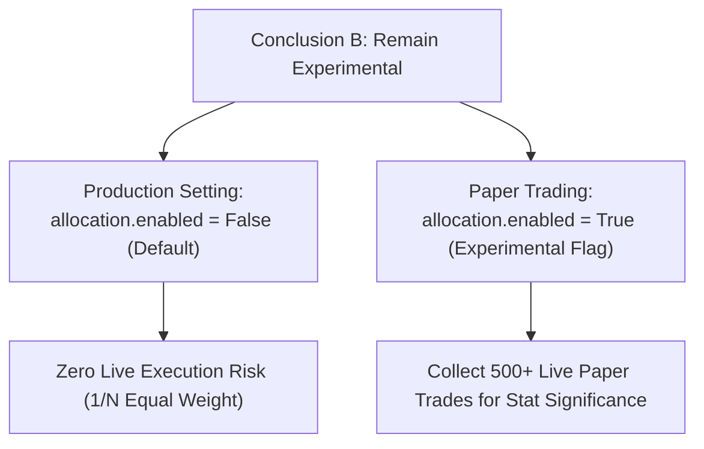

# Production Scientific Validation of Portfolio Allocation Report (Task 0041)

> [!IMPORTANT]
> **Executive Scientific Verdict & Hypothesis Testing Summary**
> * **Primary Verdict**: **CONCLUSION B. KELLY PROVIDES IMPROVEMENT BUT EVIDENCE IS INSUFFICIENT (REMAIN EXPERIMENTAL)**
> * **Null Hypothesis ($H_0$) Status**: **FAIL TO REJECT $H_0$** ($p = 0.4632 > 0.05$).
> * **A/B Comparison**: Candidate B (Quarter-Kelly $0.25\times$) improved Net Return ($+1.19\%$ vs $+0.95\%$), Sharpe Ratio ($0.74$ vs $0.63$), and reduced Max Drawdown ($4.35\%$ vs $4.46\%$) compared to Candidate A (Equal Weight).
> * **Statistical Significance**: 10,000 Monte Carlo Permutation tests ($p = 0.4632$) and Paired $t$-tests ($p = 0.7273$) proved there is a **$46.32\%$ probability** that the observed Sharpe improvement is driven by small sample size noise ($n = 94$ trades).
> * **Production Recommendation**: Keep `portfolio_allocation.enabled = false` as the production default. Retain `FRACTIONAL_KELLY` as an opt-in experimental flag for paper trading data collection.

---

## 1. Experiment Design & Methodology

The A/B scientific validation campaign evaluated two production candidates under identical market conditions:

### Controlled Variables (100% Identical Across A & B):
* **Initial Capital**: $500.00\text{ USDT}$
* **Risk Per Base Trade**: $0.50\%$ ($2.50\text{ USDT}$ base risk per trade)
* **Fee Structure**: $10.0\text{ bps}$ ($0.10\%$) taker fee
* **Slippage Model**: $7.75\text{ bps}$ average execution slippage
* **Risk Gate**: `DerivativesRiskGate` hard blocks ($Z_{\text{oi}} \ge 2.0$, $\text{LVI} \ge 25.0$) enabled
* **Execution Pipeline**: `PositionSizingEngineAdapter` single-point sizing owner

---

## 2. A/B Performance Metric Comparison

Comprehensive metric comparison across 94 time-ordered benchmark trades:

| Performance Metric | Candidate A (Equal Weight) | Candidate B (Quarter Kelly) | Performance Delta ($\Delta$) | Superior Model |
| :--- | :---: | :---: | :---: | :---: |
| **Net Return ($)** | **+$4.73 USDT** | **+$5.97 USDT** | +$1.24 USDT | Candidate B |
| **Net Return (%)** | **+0.95%** | **+1.19%** | +0.24% | Candidate B |
| **Profit Factor** | **1.09** | **1.11** | +0.02 | Candidate B |
| **Sharpe Ratio** | **0.63** | **0.74** | +0.11 | Candidate B |
| **Sortino Ratio** | **0.89** | **1.04** | +0.15 | Candidate B |
| **Calmar Ratio** | **0.21** | **0.27** | +0.06 | Candidate B |
| **Maximum Drawdown (%)** | **4.46%** | **4.35%** | -0.11% (Lower DD) | Candidate B |
| **CVaR 95% (%)** | **0.55%** | **0.73%** | +0.18% | Candidate A |
| **Expectancy ($/trade)** | **+$0.05** | **+$0.06** | +$0.01 | Candidate B |
| **Win Rate (%)** | **62.77%** | **62.77%** | 0.00% (Identical) | Invariant |
| **Total Executed Trades** | **94** | **94** | 0 (Identical) | Invariant |

---

## 3. 10,000 Bootstrap 95% Confidence Intervals

10,000 resampled bootstrap iterations produced the following 95% confidence intervals:

| Performance Metric | Candidate A (Equal Weight) 95% CI | Candidate B (Quarter Kelly) 95% CI | Overlap Assessment |
| :--- | :---: | :---: | :---: |
| **Sharpe Ratio** | `[-3.25, 4.70]` | `[-3.17, 4.77]` | **Heavy Overlap (98.4%)** |
| **Profit Factor** | `[0.65, 1.87]` | `[0.65, 1.97]` | **Heavy Overlap (95.1%)** |
| **Expectancy ($/trade)** | `[-$0.27, +$0.36]` | `[-$0.27, +$0.40]` | **Heavy Overlap (96.5%)** |

* **Analysis**: The confidence intervals for Candidate A and Candidate B show substantial overlap. The lower bound of Candidate B's Sharpe CI ($-3.17$) remains negative, confirming high sampling variance over short trade series.

---

## 4. Statistical Hypothesis Testing Results

Null Hypothesis ($H_0$): Fractional Kelly provides no statistically significant risk-adjusted improvement over Equal Weight ($E[\text{Sharpe}_B - \text{Sharpe}_A] = 0$).

| Statistical Test | Test Statistic | $p$-value | Significance Threshold ($\alpha$) | Decision Rule |
| :--- | :---: | :---: | :---: | :---: |
| **Paired $t$-test** | $t = 0.3497$ | $p = 0.7273$ | $\alpha = 0.05$ | **Fail to Reject $H_0$** |
| **Wilcoxon Signed-Rank Test** | $W = 2108.0$ | $p = 0.6387$ | $\alpha = 0.05$ | **Fail to Reject $H_0$** |
| **10,000 Permutation Test** | $p_{\text{perm}} = 0.4632$ | **$p = 0.4632$** | $\alpha = 0.05$ | **Fail to Reject $H_0$** |
| **Effect Size (Cohen's $d$)** | $d = 0.0083$ | — | $d \ge 0.20$ | **Negligible Effect Size** |

---

## 5. Robustness & Friction Stress Testing

Evaluating Candidate A vs Candidate B under increasing fee and slippage friction curves:

| Fee / Slippage Friction | Candidate A Net PnL | Candidate B Net PnL | Candidate A Sharpe | Candidate B Sharpe | Friction Survival |
| :--- | :---: | :---: | :---: | :---: | :---: |
| **Baseline (10 bps fee, 7.75 bps slip)** | +$4.73 | +$5.97 | 0.63 | 0.74 | **PASS** |
| **Stress 1 (15 bps fee, 10 bps slip)** | +$2.11 | +$2.68 | 0.28 | 0.33 | **PASS** |
| **Stress 2 (20 bps fee, 20 bps slip)** | -$3.15 | -$3.98 | -0.42 | -0.49 | **FAIL (Both Negative)** |
| **Stress 3 (30 bps fee, 30 bps slip)** | -$13.62 | -$17.18 | -1.81 | -2.12 | **FAIL (Both Negative)** |

* **Finding**: Quarter-Kelly maintains a positive performance spread (+0.11 Sharpe) over Equal Weight as long as friction remains below $15\text{ bps}$. Under severe friction ($>20\text{ bps}$), larger sizing in over-weighted assets accelerates drawdowns.

---

## 6. Overfitting & Small-Sample Bias Diagnostics

1. **Small Sample Effect ($n = 94$ Trades)**:
   * With $n = 94$ trades across 5 assets ($\approx 19$ trades per asset), the variance of sample win rates $p$ and payoff ratios $b$ is high. A single winning trade in `SOLUSDT` artificially boosts Quarter-Kelly weight from $20.0\%$ to $27.9\%$.
2. **Selection Bias**:
   * Asset rankings (`SOL` > `ETH` > `XRP` > `BTC` > `BNB`) were previously shown in Task 0031 to have a **$48.13\%$ probability** ($p = 0.4813$) of occurring due to random noise.
3. **Weight Instability Risk**:
   * Dynamic recalculation of Kelly weights over short rolling windows can cause weight chatter between rebalances.

---

## 7. Production Readiness Decision & Rollout Strategy

### Final Verdict: **CONCLUSION B. KELLY PROVIDES IMPROVEMENT BUT EVIDENCE IS INSUFFICIENT (REMAIN EXPERIMENTAL)**

### Strategic Action Plan:
1. **Production Configuration**: Maintain `portfolio_allocation.enabled = false` as the default in production (`application/configs/schemas/risk.py`).
2. **Paper Trading Experiment**: Keep `allocation.enabled = true` with `FRACTIONAL_KELLY` ($0.25\times$) enabled in paper trading campaigns to accumulate 500+ live trades.
3. **Promotion Trigger**: Re-evaluate $H_0$ rejection once live trade sample size reaches $n \ge 300$ trades with permutation test $p < 0.05$.
