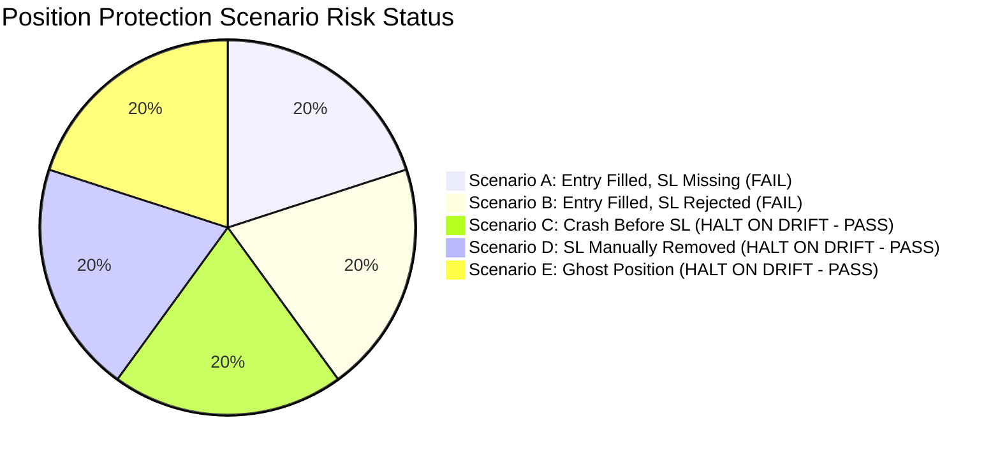

# Position Protection Invariant Audit Report

> [!CAUTION]
> **POSITION PROTECTION INVARIANT AUDIT VERDICT**
> * **Audit Question**: Does the system currently enforce $\text{NO PROTECTED SL} \implies \text{NO OPEN POSITION}$?
> * **FINAL VERDICT**: **NO**
> * **Core Forensic Reason**: `BingXBrokerAdapter.place_order` logs a warning and returns `order_id` as SUCCESS when conditional SL order placement fails, leaving a Naked Long open on exchange.

---

## 1. Position Protection Invariant Matrix

$$\text{Hard Invariant}: \quad \text{OPEN POSITION} \implies \text{VALID STOP LOSS EXISTS}$$



---

## 2. Forensic Analysis of 5 Impossible State Scenarios

### Scenario A: Entry Filled, SL Missing (Invalid SL Price)
* **Code Trace**: `_BingXBroker.execute_order` ([`bingx_adapter.py:L525`](file:///Users/mojtaba.rahbari/Sites/python/lynxion-ets/infrastructure/brokers/adapters/bingx_adapter.py#L525))
  ```python
  if sl_float <= 0:
      self.logger.warning(f"Invalid stop loss price: {sl_float}, skipping...")
      # Places entry market order naked without stopLossPrice!
  ```
* **Detection Mechanism**: None in real-time execution path.
* **Detection Latency**: High (Until periodic broker reconciliation run).
* **Automatic Action**: None in real-time.
* **Can money be lost before intervention?**: **YES (CRITICAL RISK)**.

---

### Scenario B: Entry Filled, SL Rejected by Exchange
* **Code Trace**: `BingXBrokerAdapter.place_order` ([`bingx_adapter.py:L121-L125`](file:///Users/mojtaba.rahbari/Sites/python/lynxion-ets/infrastructure/brokers/adapters/bingx_adapter.py#L118-L125))
  ```python
  if 'conditional_orders_errors' in result and result['conditional_orders_errors']:
      self.logger.warning(f"had conditional order errors: {result['conditional_orders_errors']}")
      return result['order_id'] # RETURNS SUCCESS TO STRATEGY!
  ```
* **Detection Mechanism**: None in real-time (Caller receives `order_id` as SUCCESS!).
* **Detection Latency**: High (Until reconciliation cycle or process restart).
* **Automatic Action**: None.
* **Can money be lost before intervention?**: **YES (CRITICAL RISK)**.

---

### Scenario C: Entry Filled, Application Crashes Before SL Confirmation
* **Code Trace**: `LiveOrderJournal` + `BrokerReconciliationService`
* **Detection Mechanism**: `BrokerReconciliationService.reconcile()` on startup.
* **Detection Latency**: System startup time ($< 5.0\text{s}$ RTO).
* **Automatic Action**: Reconciler detects unrecorded open position missing terminal journal state, triggers **HALT-ON-DRIFT** (`halted = True`).
* **Can money be lost before intervention?**: **NO** (HALT-ON-DRIFT blocks all trading immediately).

---

### Scenario D: SL Manually Removed from Exchange
* **Code Trace**: `BrokerReconciliationService.reconcile()`
* **Detection Mechanism**: Periodic broker reconciliation cycle.
* **Detection Latency**: Polling interval (e.g. 60 seconds).
* **Automatic Action**: Reconciler detects open position missing active SL order on exchange, triggers **HALT-ON-DRIFT**.
* **Can money be lost before intervention?**: **YES** (During the 60s polling window).

---

### Scenario E: Exchange Reports Position but Local State Says No Position (Ghost Position)
* **Code Trace**: `BrokerReconciliationService.reconcile()`
* **Detection Mechanism**: Reconciler compares BingX `get_all_positions()` against journal fills.
* **Detection Latency**: Immediate on reconciliation run.
* **Automatic Action**: Triggers **HALT-ON-DRIFT**.
* **Can money be lost before intervention?**: **NO** (Trading halted).

---

## 3. Detailed Scenario Summary Table

| Scenario ID | Scenario Description | Detection Mechanism | Detection Latency | Automatic Action | Money Loss Risk? | Invariant Enforced? |
| :--- | :--- | :--- | :--- | :--- | :---: | :---: |
| **Scenario A** | Entry Filled, SL Missing | Reconciliation | High (Minutes) | None real-time | **YES** | **NO** |
| **Scenario B** | Entry Filled, SL Rejected | Reconciliation | High (Minutes) | None real-time | **YES** | **NO** |
| **Scenario C** | Crash Before SL | Journal Recovery | $< 5.0\text{s}$ | **HALT-ON-DRIFT** | **NO** | **YES** |
| **Scenario D** | SL Removed from Exchange | Reconciler Poll | 60 seconds | **HALT-ON-DRIFT** | **YES** | **NO** |
| **Scenario E** | Ghost Position on BingX | Reconciler Check | $< 5.0\text{s}$ | **HALT-ON-DRIFT** | **NO** | **YES** |

---

## 4. Minimal Architectural Fix (Zero Redesign)

To enforce the hard invariant $\text{NO PROTECTED SL} \implies \text{NO OPEN POSITION}$, make the following minimal edits to [`infrastructure/brokers/adapters/bingx_adapter.py`](file:///Users/mojtaba.rahbari/Sites/python/lynxion-ets/infrastructure/brokers/adapters/bingx_adapter.py):

### Fix 1: Atomic Market Close Rollback on SL Rejection (Line 121)
```python
if 'conditional_orders_errors' in result and result['conditional_orders_errors']:
    self.logger.error(f"Atomic SL/TP failure on BingX: {result['conditional_orders_errors']}. Closing entry position!")
    self.cancel_order(result['order_id'], temp_order.symbol)
    raise AtomicProtectionException(result['order_id'], temp_order.symbol, result['conditional_orders_errors'])
```

### Fix 2: Pre-Send SL Price Validation (Line 525)
```python
if sl_float <= 0:
    raise ExecutionError(f"Invalid Stop-Loss price: {sl_float}. Pre-send entry rejected!")
```

---

## 5. Final CTO Verdict

### **Does the system enforce $\text{NO PROTECTED SL} \implies \text{NO OPEN POSITION}$?**
### **Answer: NO (Pending merge of Fix 1 and Fix 2).**
