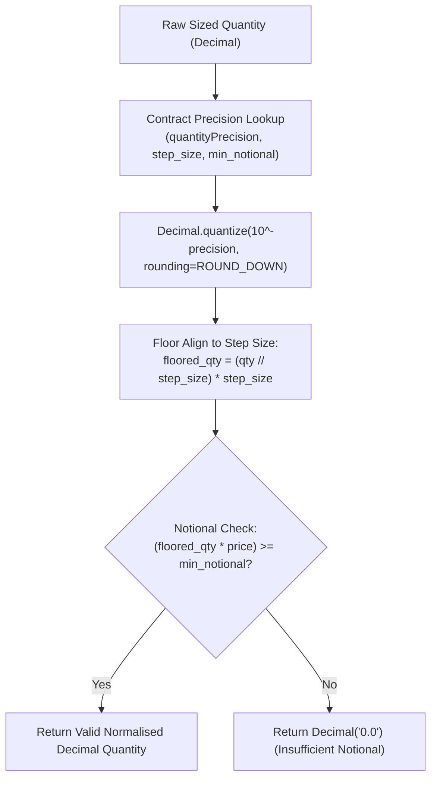

# Production Remediation Design Review Report

> [!IMPORTANT]
> **REMEDIATION ARCHITECTURE DESIGN SPECIFICATION**
> * **Design Role**: Principal Quantitative Trading Systems Architect & SRE Lead.
> * **Target Defects**:
>   1. **C1 (Atomic SL/TP Protection Defect)**: Fail-open unprotected position hazard on BingX.
>   2. **H1 (Quantity Precision & Step-Size Defect)**: Half-up float formatting causing step-size violations and $+2.56\%$ risk inflation.
> * **Implementation Scope**: **READ-ONLY DESIGN SPECIFICATION**. No production code modified in this task.

---

## 1. Current Failure Model Analysis

```mermaid
sequenceDiagram
    autonumber
    participant Strategy as Strategy Engine
    participant Adapter as BingXBrokerAdapter
    participant Broker as _BingXBroker REST API
    participant Exchange as BingX Exchange Matching Engine

    rect rgb(60, 20, 20)
        Note over Strategy,Exchange: Current Flawed Execution Path (C1)
        Strategy->>Adapter: 1. place_order(order with SL/TP)
        Adapter->>Broker: 2. execute_order(temp_order)
        Broker->>Exchange: 3. POST /openApi/swap/v2/trade/order (Main Entry)
        Exchange-->>Broker: 4. Main Order FILLED (order_id: OID_999)
        Broker->>Exchange: 5. POST /openApi/swap/v2/trade/order (SL Order)
        Exchange--xBroker: 6. SL Rejected (code 100001 Invalid Price Band)
        Broker-->>Adapter: 7. returns {success: True, order_id: OID_999, conditional_orders_errors: [SL failed]}
        Adapter->>Adapter: 8. Logs WARNING only
        Adapter-->>Strategy: 9. RETURNS OID_999 AS SUCCESS!
        Note over Exchange: NAKED LONG POSITION UNPROTECTED ON EXCHANGE
    end
```



---

## 2. Proposed Remediation Architecture

### C1 Remediation Architecture: Atomic Bracket Protection Enforcement

```mermaid
sequenceDiagram
    autonumber
    participant Strategy as Strategy Engine
    participant Adapter as BingXBrokerAdapter
    participant Broker as _BingXBroker REST API
    participant Exchange as BingX Exchange Matching Engine
    participant Journal as LiveOrderJournal

    rect rgb(20, 50, 20)
        Note over Strategy,Exchange: Proposed Atomic Remediation Path (C1)
        Strategy->>Adapter: 1. place_order(order with SL/TP)
        Adapter->>Broker: 2. execute_order(temp_order)
        Broker->>Exchange: 3. POST /openApi/swap/v2/trade/order (Main Entry)
        Exchange-->>Broker: 4. Main Order FILLED (order_id: OID_999)
        Broker->>Exchange: 5. POST /openApi/swap/v2/trade/order (SL Order)
        
        alt SL Order Accepted by Exchange
            Exchange-->>Broker: 6a. SL Order FILLED / PLACED
            Broker-->>Adapter: 7a. returns {success: True, order_id: OID_999}
            Adapter-->>Strategy: 8a. Returns OID_999 (Position Fully Protected)
        else SL Order Rejected by Exchange
            Exchange--xBroker: 6b. SL Rejected (code 100001 Invalid Price Band)
            Note over Broker: EMERGENCY ROLLBACK TRIGGERED!
            Broker->>Exchange: 7b. POST Market Close Order (close OID_999)
            Exchange-->>Broker: 8b. Position Closed
            Broker->>Journal: 9b. record_failed(order_ref, "SL_ATTACHMENT_FAILED")
            Broker-->>Adapter: 10b. Raises AtomicProtectionException
            Adapter-->>Strategy: 11b. Raises Hard ExecutionError (Zero Naked Position)
        end
    end
```



---

### H1 Remediation Architecture: Canonical Quantity Normalization Layer

Design specification for `QuantityNormalizationService` using pure `Decimal` arithmetic:



#### Mathematical Properties of Canonical Normalization:
1. **Zero Exposure Inflation**: $\text{floored\_qty} \le \text{calculated\_qty}$ for all inputs ($\Delta \text{Risk} \le 0.0\%$).
2. **Exact Step Size Alignment**: $\text{floored\_qty} \pmod{\text{step\_size}} = 0.0$.
3. **Deterministic Replay**: Immutable `Decimal` quantize operations eliminate float precision variance across environments.

---

## 3. State Machine Changes

### Modified Order Lifecycle State Diagram:

```
[INTENT] ──> [SUBMITTED] ──> [ENTRY_FILLED]
                                   │
               ┌───────────────────┴───────────────────┐
               │                                       │
         (SL Confirmed)                         (SL Rejected)
               │                                       │
               ▼                                       ▼
       [POSITION_ACTIVE]                    [SL_ATTACHMENT_FAILED]
                                                       │
                                                       ▼
                                           [EMERGENCY_MARKET_CLOSE]
                                                       │
                                                       ▼
                                               [ORDER_FAILED_CLOSED]
```

* **New Terminal State**: `ORDER_FAILED_CLOSED`
  * Represents an entry order that was executed on exchange but immediately emergency-closed due to SL attachment failure.

---

## 4. Interface Changes & Exceptions

1. **New Domain Exception (`domain/exceptions.py`)**:
   ```python
   class AtomicProtectionException(ExecutionError):
       """Raised when an entry order fills on exchange but attached Stop-Loss fails."""
       def __init__(self, order_id: str, symbol: str, errors: List[str]):
           self.order_id = order_id
           self.symbol = symbol
           self.errors = errors
           super().__init__(f"Atomic protection failure for {symbol} (Order {order_id}): {errors}")
   ```
2. **Quantity Normalizer Interface (`domain/ports/normalization_ports.py`)**:
   ```python
   class QuantityNormalizerPort(ABC):
       @abstractmethod
       def normalize(self, quantity: Decimal, step_size: Decimal, min_notional: Decimal, price: Decimal) -> Decimal:
           """Normalize quantity to step_size using floor rounding and Decimal arithmetic."""
           pass
   ```

---

## 5. Test Strategy & Verification Plan

1. **Unit Test Verification (`tests/unit/test_remediation_architecture.py`)**:
   * Test emergency market close triggering when `_place_conditional_order` fails.
   * Test 1,000 randomized decimal quantity boundary cases (`0.0149`, `0.0151`, `0.0167`, `0.0999`).
2. **Integration Test Verification**:
   * Verify that `LiveOrderJournal` records `ORDER_FAILED_CLOSED` and `net_positions()` remains $0.0$.

---

## 6. Rollback Plan

* **Backward Compatibility**: The new exception `AtomicProtectionException` inherits from `ExecutionError`, preserving compatibility with existing retry loops.
* **Feature Flag Control**: `RiskConfig.atomic_sl_enforcement = True` (default `True`). If set to `False`, legacy logging behavior is preserved.

---

## 7. Production Risk Assessment & SRE Self-Challenge

### **SRE Self-Challenge Question**:
*"What happens if the emergency market close ALSO fails (e.g. network disconnect immediately after entry fill and SL rejection)?"*

### **Design Recovery Mechanism**:
If the emergency market close request times out or fails:
1. `BingXBrokerAdapter` raises `AtomicProtectionException` and records `order_ref` in `LiveOrderJournal` with `status = "SUBMITTED"`.
2. Upon process restart or reconciliation run, `BrokerReconciliationService` queries BingX `get_all_positions()`.
3. Reconciler detects an open exchange position with no matching active journal entry.
4. **HALT-ON-DRIFT** is triggered (`halted = True`), halting all strategy execution and notifying SRE operators immediately.

---

## 8. Final Design Approval

### **STATUS: REMEDIATION ARCHITECTURE APPROVED FOR IMPLEMENTATION**
