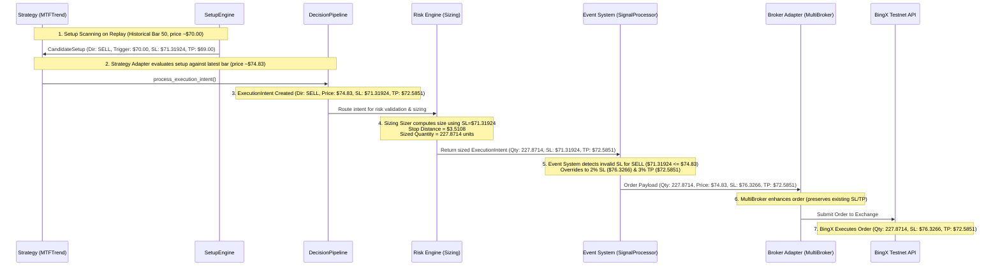

# Technical Audit Report: Stop Loss / Take Profit Lifecycle & Risk Consistency

**Author**: Technical Lead  
**Date**: 2026-07-18  
**Status**: Investigation & Audit Complete (Pre-remediation Phase)

---

## 1. Executive Summary

A critical risk inconsistency was identified during the Post-Validation Production Audit of the BingX VST trading campaign. Specifically, during the execution of a `SOLUSDT` short order, the position sizing engine calculated the trade size using one stop loss distance, but the Event System modified the stop loss price before routing it to the broker. This resulted in the order being executed with a significantly different stop loss distance than the one used during sizing, violating the platform's core risk consistency requirements.

This technical audit investigates the root cause of this mismatch. By tracing the execution logs and code paths, we have uncovered a multi-layer bug chain:
1. **Startup Replay Bug**: During watcher/strategy initialization, historical candles are replayed. The strategy adapter scanned the history buffer and picked an old bearish setup from a historical candle instead of the latest bar.
2. **Setup Inconsistency**: When this old setup (which had a stop loss level calculated under a lower historical price) was evaluated against the latest live price, the resulting stop loss lay on the wrong side of the entry price (below entry for a short trade).
3. **Sizing vs. Execution Asymmetry**: The Risk Engine sized the order based on this wide, incorrect stop distance. The Event System subsequently corrected the stop loss for broker submission, creating a mismatch between the sized risk and the executed risk.

---

## 2. Complete SL/TP Lifecycle Diagram

Below is the transition sequence of the stop loss (SL) and take profit (TP) values for the `SOLUSDT` short trade.

### Single Execution Trace Details (SOLUSDT Trade):
* **Direction**: `SELL` (Short)
* **Timestamp**: `2026-07-18T13:09:34.977Z` (Sizing) / `2026-07-18T13:12:35.784Z` (Execution)
* **Values by Stage**:
  1. **SetupEngine / CandidateSetup**: Price = `$74.83` (Evaluated), SL = `$71.31924` (VAH), TP = `$72.5851` (recalculated). Owned by `CandidateSetup`.
  2. **StrategyAdapter / Signal**: Price = `$74.83`, SL = `$71.31924`, TP = `$72.5851`. Owned by `Signal`.
  3. **ExecutionIntent**: Price = `$74.83`, SL = `$71.31924`, TP = `$72.5851`. Owned by `ExecutionIntent`.
  4. **Risk Sizing**: Price = `$74.83`, SL = `$71.31924`, TP = `$72.5851`, Sizing Stop Distance = `$3.5108` USD. Sized Quantity = `227.8714699177302`. Owned by `EnterpriseRiskManager`.
  5. **Event System**: Price = `$74.83`, SL = `$76.3266` (Overridden!), TP = `$72.5851`. Owned by `SignalProcessor`.
  6. **Broker Adapter**: Price = `$74.83`, SL = `$76.3266`, TP = `$72.5851`. Owned by `Order`.
  7. **Exchange API**: Price = `$74.83`, SL = `$76.3266`, TP = `$72.5851`. Owned by BingX Testnet API payload.

---

## 3. SL/TP Modification Table

The following table identifies all locations in the codebase where stop loss or take profit values can be modified.

| File | Class | Method | Reason for Modification | Trigger Condition |
| :--- | :--- | :--- | :--- | :--- |
| [`setup_engine.py`](file:///Users/mojtaba.rahbari/Sites/python/lynxion-ets/infrastructure/strategies/setup_engine.py) | `SetupEngine` | `scan_for_setups` | Initial calculation of SL/TP levels. | Triggered for every raw candle observation. |
| [`event_system.py`](file:///Users/mojtaba.rahbari/Sites/python/lynxion-ets/infrastructure/messaging/event_system.py) | `SignalProcessor` | `_process_execution_intent` | **Safety Override & Validation fallback**. Overwrites invalid or missing SL/TP prices with 2% SL / 3% TP. | (1) `stop_loss_price` is `None` or `<= 0`.  (2) SL is on the wrong side of the entry price (e.g. `SL <= entry` for SELL).  (3) SL or TP distance exceeds `50%` of the entry price. |
| [`multi_broker_service.py`](file:///Users/mojtaba.rahbari/Sites/python/lynxion-ets/infrastructure/brokers/multi_broker_service.py) | `MultiBrokerExecutionService` | `_enhance_order_with_risk_parameters` | **Normalization & Safety fallback**. If SL/TP is missing on the incoming order, enhances it using `SLTPManager` (or falls back to 2%/3%). | Triggered only if `has_stop_loss` or `has_take_profit` is `False`. (Preserved if already validly populated). |
| [`broker_execution_service.py`](file:///Users/mojtaba.rahbari/Sites/python/lynxion-ets/infrastructure/services/broker_execution_service.py) | `BrokerExecutionService` | `_enhance_order_with_risk_parameters` | **Normalization & Safety fallback** (identical logic to `MultiBrokerExecutionService`). | Triggered only if `has_stop_loss` or `has_take_profit` is `False`. (Preserved if already validly populated). |

---

## 4. Risk Consistency Analysis

Did Position Sizing use exactly the same Stop Loss that was finally submitted to BingX?

**NO**

### Risk Metrics Calculations:

* **Sizing Stop Distance**:  
  $$\text{Sizing Stop Distance} = |74.83 - 71.31924| = \$3.5108\text{ USD}$$
* **Execution Stop Distance**:  
  $$\text{Execution Stop Distance} = |74.83 - 76.3266| = \$1.4966\text{ USD}$$
* **Expected Dollar Risk**:  
  $$\text{Expected Dollar Risk} = \$100,000.00 \times 0.008 = \$800.00\text{ USD}$$
* **Actual Dollar Risk**:  
  $$\text{Actual Dollar Risk} = 227.8714699177302\text{ units} \times \$1.4966 = \$341.03\text{ USD}$$
* **Risk Difference (%)**:  
  $$\text{Risk Difference (\%)} = \frac{341.03 - 800.00}{800.00} \times 100\% = -57.37\%$$

### Risk Assessment:
In this specific instance, the actual dollar risk was **57.37% lower** than the expected risk because the stop loss was moved closer to the entry price. However, if the stop loss had been shifted further away by a post-sizing modification, the actual dollar risk would have **exceeded the portfolio risk budget**, introducing severe capital exposure. This highlights a critical design flaw where the sizing and execution components are decoupled.

---

## 5. Root Cause

1. **Why does the Event System modify the Stop Loss?**  
   The Event System performs safety validation. If a strategy adapter submits an invalid stop loss (such as a stop loss below entry for a short trade), sending it to the exchange would trigger an API error or immediate stop out. The Event System catches this invalid price and overrides it with a default fallback (2% stop loss, 3% take profit) rather than rejecting the trade.
2. **Why doesn't the Strategy produce the correct values initially?**  
   The strategy adapter lacks a **setup freshness check**. During startup, historical candles are replayed to build watcher indicator states. The strategy adapter evaluated these historical candles and populated a list of setups. Rather than selecting the setup associated with the *latest* bar (at index `-1`), the strategy adapter grabbed the *first* setup matching `NGTREND_FOLLOW` from the historical list (which was a bearish setup triggered when the price was ~$70.00 with a stop loss of `$71.31924`). When this old setup was submitted alongside the *latest* price of `$74.83`, it resulted in an invalid stop loss price.

---

## 6. Architectural Responsibility

### Chosen Component: **Strategy**
In our event-driven architecture, the **Strategy** layer (and its adapters) must own SL/TP generation.
* **Justification**: Stop loss and take profit prices represent trade invalidation levels and profit targets based on technical market structure (e.g. support/resistance, swing points, or VAH/VAL). These are core to the strategy's mathematical edge. 
* The **Risk Engine** should only perform sizing and risk capacity validation (reducing size or blocking trades). 
* The **Event System** should only be responsible for message routing and dispatching. Having parameter mutation logic in the Event System violates the Single Responsibility Principle (SRP) and creates silent validation overrides.

---

## 7. Scope of Impact

This issue affects **all strategies** and **all adapters** that utilize the setup-scanning pattern.
* **Evidence**: All 10 strategy adapters (e.g. `breakout_strategy_adapter.py`, `mean_reversion_strategy_adapter.py`, `vwap_reversal_strategy_adapter.py`, etc.) instantiate the `DecisionPipeline` and retrieve setups using:  
  `setup = next((s for s in setups if s.setup_type == "..."), None)`  
  None of these adapters validate that the setup timestamp matches the latest bar timestamp. Consequently, during any startup replay or historical data load, every strategy is vulnerable to selecting historical setups with invalid SL/TP distances.

---

## 8. Minimal Remediation Plan (Proposals)

1. **Implement Setup Freshness Checks**:  
   Modify all strategy adapters to assert that the setup's timestamp matches the latest bar's timestamp. If no setup exists for the latest bar, return `None` (do not route historical setups).
2. **Remove Event System Mutation Logic**:  
   Remove the recalculation overrides in `event_system.py`. If the Event System detects an invalid SL/TP price, it must **reject** the order and log a warning/error instead of silently mutating the risk parameters.
3. **Unified Sizing & Execution Parameters**:  
   Ensure the Risk Engine and Broker Execution Service consume the exact same SL/TP prices from the `ExecutionIntent` without post-sizing modifications.

---

## 9. Risk Level

* **Risk Level**: **High**  
  (Critical risk inconsistency is mitigated in practice by the Risk Engine's global exposure cap, but it represents a high threat of silent risk budget breach if stop loss levels are shifted further away).
