# Lynxion ETS - System Components Catalog

> [!NOTE]
> **COMPREHENSIVE COMPONENT CATALOG & ARCHITECTURAL REFERENCE**
> This document details all **Watchers**, **Engines**, **Fusion Services**, and **Strategies** in the Lynxion Enterprise Trading System (ETS).
> Data Pipeline: **Watcher $\rightarrow$ Engine $\rightarrow$ Fusion $\rightarrow$ Strategy $\rightarrow$ Risk $\rightarrow$ Broker**.

---

## 1. System Architecture Overview

```mermaid
flowchart LR
    Watcher["1. Watcher Layer<br/>(10 Domain Watchers)"] -->|Raw MarketObservations| Engine["2. Engine Layer<br/>(EngineService Interpretation)"]
    Engine -->|InterpretedSignals| Fusion["3. Fusion Layer<br/>(Adaptive Fusion & Weights)"]
    Fusion -->|FusedSignals| Strategy["4. Strategy Layer<br/>(11 Strategy Adapters)"]
    Strategy -->|ExecutionIntents| Risk["5. Risk & Guard Layer<br/>(ATR Sizing & Pre-flight)"]
    Risk -->|Orders| Broker["6. Broker Layer<br/>(Exchange Routing & Ledger)"]
```

---

## 2. Watcher Layer Catalog (10 Watchers)

The Watcher layer **owns domain-specific market analysis**. Each watcher runs independently, monitors market streams, and emits raw `MarketObservation` objects into the pipeline.

### Watchers Summary Table

| # | Watcher Name | Key Identifier | File Location | Primary Logic & Technical Mechanism | Output Observation Types |
|:---:|:---|:---|:---|:---|:---|
| **1** | **Historical Candle** | `historical_candle` | [`infrastructure/watchers/adapters/historical_candle.py`](file:///Users/mojtaba.rahbari/Sites/python/lynxion-ets/infrastructure/watchers/adapters/historical_candle.py) | **Candlestick Pattern Recognition**: Analyzes historical OHLCV candle buffers for key patterns: Doji (indecision), Bullish/Bearish Engulfing, Hammer / Inverted Hammer, Spinning Tops, and Small Body candles using adaptive body-to-wick ratio thresholds. | `pattern_detected`, `doji`, `engulfing`, `hammer` |
| **2** | **Market Pulse** | `market_pulse` | [`infrastructure/watchers/adapters/market_pulse.py`](file:///Users/mojtaba.rahbari/Sites/python/lynxion-ets/infrastructure/watchers/adapters/market_pulse.py) | **Multi-Indicator Sentiment & Momentum**: Combines momentum, trend, and volume sub-scores using RSI (overbought $>65$, oversold $<35$), MACD histogram crossovers, and volume spike detection ($>1.5\times$ avg volume). | `market_pulse` (direction, momentum score, volume surge) |
| **3** | **Volatility** | `volatility` | [`infrastructure/watchers/adapters/volatility.py`](file:///Users/mojtaba.rahbari/Sites/python/lynxion-ets/infrastructure/watchers/adapters/volatility.py) | **Volatility Regime & ATR Expansion/Compression**: Calculates ATR and price standard deviation over lookback windows. Classifies market into `high` (expansion $>1.5\times$ avg), `low` (compression $<0.5\times$ avg), or `normal` volatility regimes. | `volatility_expansion`, `volatility_compression` |
| **4** | **Multi-Timeframe Trend** | `trend_mtf` | [`infrastructure/watchers/adapters/trend_mtf.py`](file:///Users/mojtaba.rahbari/Sites/python/lynxion-ets/infrastructure/watchers/adapters/trend_mtf.py) | **Multi-Timeframe Trend Direction & Alignment**: Computes price trend direction and linear regression slope across 3 distinct time windows (short 5p, medium 15p, long 30p). Calculates trend alignment score across all timeframes. | `trend_positive`, `trend_negative`, `trend_neutral` |
| **5** | **Anomaly ML** | `anomaly_ml` | [`infrastructure/watchers/adapters/anomaly_ml.py`](file:///Users/mojtaba.rahbari/Sites/python/lynxion-ets/infrastructure/watchers/adapters/anomaly_ml.py) | **Statistical & ML Anomaly Detection**: Normalizes price, volume, and volatility features via Z-score standardization. Uses Isolation Forest / Z-score outlier detection to spot flash dumps, volume surges, or price anomalies ($>0.6$). | `anomaly_detected` (anomaly magnitude & cooldown) |
| **6** | **Order Flow WebSocket** | `orderflow_ws` | [`infrastructure/watchers/adapters/orderflow_ws.py`](file:///Users/mojtaba.rahbari/Sites/python/lynxion-ets/infrastructure/watchers/adapters/orderflow_ws.py) | **Order Book Imbalance & Live Trade Flow Delta**: Processes WebSocket order book depth and live trade execution feeds. Computes aggressive buy volume vs aggressive sell volume, bid/ask volume imbalance, and tick flow direction. | `order_flow_imbalance`, `order_flow_neutral` |
| **7** | **CMC Screener** | `cmc_screener` | [`infrastructure/watchers/adapters/cmc_screener.py`](file:///Users/mojtaba.rahbari/Sites/python/lynxion-ets/infrastructure/watchers/adapters/cmc_screener.py) | **Market-Wide Universe Screening**: Queries CoinMarketCap API for top crypto assets. Filters by 24h volume, price momentum, market cap rank, and volume surges to evaluate market breadth and select top universe candidates. | `universe_screening` (top gainers & market sentiment) |
| **8** | **Funding Rate** | `funding_rate` | [`infrastructure/watchers/adapters/funding_rate.py`](file:///Users/mojtaba.rahbari/Sites/python/lynxion-ets/infrastructure/watchers/adapters/funding_rate.py) | **Perpetual Funding Rate & Position Crowding**: Tracks 8-hour perpetual contract funding rates. Identifies extreme positive funding ($>0.5\%\text{--}1.0\%$, long crowding) or extreme negative funding ($<-0.5\%$, short crowding). | `funding_rate_extreme` (short/long squeeze warning) |
| **9** | **Liquidity** | `liquidity` | [`infrastructure/watchers/adapters/liquidity.py`](file:///Users/mojtaba.rahbari/Sites/python/lynxion-ets/infrastructure/watchers/adapters/liquidity.py) | **Order Book Depth & Liquidity Density**: Evaluates order book bid/ask depth score, bid-ask spread percentage, and liquidity ratio across top order book levels to detect thin liquidity or thick wall absorption. | `high_liquidity`, `low_liquidity` |
| **10** | **Tick Watcher** | `tick` | [`infrastructure/watchers/adapters/tick.py`](file:///Users/mojtaba.rahbari/Sites/python/lynxion-ets/infrastructure/watchers/adapters/tick.py) | **Micro-Structure Tick Intensity & Imbalance**: Analyzes tick-by-tick price changes, tick sizes, and tick directions (up-tick vs down-tick). Calculates tick intensity (ticks per second) and tick imbalance ratio. | `high_tick_intensity`, `tick_imbalance` |

---

## 3. Engine Layer Catalog

The **Engine Service** (`EngineService`) is the single canonical engine layer. It transforms raw `MarketObservation` objects emitted by watchers into `InterpretedSignal` objects for consumption by Fusion.

### Engine Component Table

| Component Name | Class Name | File Location | Core Responsibility |
|:---|:---|:---|:---|
| **Engine Service** | `EngineService` | [`infrastructure/engines/engine_service.py`](file:///Users/mojtaba.rahbari/Sites/python/lynxion-ets/infrastructure/engines/engine_service.py) | Maps `MarketObservation` $\rightarrow$ `InterpretedSignal` (SignalType BUY/SELL/NEUTRAL/HOLD, direction $[-1.0, 1.0]$, strength $[0.0, 1.0]$, confidence $[0.0, 1.0]$). |
| **Engine Adapter** | `EngineServiceAdapter` | [`infrastructure/engines/engine_port_adapter.py`](file:///Users/mojtaba.rahbari/Sites/python/lynxion-ets/infrastructure/engines/engine_port_adapter.py) | Implements `EnginePort` domain interface via pure delegation to `EngineService`. |

### Engine Transformation Logic Rules

1. **Market Pulse Mapping**: `market_pulse_positive` or value $>0.01 \rightarrow \text{BUY}$; `market_pulse_negative` or value $<-0.01 \rightarrow \text{SELL}$.
2. **Trend Mapping**: `trend_bullish` / `trend_positive` $\rightarrow \text{BUY}$; `trend_bearish` / `trend_negative` $\rightarrow \text{SELL}$; neutral $\rightarrow \text{NEUTRAL}$.
3. **Volatility Mapping**: `volatility_high` ($>0.7$) $\rightarrow \text{BUY}$ (breakout opportunity); `volatility_low` ($<0.3$) $\rightarrow \text{HOLD}$ (wait for volatility expansion).
4. **Order Flow Mapping**: Imbalance $>0.3 \rightarrow \text{BUY}$; Imbalance $<-0.3 \rightarrow \text{SELL}$; $|Imbalance| < 0.1 \rightarrow \text{NEUTRAL}$.

---

## 4. Fusion Layer Catalog

The **Fusion Layer** aggregates multiple `InterpretedSignal` objects into unified `FusedSignal` objects, employing performance-adaptive weights, correlation penalties, stability factors, and regime awareness.

### Fusion Modules Table

| Module Name | Class Name | File Location | Key Mathematical Feature / Logic |
|:---|:---|:---|:---|
| **Performance-Adaptive Fusion** | `PerformanceAdaptiveFusionService` | [`infrastructure/fusion/fusion_service.py`](file:///Users/mojtaba.rahbari/Sites/python/lynxion-ets/infrastructure/fusion/fusion_service.py) | Computes dynamic signal weights based on historical accuracy, stability, regime compatibility, and correlation penalties. |
| **Advanced Fusion Weighting** | `AdvancedFusionWeighting` | [`infrastructure/fusion/adaptive_fusion_weighting.py`](file:///Users/mojtaba.rahbari/Sites/python/lynxion-ets/infrastructure/fusion/adaptive_fusion_weighting.py) | Implements stability rewards, noise suppression thresholds, and correlation matrix penalties to avoid double-counting correlated signals. |
| **Hierarchical Fusion** | `HierarchicalFusionService` | [`infrastructure/fusion/hierarchical/hierarchical_fusion_service.py`](file:///Users/mojtaba.rahbari/Sites/python/lynxion-ets/infrastructure/fusion/hierarchical/hierarchical_fusion_service.py) | Role-based watcher classification (Primary, Secondary, Filter) with tiered confidence threshold gating. |

### Fusion Weighting Mathematical Formula

$$\text{Weight}_i = \frac{\text{Performance\_Score}_i \cdot \text{Stability\_Factor}_i \cdot \text{Regime\_Adjustment}_i}{1 + \text{Correlation\_Penalty}_i} \cdot \text{Timeframe\_Adjustment}_i$$

* **Performance Score**: Exponentially devalued historical accuracy ($\text{decay\_factor} = 0.95$).
* **Correlation Penalty**: Penalty sum based on pairwise signal correlation ($\text{penalty\_factor} = 0.3$).
* **Stability Factor**: Variance-penalized signal direction consistency over lookback window.

---

## 5. Strategy Layer Catalog (11 Strategies)

Strategies take `FusedSignal` objects or `SetupEngine` candidates and convert them into validated `ExecutionIntent` objects with dynamic ATR-based SL/TP parameters and dynamic confidence scaling.

### Strategies Summary Table

| # | Strategy Name | Registration Key | File Location & Class | Core Strategy Logic & Entry Triggers | Dynamic Risk, SL/TP & Exits |
|:---:|:---|:---|:---|:---|:---|
| **1** | **Trend Follow** | `trend_following` | [`trend_follow_strategy_adapter.py`](file:///Users/mojtaba.rahbari/Sites/python/lynxion-ets/infrastructure/strategies/adapters/trend_follow_strategy_adapter.py) `TrendFollowStrategyAdapter` | **EMA Crossover with Momentum**: Fast EMA (10/20) vs Slow EMA (50/200). Generates `BUY` on bullish EMA cross with positive momentum and ATR above floor; `SELL` on bearish cross. | **ATR SL/TP**: SL at $1.5 \times \text{ATR}$, TP at $2.0\text{--}3.0 \times \text{ATR}$. Confidence scaled $[0.50, 0.95]$. |
| **2** | **Mean Reversion** | `mean_reversion` | [`mean_reversion_strategy_adapter.py`](file:///Users/mojtaba.rahbari/Sites/python/lynxion-ets/infrastructure/strategies/adapters/mean_reversion_strategy_adapter.py) `MeanReversionStrategyAdapter` | **RSI + Bollinger Bands Reversion**: Triggers `BUY` when price pierces lower $2.0\sigma$ Bollinger Band with oversold RSI ($< 35$); triggers `SELL` when piercing upper band with overbought RSI ($> 65$). | **Mean Exit**: SL set beyond swing high/low; TP set at middle Bollinger Band (SMA/POC). |
| **3** | **Breakout** | `breakout` / `crypto_breakout` | [`breakout_strategy_adapter.py`](file:///Users/mojtaba.rahbari/Sites/python/lynxion-ets/infrastructure/strategies/adapters/breakout_strategy_adapter.py) `BreakoutStrategyAdapter` | **Consolidation Channel Breakout**: Identifies tight price consolidation. Triggers `BUY` on N-period high breakout with volume $>1.5\times$ average; triggers `SELL` on N-period low break. | **Channel Exit**: SL placed inside consolidation channel; TP at multi-R expansion level. |
| **4** | **Donchian Breakout** | `donchian_breakout` | [`donchian_breakout_strategy_adapter.py`](file:///Users/mojtaba.rahbari/Sites/python/lynxion-ets/infrastructure/strategies/adapters/donchian_breakout_strategy_adapter.py) `DonchianBreakoutStrategyAdapter` | **Donchian Channel Expansion**: Computes N-period highest high and lowest low (Donchian Channels). Triggers `BUY` on upper channel break; `SELL` on lower channel break. | **Channel Width Exit**: ATR-scaled stop loss and channel width expansion profit targets. |
| **5** | **Liquidity Sweep** | `liquidity` | [`liquidity_strategy_adapter.py`](file:///Users/mojtaba.rahbari/Sites/python/lynxion-ets/infrastructure/strategies/adapters/liquidity_strategy_adapter.py) `LiquidityStrategyAdapter` | **Liquidity Pool Sweep (Stop-Hunt)**: Triggers `BUY` when price sweeps below support and immediately reclaims the level (spring setup); triggers `SELL` on upper sweep rejection (upthrust). | **Tight Wick Exit**: SL placed just beyond sweep wick extreme; TP targeted at opposing liquidity pool. |
| **6** | **MTF Trend** | `mtf_trend` | [`mtf_trend_strategy_adapter.py`](file:///Users/mojtaba.rahbari/Sites/python/lynxion-ets/infrastructure/strategies/adapters/mtf_trend_strategy_adapter.py) `MTFTrendStrategyAdapter` | **Multi-Timeframe Trend Consensus**: Evaluates trend direction across 15m, 1h, and 4h timeframes. Triggers `BUY` only on 100% bullish consensus; `SELL` on 100% bearish consensus. | **Regime Consensus Exit**: Filters out conflicting regimes; ATR trailing stop. |
| **7** | **OI Footprint** | `oi_footprint` | [`oi_footprint_strategy_adapter.py`](file:///Users/mojtaba.rahbari/Sites/python/lynxion-ets/infrastructure/strategies/adapters/oi_footprint_strategy_adapter.py) `OIFootprintStrategyAdapter` | **Open Interest ($\Delta\text{OI}$) Delta**: Analyzes Open Interest changes + price action: Long Accumulation (Price $\uparrow$ + OI $\uparrow$), Short Accumulation (Price $\downarrow$ + OI $\uparrow$), Liquidation Flush (Price $\downarrow$ + OI $\downarrow$), Short Squeeze (Price $\uparrow$ + OI $\downarrow$). | **Structure Exit**: SL beyond liquidation candle extreme; TP set at high-volume nodes. |
| **8** | **Short-Term Reversal** | `short_term_reversal` | [`short_term_reversal_strategy_adapter.py`](file:///Users/mojtaba.rahbari/Sites/python/lynxion-ets/infrastructure/strategies/adapters/short_term_reversal_strategy_adapter.py) `ShortTermReversalStrategyAdapter` | **Micro-structure VWAP Deviation**: Monitors short-term price spikes extending beyond $3\sigma$ standard deviation boundaries from VWAP/EMA. Generates counter-trend scalps on volume/tick exhaustion. | **Mean Reversion Exit**: Tight ATR stop loss; TP set back at short-term VWAP mean. |
| **9** | **Sweep Scalper** | `sweep_scalper` | [`sweep_scalper_strategy_adapter.py`](file:///Users/mojtaba.rahbari/Sites/python/lynxion-ets/infrastructure/strategies/adapters/sweep_scalper_strategy_adapter.py) `SweepScalperAdapter` | **Order Book Sweep Scalping**: Intercepts WebSocket order book sweeps. Identifies aggressive market order series eating through order book levels. Emits rapid momentum scalp or limit absorption fade signals. | **Ultra-Fast Exit**: Very short holding time; tight tick-based stop loss. |
| **10** | **VWAP Reversal** | `vwap_reversal` | [`vwap_reversal_strategy_adapter.py`](file:///Users/mojtaba.rahbari/Sites/python/lynxion-ets/infrastructure/strategies/adapters/vwap_reversal_strategy_adapter.py) `VWAPReversalStrategyAdapter` | **Session VWAP Deviation & Value Area Reversion**: Computes Session VWAP and Standard Deviation Bands ($\pm 1\sigma, \pm 2\sigma, \pm 3\sigma$) alongside VAH, VAL, and POC. Triggers `BUY` below $-2\sigma / -3\sigma$ VWAP or VAL; `SELL` above $+2\sigma / +3\sigma$ VWAP or VAH. | **Value Area Exit**: SL set outside extreme deviation band; TP set at Session VWAP / POC. |
| **11** | **Volatility Breakout** | `volatility_breakout` | [`strategy_adapters.py`](file:///Users/mojtaba.rahbari/Sites/python/lynxion-ets/infrastructure/strategies/strategy_adapters.py) `VolatilityBreakoutStrategy` | **Volatility Squeeze & Keltner Expansion**: Identifies periods where Bollinger Bands contract inside Keltner Channels (volatility squeeze). Triggers signals on price channel breakout with expanding ATR. | **Channel Expansion Exit**: Dynamic Keltner Channel stop loss and trailing ATR profit targets. |

---

## 6. Strategy Management & Capital Allocation

The `StrategyManager` ([`infrastructure/strategies/strategy_manager.py`](file:///Users/mojtaba.rahbari/Sites/python/lynxion-ets/infrastructure/strategies/strategy_manager.py)) manages strategy lifecycles, health monitoring, auto-restarts, and performance-ranked capital allocation via `PerformanceRankedStrategySelector`.

### Performance Ranking & Allocation Formula

$$\text{Performance\_Score}_i = f(\text{win\_rate}, \text{avg\_rr}, \text{expectancy}, \text{Sharpe}) \cdot \text{decay\_factor}$$

$$\text{Risk\_Adjusted\_Score}_i = \text{Performance\_Score}_i \cdot (1 - \text{Correlation\_Penalty}_i) \cdot \text{Regime\_Factor}_i$$

$$\text{Allocation\_Percentage}_i = \min\left(\text{max\_allocation\_per\_strategy}, \frac{\text{Risk\_Adjusted\_Score}_i}{\sum \text{Scores}} \right)$$

---

## 7. Complete End-to-End Pipeline Summary

$$\text{Watcher (10)} \xrightarrow{\text{MarketObservation}} \text{Engine (1)} \xrightarrow{\text{InterpretedSignal}} \text{Fusion (3)} \xrightarrow{\text{FusedSignal}} \text{Strategy (11)} \xrightarrow{\text{ExecutionIntent}} \text{Risk \& Broker}$$
