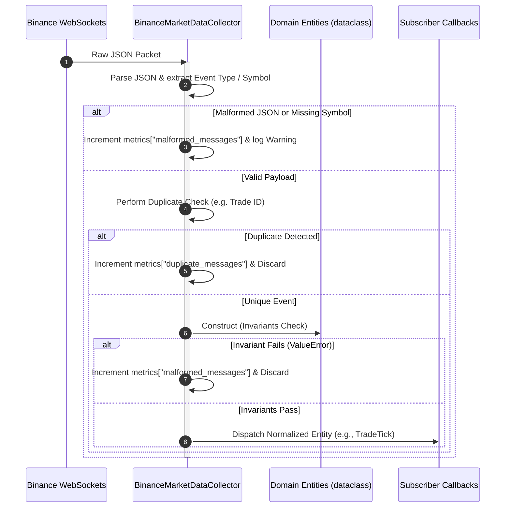
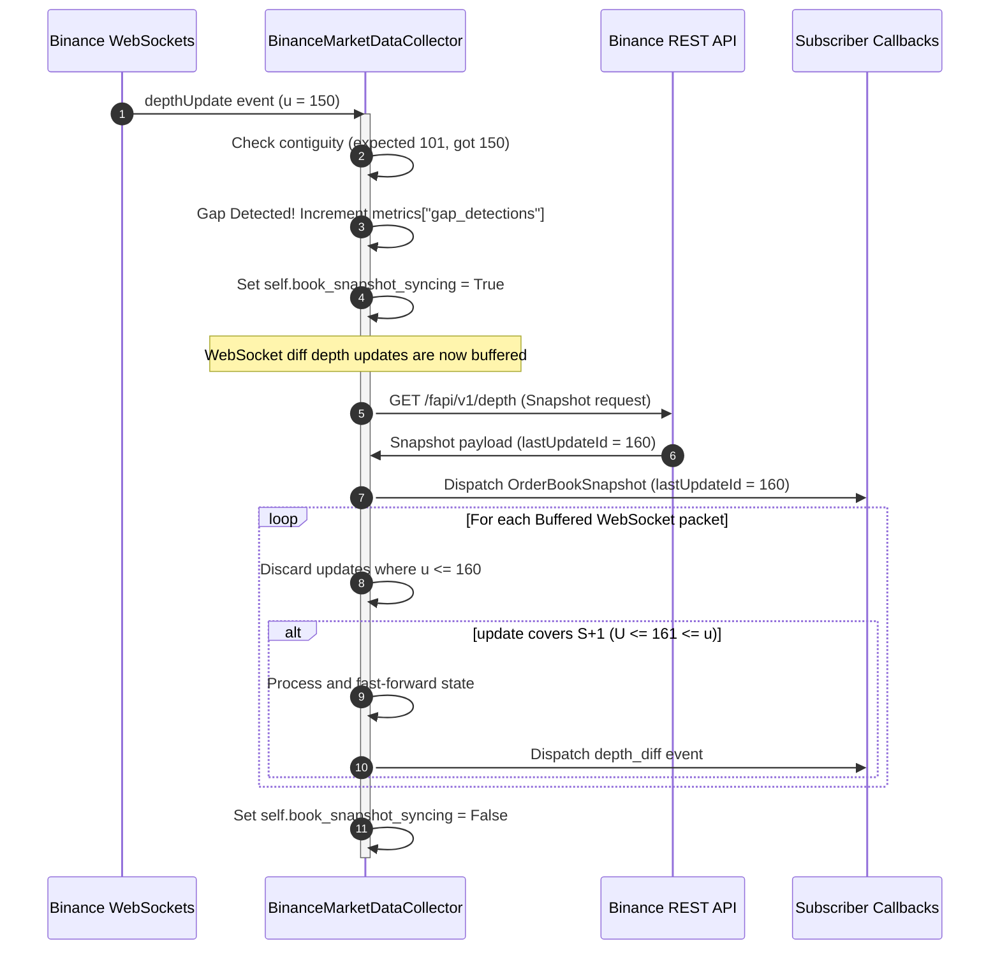

# Binance Futures Market Data Collector: Technical Documentation

**Component Path:** `infrastructure/data/collector/binance_collector.py`  
**Implements Port:** `MarketDataCollectorPort` (from `domain.ports.data_ports`)  
**Target Platform:** Binance USD-M Futures WebSockets and REST API  

---

## 1. Overview & Architecture
The `BinanceMarketDataCollector` acts as the inbound gateway for all market microstructure events. Operating as an infrastructure adapter inside the Hexagonal Architecture, it connects to external exchange feeds, parses raw payloads, validates them against domain rules, and dispatches clean domain entities to registered callbacks.

```
+-----------------------------------------------------------------------------------+
|                                 HEXAGONAL CONTEXT                                 |
|                                                                                   |
|  +---------------------------+           +-------------------------------------+  |
|  |   INFRASTRUCTURE LAYER    |           |            DOMAIN LAYER             |  |
|  |                           |           |                                     |  |
|  |  +---------------------+  |           |  +-------------------------------+  |  |
|  |  | BinanceMarketData   |--|---------->|  |    MarketDataCollectorPort    |  |  |
|  |  | Collector           |  |           |  +---------------+---------------+  |  |
|  |  +----------+----------+  |           |                  |                  |  |
|  |             |             |           |                  v                  |  |
|  |             |             |           |  +-------------------------------+  |  |
|  |             +-------------|-----------|->|      Domain Event Dispatch      |  |  |
|  |                           |           |  +-------------------------------+  |  |
|  +---------------------------+           +-------------------------------------+  |
|                                                                                   |
+-----------------------------------------------------------------------------------+
```

---

## 2. Sequence Diagrams

### A. Real-Time Stream Message Processing
The following diagram details the standard path of an incoming WebSocket packet (e.g., Trade, Mark Price, or Partial Depth):



### B. Sequence Gap Detection & REST Snapshot Recovery
For order book updates, keeping contiguity is critical. Gaps in update sequences trigger a REST depth snapshot synchronization:



---

## 3. Key Implementation Details

### A. Resilient Reconnections & Heartbeats
*   **Exponential Backoff:** If the WebSocket breaks, the collector sleeps for `current_reconnect_delay` (starting at 1s), doubling on each failed attempt up to `max_reconnect_delay` (60s). It resets back to 1s upon successful connection.
*   **Heartbeat Monitor:** Spawns a background task checking `time.time() - self.last_heartbeat_time` every few seconds. If it exceeds `heartbeat_interval`, it logs an error and force-closes the socket to trigger a clean reconnect.

### B. Open Interest (OI) Polling
*   Because Binance Futures does not push public Open Interest over standard WebSocket streams, the collector implements an isolated async task that polls the Binance REST API `/fapi/v1/openInterest` at configurable intervals (default: 10s) and dispatches it through the normal callback pipeline.

---

## 4. Known Limitations
1.  **Polling Latency for Open Interest:** Open Interest is retrieved via polling rather than streaming, which introduces a polling delay (up to 10s).
2.  **No L3 (Tick-by-Tick Order Queue):** Binance only provides public L2 book data (aggregated price levels). Sub-millisecond queue position tracking is not possible with these public streams.
3.  **Local Clock Dependance for Ingest Timestamps:** Local timestamps rely on the system clock. System clock drift or NTP synchronization steps can cause minor jitter in calculated ingestion delays.

---

## 5. Risk Assessment & Mitigations

| Risk | Impact | Likelihood | Mitigation Strategy |
| :--- | :--- | :--- | :--- |
| **REST API Rate Limits (HTTP 429)** | High | Medium | Implement exponential backoff on REST snapshots; limit Open Interest polling frequency; reuse `httpx.AsyncClient` connections. |
| **High WebSocket Traffic during Volatility** | Medium | High | Move JSON parsing and L2 serialization to dedicated threads or async workers to prevent blocking the main asyncio event loop. |
| **Connection Drops / Silence** | High | High | Heartbeat monitor checks quietness and closes stale connections; REST recovery resolves missing sequences. |
| **Malformed Messages** | Low | Low | Strict schema checks and `try-except` blocks on object creation prevent parsing crashes. |
