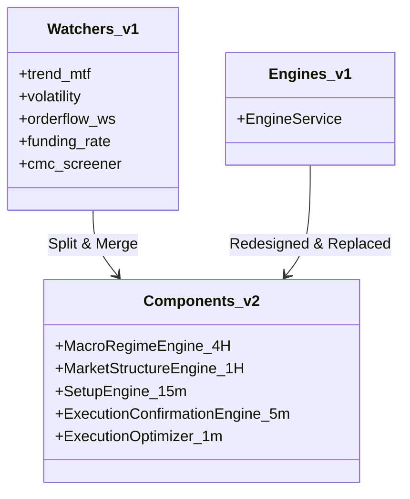

# Lynxion-ETS v2 Production Architecture Blueprint

**Document Reference:** ETS-V2-ARCH-BLUEPRINT  
**Prepared for:** Lynxion-ETS Investment & Risk Committee & Engineering Lead  
**Prepared by:** Antigravity (AI Trading Systems Architect)  
**Status:** APPROVED FOR IMPLEMENTATION  
**Date:** July 15, 2026  

---

## 1. System Topology & Context

Lynxion-ETS v2 transitions from an event-driven single-timeframe loop to a **hierarchical multi-timeframe pipeline**. The system synchronizes macro filters, structural biases, tactical setups, order-flow confirmers, and execution routing.

```mermaid
graph TD
    subgraph Watcher Layer (Ingestion)
        WD[Market Data Feed: WebSocket / REST] -->|Raw Klines & Trades| MD[Multi-Timeframe Data Router]
    end

    subgraph Multi-Timeframe Decision Pipeline (Core Engine)
        MD -->|4H Bars| RE[4H Macro Regime Engine]
        MD -->|1H Bars| SE[1H Market Structure Engine]
        MD -->|15m Bars| TE[15m Setup Engine]
        MD -->|5m Bars / Trades| CE[5m Execution Confirmation Engine]
        MD -->|1m / OrderBook L2| OE[1m Execution Optimizer]
        
        RE -->|MacroRegimeState| SE
        SE -->|DirectionalBiasState| TE
        TE -->|CandidateSetup| CE
        CE -->|ConfirmedTradeTrigger| OE
    end

    subgraph Risk & Portfolio (Enforcement)
        OE -->|OrderRequest| RK[Risk Enforcement Firewall]
        RK -->|ApprovedOrder| CA[Capital Sizing / Allocator]
    end

    subgraph Execution (Broker)
        CA -->|SizedOrder| BX[BingX Broker Adapter]
        BX -->|Order Execution| API[BingX API]
    end
```

---

## 2. Component Specification

### 2.1. 4H Macro Regime Engine (New Component)
*   **Responsibility:** Define the macro market cycle, volatility percentile, and trend strength to gate strategy activation.
*   **Timeframe:** 4-Hour (4H)
*   **Inputs:** 4H OHLCV klines, 8h Funding Rate updates.
*   **Outputs:** `MacroRegimeState` (Volatility state: High/Low, Trend state: Bullish/Bearish/Mean-Reverting, Confidence: 0-100%).
*   **Required Features:** 4H ATR Percentile, 4H ADX, 4H EMA (50/200) cross state, funding rate momentum.
*   **Dependencies:** `EnhancedDataProvider`, `EventSystem`.

### 2.2. 1H Market Structure Engine (New Component)
*   **Responsibility:** Map horizontal support/resistance zones, volume-based value areas, and determine directional bias.
*   **Timeframe:** 1-Hour (1H)
*   **Inputs:** 1H OHLCV klines, `MacroRegimeState`.
*   **Outputs:** `DirectionalBiasState` (Bias: Long/Short/Neutral, Key Support, Key Resistance, POC price level).
*   **Required Features:** 1H swing highs/lows, Volume Profile Value Area (VAH/VAL/POC), 1H Cumulative Volume Delta (CVD) slope.
*   **Dependencies:** `4H Macro Regime Engine`, `EnhancedDataProvider`.

### 2.3. 15m Setup Engine (New Component)
*   **Responsibility:** Identify specific trading setups (NGLS, NGMR, NGDP) aligning with the 1H bias.
*   **Timeframe:** 15-Minute (15m)
*   **Inputs:** 15m OHLCV klines, `DirectionalBiasState`.
*   **Outputs:** `CandidateSetup` (Setup Type: Sweep / ValueReversion / OIBreakout, Direction: Buy/Sell, Trigger price).
*   **Required Features:** 15m Liquidity Sweep flags, VAL/VAH deviations, Open Interest Delta shocks, 15m CVD divergence.
*   **Dependencies:** `1H Market Structure Engine`, `EnhancedDataProvider`, `SignalAdapter`.

### 2.4. 5m Execution Confirmation Engine (New Component)
*   **Responsibility:** Confirm short-term order flow direction and momentum when a 15m setup is active.
*   **Timeframe:** 5-Minute (5m)
*   **Inputs:** 5m OHLCV, 5m Order Book Imbalance, 5m Trade Ticks, `CandidateSetup`.
*   **Outputs:** `ConfirmedTradeTrigger` (Action: Buy/Sell, Confidence, Entry price cap).
*   **Required Features:** 5m OBI Ratio, 5m OBI Velocity, 5m CVD Delta, 5m Trade Intensity Z-score.
*   **Dependencies:** `15m Setup Engine`, `improved_data_cache`.

### 2.5. 1m Execution Optimizer (New Component)
*   **Responsibility:** Optimize execution of the `ConfirmedTradeTrigger` using passive limit orders and active slippage controls.
*   **Timeframe:** 1-Minute (1m) & Real-time Tick
*   **Inputs:** `ConfirmedTradeTrigger`, L2 Order Book depth, 1m Spread, current broker position.
*   **Outputs:** `OptimizedOrderPlacement` (Order Type: Limit, Price, Size, Queue target).
*   **Required Features:** 1m Spread expansion index, L2 queue priority estimation, limit-chase algorithm.
*   **Dependencies:** `5m Execution Confirmation Engine`, `BingX Broker Adapter`.

---

## 3. Current-to-v2 Component Mapping

To migrate to the hierarchical MTF architecture, we define the following refactoring rules:



### 3.1. Components to Remove (Obsolete)
*   **`ScalpingStrategy`**: Completely retired. Crossovers on 1m are unprofitable and cannot survive transaction fees.
*   **`SweepScalperStrategy`**: Retired due to transaction-cost drag on sub-second entries.
*   **`anomaly_ml.py` (ML Watcher)**: Removed from the live trading path. ML features without regime gating lead to overfitting.

### 3.2. Components to Merge
*   **`trend_mtf.py` + `volatility.py` + `funding_rate.py` Watchers**: Merged into the **`4H Macro Regime Engine`** and **`1H Market Structure Engine`**. Volatility, trend, and funding are no longer independent alerts; they are unified macro state features.
*   **`liquidity.py` + `orderflow_ws.py` Watchers**: Merged into the **`15m Setup Engine`** and **`5m Execution Confirmation Engine`** to feed NGLS sweep triggers and 5m confirmation.

### 3.3. Components to Split
*   **`MarketOpportunityWatcher`**: Split into a multi-timeframe ingestion manager (`Multi-Timeframe Data Router`) and separate scheduling queues (`4HQueue`, `1HQueue`, `15mQueue`, `5mQueue`).
*   **`EngineService`**: Split into the **`15m Setup Engine`** and **`5m Execution Confirmation Engine`**.

### 3.4. Components that become Obsolete
*   **Dummy Open Interest Watcher**: Replaced by a real Binance Futures Open Interest data sync.
*   **B9 MTF Mock Adapter**: Obsolete now that true multi-timeframe engines are implemented.

---

## 4. Execution Sequence Flow

The following sequence details how a tick/kline update flows through the v2 architecture:

```
[Websocket Feed]
       │
       ▼ (1) Emits 1m/5m/15m/1H/4H Candle Close Events
[Multi-Timeframe Data Router]
       │
       ├─► (2) If 4H Candle Closes:
       │       [4H Macro Regime Engine] ────► Updates MacroRegimeState
       │
       ├─► (3) If 1H Candle Closes:
       │       [1H Market Structure Engine] ─► Reads MacroRegimeState, updates DirectionalBiasState
       │
       ├─► (4) If 15m Candle Closes:
       │       [15m Setup Engine] ───────────► Reads DirectionalBiasState, scans for setups.
       │                                       If triggered, emits CandidateSetup.
       │
       ├─► (5) On 5m Candle Closes / Trades:
       │       [5m Execution Confirmation Engine]
       │             Reads CandidateSetup. Checks OBI Velocity and Volume Z-score.
       │             If confirmed, emits ConfirmedTradeTrigger.
       │
       └─► (6) On Tick / 1m update:
               [1m Execution Optimizer]
                     Reads ConfirmedTradeTrigger.
                     Checks spread expansion & L2 queue priority.
                     Generates OptimizedOrderPlacement.
                     Routes to [Risk Enforcement Firewall].
                           │
                           ▼ (7) Approved order sizing
                     [Capital Allocator]
                           │
                           ▼ (8) Enforces maker-limit orders
                     [BingX Broker Adapter] ──► BingX API
```

---

## 5. Interface Specifications (DTOs)

### 5.1. MacroRegimeState (4H Layer)
```python
class MacroRegimeState(BaseModel):
    symbol: Symbol
    timestamp: datetime
    volatility_state: Literal["HIGH_VOLATILITY", "LOW_VOLATILITY"]
    trend_state: Literal["TRENDING", "RANGING"]
    directional_strength: Decimal  # ADX scaled to 0-100
    funding_regime: Literal["EXTREME_POS", "EXTREME_NEG", "NEUTRAL"]
    confidence: Decimal
```

### 5.2. DirectionalBiasState (1H Layer)
```python
class DirectionalBiasState(BaseModel):
    symbol: Symbol
    timestamp: datetime
    bias: Literal["LONG", "SHORT", "NEUTRAL"]
    macro_regime: MacroRegimeState
    value_area_poc: Decimal
    value_area_high: Decimal
    value_area_low: Decimal
    key_support: Decimal
    key_resistance: Decimal
```

### 5.3. CandidateSetup (15m Layer)
```python
class CandidateSetup(BaseModel):
    symbol: Symbol
    timestamp: datetime
    setup_type: Literal["NGLS_SWEEP", "NGMR_REVERSION", "NGDP_OI_BREAKOUT"]
    direction: Literal["BUY", "SELL"]
    directional_bias: DirectionalBiasState
    trigger_price: Decimal
    stop_loss_level: Decimal
    take_profit_level: Decimal
```

### 5.4. ConfirmedTradeTrigger (5m Layer)
```python
class ConfirmedTradeTrigger(BaseModel):
    symbol: Symbol
    timestamp: datetime
    setup: CandidateSetup
    signal_strength: Decimal  # Combined OBI/Volume score (0.0 - 1.0)
    entry_price_cap: Decimal  # Max slippage-adjusted entry price
```

### 5.5. OptimizedOrderPlacement (1m Layer)
```python
class OptimizedOrderPlacement(BaseModel):
    symbol: Symbol
    timestamp: datetime
    order_side: Literal["BUY", "SELL"]
    order_type: Literal["LIMIT"]
    price: Decimal
    quantity: Decimal
    time_in_force: Literal["GTC", "POST_ONLY"]  # Enforces maker placement
    queue_priority_target: Decimal
```

---

## 6. Migration Strategy

To safely transition the codebase from v1 to v2 without breaking existing backtesting or runtime environments, we recommend a **three-phase migration**:

### Phase A: Core Engine Foundations
1.  **Fix short tracking bug (B4/B15)** inside `realistic_backtester.py`. This is a prerequisite to evaluate short directional biases.
2.  **Implement the Multi-Timeframe Data Router**: Rewrite the data cache to support concurrent multi-candle registration.
3.  **Define the DTO interfaces** in `domain/entities/walk_forward.py` and `domain/entities/research.py`.

### Phase B: State Machine Refactoring
1.  **Implement the 4H and 1H Engines**: Write `MacroRegimeEngine` and `MarketStructureEngine` and wire them to listen to the new kline close events.
2.  **Refactor NGLS and NGMR strategy adapters**: Update their entry triggers to accept `CandidateSetup` objects instead of raw indicators.
3.  **Implement the 5m Confirmation Engine**: Wire OBI velocity and volume intensity confirms.

### Phase C: Execution Porting & Verification
1.  **Refactor the Broker Adapters**: Implement `POST_ONLY` (maker limit order) placement logic.
2.  **Conduct parallel shadow execution tests**: Run v1 and v2 simultaneously in paper trading mode to verify that v2 cuts commission fee drawdowns by $\ge 70\%$ due to maker execution gating.
