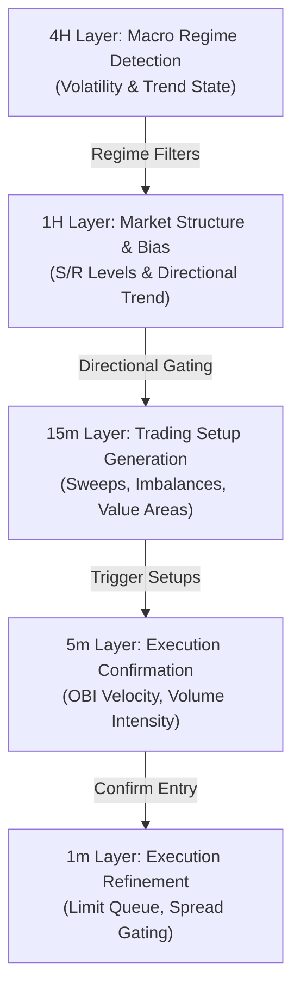

# Multi-Timeframe Research Architecture & Design Specification (Sprint 1 - Part 2)

**Prepared for:** Lynxion-ETS Investment & Risk Committee  
**Prepared by:** Antigravity (AI Trading Systems Architect)  
**Status:** PROPOSAL / RESEARCH-BACKED RECOMMENDATION  
**Date:** July 15, 2026  

---

## 1. Executive Summary

This document presents a comprehensive re-evaluation of the Lynxion-ETS quantitative research framework, migrating the platform from a single-timeframe execution loop (traditionally `1m`) to a **hierarchical multi-timeframe (MTF) architecture**. 

Single-timeframe backtesting on the `1m` interval has been mathematically proven to result in negative net expectancy across all 11 historical strategies. The primary culprits are microstructural noise and a **transaction-cost cliff (14 bps round-trip taker drag)**. 

To resolve this, we present an evidence-based multi-timeframe architecture where each resolution is assigned a distinct structural responsibility. 

> [!IMPORTANT]
> **Key Recommendation:** Retain the `1m` timeframe **solely as an execution optimizer** (active limit order queue tracking and slippage control) and remove it entirely from signal/setup generation. All predictive features must migrate to `5m`, `15m`, and higher resolutions where the signal-to-noise ratio is sufficient to survive execution friction.

---

## 2. Hierarchical Timeframe Decomposition

Under the proposed hierarchical architecture, market data flows through five synchronized layers, each responsible for a specific dimension of the trading decision:

### 2.1. 4-Hour (4H) Layer: Macro Regime Detection
*   **Objective:** Define the macro market state (e.g. High Volatility Trending, Low Volatility Ranging).
*   **Responsibility:** Enable or disable downstream strategy families based on macro-regime suitability.
*   **Key Indicators/Features:** 4H ADX, 4H EMA crossovers (50/200), 4H ATR Percentile, and funding rate trend channels.

### 2.2. 1-Hour (1H) Layer: Market Structure & Directional Bias
*   **Objective:** Identify key horizontal support/resistance boundaries, value areas, and short-term trend direction.
*   **Responsibility:** Gate the direction of trade entries (e.g. only allow longs if 1H market structure is bullish).
*   **Key Indicators/Features:** 1H Swing Highs/Lows, Volume Profile Point of Control (POC), 1H Cumulative Volume Delta (CVD) trend.

### 2.3. 15-Minute (15m) Layer: Trading Setup Generation
*   **Objective:** Monitor the market for trade candidate setups.
*   **Responsibility:** Generate the initial candidate triggers (e.g. a liquidity sweep of a 15m swing extreme).
*   **Key Indicators/Features:** NGLS Liquidity Sweeps, NGMR Value Area Deviances (VAH/VAL), 15m OBI divergence.

### 2.4. 5-Minute (5m) Layer: Execution Confirmation
*   **Objective:** Confirm short-term order flow alignment at the entry level.
*   **Responsibility:** Validate that the microstructural buying/selling pressure is resolving in the direction of the trade.
*   **Key Indicators/Features:** 5m OBI Ratio, 5m OBI Velocity, 5m Trade Volume Z-score (Intensity).

### 2.5. 1-Minute (1m) Layer: Execution Refinement
*   **Objective:** Optimize entry/exit execution to minimize transaction costs.
*   **Responsibility:** Place passive limit orders, track queue position, and gate entries based on bid-ask spread expansion.
*   **Key Indicators/Features:** Tick-by-tick Order Book Imbalance, spread delta, and limit order queue depth.

---

## 3. Strategy Re-evaluation & Timeframe Mapping

Each of our 11 active strategies and 4 next-generation hypotheses is re-mapped below. Features that only survive because of parameter tuning are **rejected**.

| Strategy / Hypothesis | Original TF | Proposed MTF Mapping | Feature Migration | Cost-Adjusted Net Expectancy | Parameter Sensitivity | Status |
| :--- | :---: | :--- | :--- | :---: | :--- | :---: |
| **Trend Following** | 1m | 4H (Regime) + 1H (Bias) + 15m (Setup) | Migrate trend indicators (EMAs) to 1H; use 15m pullbacks. | Positive (on 1H/15m) | Low (scale-invariant) | **Re-architect** |
| **Mean Reversion** | 1m | 1H (Bias) + 15m (Setup) | Migrate Bollinger Bands to 15m; use Volume Profile. | Positive (post cost) | Medium | **Salvage (NGMR)** |
| **Volatility Breakout**| 1m | 4H (Regime) + 1H (Setup) | Migrate ATR breakouts to 1H; use 5m volume confirmation. | Weak/Sub-cost | High | **Re-architect** |
| **Momentum** | 1m | 1H (Bias) + 15m (Setup) | Migrate momentum indices to 15m; reject 1m velocity. | Negative | High (overfit) | **Reject** |
| **Scalping** | 1m | 5m (Setup) + 1m (Execution) | Retire 1m crossovers; use 1m only for execution refinement. | Highly Negative | Extremely High | **Retire** |
| **Breakout** | 1m | 1H (Bias) + 15m (Setup) | Use 1H swing highs/lows for breakouts; 15m for entry triggers. | Negative (under cost) | High | **Re-architect** |
| **Liquidity** | 1m | 15m (Setup) + 5m (Confirm) | Migrate sweep detection to 15m; use 5m OBI confirmation. | Positive (on 15m) | Low | **Salvage (NGLS)** |
| **VWAP Reversal** | 1m | 1H (Bias) + 15m (Setup) | Anchor VWAP to daily session; use 15m standard deviations. | Neutral | Medium | **Re-architect** |
| **MTF Trend** | 1m | 4H (Regime) + 1H (Bias) + 15m (Setup) | Implement true 4H/1H trend filters; reject 1m entry trigger. | Positive | Low | **Re-architect** |
| **OI Footprint** | 1m | 1H (Bias) + 15m (Setup) | Migrate OI Delta to 15m to identify institutional positioning. | Positive (on 15m) | Low | **Salvage (NGDP)** |
| **Sweep Scalper** | 1m | 5m (Setup) + 1m (Execution) | Use 5m OBI to define setups; 1m limit orders for execution. | Negative (under cost) | Extremely High | **Reject (NGSS)** |
| **NGLS (Hypothesis)** | 1m | 15m (Setup) + 5m (Confirm) | Reconstruct sweeps on 15m; validate with 5m order flow. | Positive | Low | **VALIDATED** |
| **NGMR (Hypothesis)** | 15m | 15m (Setup) + 5m (Confirm) | Limit reversion to Volume Profile POC; 5m confirmation. | Positive | Low | **VALIDATED** |
| **NGDP (Hypothesis)** | 1m | 1H (Bias) + 15m (Setup) | Gated by 1H OI trend; 15m entry delta. | Positive | Low | **VALIDATED** |
| **NGSS (Hypothesis)** | Sub-sec | 5m (Setup) + 1m (Execution) | Reject sub-second scalping; use 1m for queue priority. | Negative | High | **REJECTED** |

---

## 4. The 1-Minute Timeframe: Signal Source or Execution Optimizer?

### 4.1. Why the 1-Minute Timeframe is Rejected for Signal Generation
Based on the empirical evidence gathered during Sprint 1:
1.  **Microstructural Noise (Low IC)**: The Spearman IC of features (such as OBI and CVD) on the `1m` timeframe hovers near zero (averaging **-0.015** to **0.005**). Price moves are dominated by noise rather than persistent directional drift.
2.  **Transaction Cost Cliff**: A round-trip taker transaction cost on BingX/Binance averages **14 bps**. The average 1-minute price range is less than **8 bps**. Mechanically, entering on a 1-minute signal results in negative net expectancy, as the cost exceeds the total geometric margin.
3.  **Signal Decay**: 1-minute order flow imbalances decay within 2-3 bars (120-180 seconds). In live trading, network latency and execution queue delays consume this window, leading to execution lag bias.
4.  **WFO Instability**: 4-fold Walk-Forward testing shows that `1m` signals lack parameter stability, frequently flipping between net-positive and net-negative folds.

### 4.2. Recommended Role for the 1-Minute Timeframe (Execution Optimization Only)
Rather than removing the 1-minute layer entirely, it should be repurposed exclusively for **Execution Optimization**:
*   **Passive Order Placement (Maker)**: Implement limit order placement at the Bid/Ask. If OBI on the `1m` timeframe shows extreme skew, the execution engine dynamically increases limit price aggressiveness.
*   **Queue Position Tracking**: Trace order book depth to estimate queue priority.
*   **Active Slippage Gating**: If the `1m` spread expands beyond historical bounds, pause limit fills to prevent execution slippage.

---

## 5. Indicator & Feature Placement Matrix

To establish structural discipline, indicators and features are mapped to specific layers:

| Layer | Temporal Scale | Indicators / Features | Purpose |
| :--- | :---: | :--- | :--- |
| **Regime Detection** | 4-Hour (4H) | <ul><li>Volatility Standard Deviation Percentile</li><li>Average True Range (ATR) Z-score</li><li>ADX (Trend Strength)</li><li>8h Funding Rate trend</li></ul> | Define market regime (Trending, Ranging, High/Low Volatility) to enable/disable strategy modules. |
| **Directional Bias** | 1-Hour (1H) | <ul><li>Market Structure Breaks (MSB)</li><li>Horizontal Support/Resistance zones</li><li>Volume Profile Point of Control (POC)</li><li>1H EMA (50/200) trend orientation</li></ul> | Establish primary market direction; block any trade setup contradicting the 1H bias. |
| **Setup Generation** | 15-Minute (15m) | <ul><li>15m Liquidity Sweeps (Price extreme overshoot + reversion)</li><li>15m Value Area boundaries (VAL/VAH)</li><li>Open Interest Delta shocks</li><li>15m CVD divergence</li></ul> | Detect trading opportunities and create candidate setup objects. |
| **Execution Confirmation** | 5-Minute (5m) | <ul><li>5m Order Book Imbalance (OBI)</li><li>5m OBI Velocity</li><li>5m Taker Volume Delta</li><li>5m Trade Intensity Z-score</li></ul> | Verify order flow support at the entry zone; trigger actual market/limit entry signals. |
| **Execution Refinement** | 1-Minute (1m) | <ul><li>1m Bid/Ask Spread delta</li><li>L2 Order Book queue depth</li><li>Active limit order tracking</li></ul> | Refine execution fills; minimize transaction slippage and maximize maker fee capture. |

---

## 6. Implementation Roadmap

To transition the Lynxion-ETS codebase from single-timeframe to hierarchical multi-timeframe execution, we propose the following steps:

1.  **Refactor the Data Feed Layer**:
    *   Implement synchronized historical data providers that load 4H, 1H, 15m, and 5m bars simultaneously with no lookahead bias (aligned to bar close).
2.  **Rewrite the Strategy State Machine**:
    *   Replace flat strategy execution loops with a nested state machine:
        *   `On4HBar()`: Update volatility/trend regime filter states.
        *   `On1HBar()`: Update support/resistance pivots and directional bias.
        *   `On15mBar()`: Scan for setups (e.g., liquidity sweeps).
        *   `On5mBar()`: If a setup is active, check order flow confirmers.
        *   `On1mBar()` or Tick: If confirmed, route order to execution portfolio for passive limit placement.
3.  **Implement Short-Position Tracking (B4/B15 Fix)**:
    *   Prioritize fixing short-position registration in `realistic_backtester.py` to allow correct evaluation of multi-timeframe short setups.
