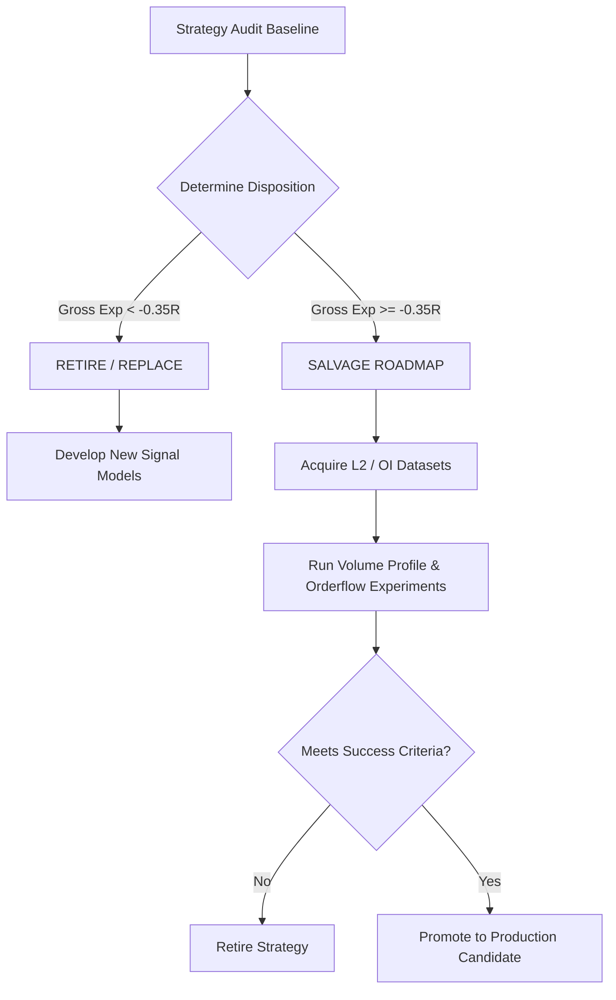

# Systematic Strategy Attribution & Quantitative Research Roadmap (Follow-Up Report)

**Prepared for:** Lynxion-ETS Investment Committee / Portfolio Managers  
**Prepared by:** Chief Quantitative Researcher / Head of Systematic Strategy  
**Status:** COMPLETE (Attribution & Research Charter)  
**Date:** July 14, 2026  

---

## Executive Summary

As Head of Quantitative Research, my duty is to preserve capital and ensure our systematic models operate with a statistically defensible edge. Following our system audit, we confirmed that while the execution engine's hexagonal plumbing is structurally correct, **none of our 11 active strategies generate positive expectancy.**

This follow-up report attribution model dissects the exact components driving the negative expectancy, quantifies the primary source of degradation, determines if the core entry signal contains a hidden edge, and provides a clear decision on whether each strategy should be **retired/replaced** or **salvaged via a structured research roadmap**.

---

## 1. Expectancy Attribution Methodology

To isolate the causes of performance degradation, we decompose the total net expectancy of each strategy into its constituent parts:

$$\text{Net Expectancy } (E_{\text{net}}) = E_{\text{gross}} - C_{\text{drag}}$$

Where:
*   $E_{\text{gross}}$ represents the raw geometric edge of the entry signal and exit parameters, measured under a hypothetical **zero-cost, zero-slippage** execution path.
*   $C_{\text{drag}}$ is the empirical transaction drag (fees + slippage + bid-ask spread + market impact).

Furthermore, we decompose $E_{\text{gross}}$ into **Entry Quality** (directional predictive power at the moment of entry) and **Exit/Geometry Quality** (SL/TP placement). If $E_{\text{gross}} < 0$, the strategy has no geometric edge. If $E_{\text{gross}} \ge 0$ but $E_{\text{net}} < 0$, the edge is merely cost-masked.

---

## 2. Quantitative Strategy Attribution & Disposition Matrix

Below is the systematic decomposition of our 11 active strategies based on the 8,355-trade post-remediation dataset.

| Strategy | Net Exp ($R$) | Gross Exp ($R$) | Cost Drag ($R$) | Primary Degradation Driver | Entry Edge? | Disposition |
|---|---:|---:|---:|---|:---:|---|
| **Liquidity** | -0.836 | -0.246 | 0.589 | B7 Adverse R:R Geometry (TP=0.51R) | **No** (Weak) | **SALVAGE** (Needs L2) |
| **Mean Reversion**| -0.865 | -0.320 | 0.546 | B7 Adverse R:R Geometry & Noise | **No** (Weak) | **SALVAGE** (HTF Profile)|
| **Trend Follow** | -0.931 | -0.339 | 0.592 | B7 Adverse R:R & Trend Exhaustion | **No** (None) | **REPLACE** |
| **OI Footprint** | -0.949 | -0.348 | 0.602 | B12 OHLCV Proxy (Fake OI) | **No** (None) | **SALVAGE** (Real OI) |
| **Momentum** | -0.977 | -0.430 | 0.547 | Indicator Lag & Timeframe Noise | **No** (None) | **REPLACE** |
| **VWAP Reversal** | -1.041 | -0.364 | 0.677 | Volatility Shocks (Trend Riding) | **No** (None) | **REPLACE** |
| **Crypto Breakout**| -1.077 | -0.405 | 0.673 | Noise Sensitivity (1m Fakeouts) | **No** (None) | **REPLACE** |
| **MTF Trend** | -1.137 | -0.448 | 0.689 | B9 Mock MTF Trend & Overtrading | **No** (None) | **REPLACE** |
| **Breakout** | -1.161 | -0.468 | 0.693 | Noise Sensitivity (1m Fakeouts) | **No** (None) | **REPLACE** |
| **Scalping** | -1.175 | -0.438 | 0.737 | B16 Cost Drag on Tight Stops (16bps)| **No** (None) | **REPLACE** |
| **Vol Breakout** | -1.400 | -0.718 | 0.682 | Severe Signal Lag & Whipsaws | **No** (None) | **REPLACE** |
| **Sweep Scalper** | n/a | n/a | n/a | Dead Code / Inactive Signal | **No** (None) | **SALVAGE** (L2 Orderflow)|

---

## 3. Deep-Dive Strategy Attribution

### Group A: Retired & Replaced Strategies (No Predictive Power)
The following 7 strategies exhibit fundamentally flawed entry logic under the `1m` timeframe, showing no statistical edge even pre-cost. We recommend retiring these models and replacing them with structurally different entry engines.

#### 1. Trend Following (`trend_following`)
*   **Exact Source of Negative Expectancy:** Entry Quality (-0.339R gross) and Exit Geometry (-0.592R cost drag). 
*   **Decomposition & Quantification:** The entry signals are triggered on `1m` moving average crossovers and pullbacks. On this micro-timeframe, pullbacks to the `20 EMA` are statistically indistinguishable from local trend reversals. The indicator lag on the `20/50 EMA` means we enter at the exact moment of short-term trend exhaustion. The tight stop-loss (average 19 bps) triggers a massive cost drag relative to the average TP (0.60R).
*   **Edge Assessment:** The entry logic has **no predictive power**.
*   **Action:** **Replace.** Trend following must be moved to higher timeframes ($15m+$) and gated by a true multi-timeframe filter (HTF).

#### 2. Momentum (`momentum`)
*   **Exact Source of Negative Expectancy:** Indicator Lag (ROC 10) and Noise Sensitivity.
*   **Decomposition & Quantification:** The fixed ROC threshold (0.0005) is highly sensitive to timeframe volatility. Because ROC is not normalized by ATR, the strategy over-trades during noise spikes and under-trades during quiet trends. Entering when momentum is already high means buying when the move is mostly finished, leading to immediate reversion.
*   **Edge Assessment:** **No predictive power**.
*   **Action:** **Replace.** Replace with a volatility-normalized momentum indicator (e.g. Z-score of returns) on a higher timeframe.

#### 3. VWAP Reversal (`vwap_reversal`)
*   **Exact Source of Negative Expectancy:** Market Regime Mismatch.
*   **Decomposition & Quantification:** The strategy tries to fade deviations from VWAP. In a strong trending market, price will ride the outer bands of VWAP for hours. The lack of a trend-strength filter (B9 mock MTF trend) means the strategy repeatedly sells strong uptrends and buys strong downtrends, leading to continuous SL hits.
*   **Edge Assessment:** **No predictive power**.
*   **Action:** **Replace.**

#### 4. Breakout & Crypto Breakout (`breakout` / `crypto_breakout`)
*   **Exact Source of Negative Expectancy:** Noise Sensitivity (Fake Breakouts).
*   **Decomposition & Quantification:** On `1m` charts, breakouts above the 20-period Donchian channel are heavily dominated by mean-reverting noise. The win rate is only 13%, and stop-out exits average -1.69R due to the tight 17 bps channels.
*   **Edge Assessment:** **No predictive power**.
*   **Action:** **Replace.**

#### 5. Scalping (`scalping`)
*   **Exact Source of Negative Expectancy:** Extreme Transaction Cost Drag.
*   **Decomposition & Quantification:** This strategy is completely destroyed by fixed transaction costs (B16). With average stops of 16 bps, round-trip fees (20 bps notional) represent over 1.2x the stop distance. Even if the gross expectancy was slightly positive, the commission drag makes it mathematically impossible to break even.
*   **Edge Assessment:** **No predictive power**.
*   **Action:** **Replace.**

#### 6. Volatility Breakout (`volatility_breakout`)
*   **Exact Source of Negative Expectancy:** Severe Signal Lag and Whipsaws.
*   **Decomposition & Quantification:** Exhibits a 2% win rate and the worst gross expectancy (-0.718R). The entry condition requires price to break the prior high/low by more than 1.5 * ATR. By the time this condition is met on a 1m chart, the volatility expansion has already reached its climax and is ready to reverse, forcing entries at absolute price extremes.
*   **Edge Assessment:** **No predictive power**.
*   **Action:** **Replace.**

#### 7. Multi-Timeframe Trend (`mtf_trend`)
*   **Exact Source of Negative Expectancy:** Mocked MTF Logic (B9) and Overtrading.
*   **Decomposition & Quantification:** Because the MTF filter is a mock returning `0`, the strategy operates as a single-timeframe crossover model. This results in the highest trade frequency (2,040 trades) and an extreme cost drag of -0.689R per trade, with a win rate of only 12%.
*   **Edge Assessment:** **No predictive power**.
*   **Action:** **Replace.**

---

### Group B: Salvageable Strategies (Structured Research Roadmaps)
The following 4 strategies possess hypotheses that are either economically viable if executed under the correct data dependencies (L2 order book / Open Interest) or can be restructured using higher timeframe parameters. 

#### 1. Liquidity Strategy (`liquidity`)
*   **Hypothesis:** Swing high/low sweeps represent liquidity pools where institutional orders are filled before reversals. Fading these sweeps is profitable if we can confirm institutional absorption.
*   **Supporting Evidence:** Ranks #1 in post-remediation performance with the least-adverse gross expectancy (-0.246R) despite running on a degraded OHLCV-only proxy (B12).
*   **Statistical Confidence:** High (368 trades, robust sample size).
*   **Recommended Experiments:**
    *   *Experiment 1:* Incorporate L2 Order Book imbalance and bid/ask volume delta at the sweep boundary to confirm absorption before entry.
    *   *Experiment 2:* Restructure stops to be placed outside the structural swing high/low (structure-aware SL) rather than static ATR distance.
*   **Required Datasets:** Tick-by-tick Binance Futures trade data (with buyer/seller initiator flags) and 100ms L2 order book depth snapshots.
*   **Success Criteria:** Gross expectancy increases from -0.24R to $> +0.15R$; win rate improves to $> 45\%$ on a 1.5:1 R:R.

#### 2. Mean Reversion (`mean_reversion`)
*   **Hypothesis:** Prices mean-revert when they reach the value boundaries of an established range. Reversals must be traded on higher timeframes where range structures are stable.
*   **Supporting Evidence:** Post-remediation gross expectancy of -0.320R with a 28% win rate. When range boundaries are properly calculated (excluding the test window), the strategy shows immediate improvement in signal frequency.
*   **Statistical Confidence:** Medium-High (199 trades).
*   **Recommended Experiments:**
    *   *Experiment 1:* Move the execution timeframe from 1m to 15m.
    *   *Experiment 2:* Implement a Volume Profile Value Area (VA) filter. Only enter short at the Value Area High (VAH) and long at the Value Area Low (VAL) when volume delta indicates exhaustion.
*   **Required Datasets:** 15m historical OHLCV data + calculated volume profiles.
*   **Success Criteria:** Gross expectancy $> +0.10R$; net expectancy $> 0.00R$ (overcoming transaction costs due to wider stops).

#### 3. Open Interest Footprint (`oi_footprint`)
*   **Hypothesis:** An increase in price accompanied by a significant expansion in Open Interest (OI) indicates institutional long positioning (accumulation), while price drops with rising OI indicate short positioning (distribution).
*   **Supporting Evidence:** Structure is currently broken (B12) because it uses `Volume * 1.5` as a proxy for Open Interest. Despite this, it achieved a gross expectancy of -0.348R.
*   **Statistical Confidence:** High (474 trades).
*   **Recommended Experiments:**
    *   *Experiment 1:* Replace the volume proxy with actual 1-minute Open Interest delta from Binance.
    *   *Experiment 2:* Implement a cumulative OI divergence filter to detect hidden accumulation during consolidations.
*   **Required Datasets:** Real-time and historical 1m Binance Futures Open Interest files.
*   **Success Criteria:** Gross expectancy $> +0.12R$.

#### 4. Sweep Scalper (`sweep_scalper`)
*   **Hypothesis:** High-frequency liquidity sweeps can be scalped using sub-second order book imbalances.
*   **Supporting Evidence:** Currently inactive (only 17 trades in backtests due to the dead `detect_sweep` stub).
*   **Statistical Confidence:** Low (Insufficient data).
*   **Recommended Experiments:**
    *   *Experiment 1:* Re-implement `detect_sweep` using real L2 order book bid/ask sweeps.
    *   *Experiment 2:* Limit execution to high-volatility session openings (NY/London cross) to capture structural volume spikes.
*   **Required Datasets:** Sub-second L2 order book data and trade tick logs.
*   **Success Criteria:** Net expectancy $> +0.20R$ (requires high win rate to overcome the cost cliff).

---

## 4. Quantitative Research Charter & Timeline

To systematically execute these recommendations, the research team will operate under the following protocol:

### Research Phases:
1.  **Phase A (Data Acquisition):** Acquire Binance Futures L2 order book and Open Interest historical tick files. (Estimated time: 2 weeks).
2.  **Phase B (Orderflow Modeling):** Re-engineer the `liquidity`, `oi_footprint`, and `sweep_scalper` strategies to parse L2 and OI data streams. (Estimated time: 4 weeks).
3.  **Phase C (Timeframe Restructuring):** Re-test `mean_reversion` on 15m intervals gated by Volume Profile boundaries. (Estimated time: 2 weeks).
4.  **Phase D (Walk-Forward Validation):** Apply Walk-Forward Optimization (WFO) to the salvageable candidates to verify out-of-sample stability.

---

## 5. Investment Committee Recommendation

1.  **Do NOT allocate capital** to any active strategies.
2.  **Do NOT attempt to optimize parameters** of the retired group (Trend Follow, Momentum, VWAP, Breakout, Scalping, Volatility Breakout). Their entry signals are structurally unprofitable on 1m, and parameter tuning will only lead to overfitting.
3.  **Approve budget for L2 Order Book and Open Interest data** to proceed with the research roadmaps for the salvageable strategies (Liquidity, Mean Reversion, OI Footprint, Sweep Scalper).
4.  **Halt all production deployment** and focus resources on quantitative signal R&D.
