# Lynxion ETS - System Components Catalog

> [!NOTE]
> **COMPREHENSIVE COMPONENT CATALOG & ARCHITECTURAL REFERENCE**
> This document details all **Watchers**, **Engines**, **Fusion Services**, and **Strategies** in the Lynxion Enterprise Trading System (ETS).
> Data Pipeline: **Watcher $\rightarrow$ Engine $\rightarrow$ Fusion $\rightarrow$ Strategy $\rightarrow$ Risk $\rightarrow$ Broker**.

---

## 1. System Architecture Overview

```mermaid
flowchart LR
    Watcher["1. Watcher Layer<br/>(10 Domain Watchers)"] -->|Raw MarketObservations| Engine["2. Engine Layer<br/>(EngineService Interpretation)"]
    Engine -->|InterpretedSignals| Fusion["3. Fusion Layer<br/>(Adaptive Fusion & Weights)"]
    Fusion -->|FusedSignals| Strategy["4. Strategy Layer<br/>(6 Strategy Adapters)"]
    Strategy -->|ExecutionIntents| Risk["5. Risk & Guard Layer<br/>(ATR Sizing & Pre-flight)"]
    Risk -->|Orders| Broker["6. Broker Layer<br/>(Exchange Routing & Ledger)"]
```

---

## 2. Watcher Layer Catalog (10 Watchers)

The Watcher layer **owns domain-specific market analysis**. Each watcher runs independently, monitors market streams, and emits raw `MarketObservation` objects into the pipeline.

### Watchers Summary Table

| # | Watcher Name | Key Identifier | File Location | Primary Logic & Technical Mechanism | Output Observation Types |
|:---:|:---|:---|:---|:---|:---|
| **1** | **Historical Candle** | `historical_candle` | [`infrastructure/watchers/adapters/historical_candle.py`](file:///Users/mojtaba.rahbari/Sites/python/lynxion-ets/infrastructure/watchers/adapters/historical_candle.py) | **Candlestick Pattern Recognition**: Analyzes historical OHLCV candle buffers for key patterns: Doji (indecision), Bullish/Bearish Engulfing, Hammer / Inverted Hammer, Spinning Tops, and Small Body candles using adaptive body-to-wick ratio thresholds. | `pattern_detected`, `doji`, `engulfing`, `hammer` |
| **2** | **Market Pulse** | `market_pulse` | [`infrastructure/watchers/adapters/market_pulse.py`](file:///Users/mojtaba.rahbari/Sites/python/lynxion-ets/infrastructure/watchers/adapters/market_pulse.py) | **Multi-Indicator Sentiment & Momentum**: Combines momentum, trend, and volume sub-scores using RSI (overbought $>65$, oversold $<35$), MACD histogram crossovers, and volume spike detection ($>1.5\times$ avg volume). | `market_pulse` (direction, momentum score, volume surge) |
| **3** | **Volatility** | `volatility` | [`infrastructure/watchers/adapters/volatility.py`](file:///Users/mojtaba.rahbari/Sites/python/lynxion-ets/infrastructure/watchers/adapters/volatility.py) | **Volatility Regime & ATR Expansion/Compression**: Calculates ATR and price standard deviation over lookback windows. Classifies market into `high` (expansion $>1.5\times$ avg), `low` (compression $<0.5\times$ avg), or `normal` volatility regimes. | `volatility_expansion`, `volatility_compression` |
| **4** | **Multi-Timeframe Trend** | `trend_mtf` | [`infrastructure/watchers/adapters/trend_mtf.py`](file:///Users/mojtaba.rahbari/Sites/python/lynxion-ets/infrastructure/watchers/adapters/trend_mtf.py) | **Multi-Timeframe Trend Direction & Alignment**: Computes price trend direction and linear regression slope across 3 distinct time windows (short 5p, medium 15p, long 30p). Calculates trend alignment score across all timeframes. | `trend_positive`, `trend_negative`, `trend_neutral` |
| **5** | **Anomaly ML** | `anomaly_ml` | [`infrastructure/watchers/adapters/anomaly_ml.py`](file:///Users/mojtaba.rahbari/Sites/python/lynxion-ets/infrastructure/watchers/adapters/anomaly_ml.py) | **Statistical & ML Anomaly Detection**: Normalizes price, volume, and volatility features via Z-score standardization. Uses Isolation Forest / Z-score outlier detection to spot flash dumps, volume surges, or price anomalies ($>0.6$). | `anomaly_detected` (anomaly magnitude & cooldown) |
| **6** | **Order Flow WebSocket** | `orderflow_ws` | [`infrastructure/watchers/adapters/orderflow_ws.py`](file:///Users/mojtaba.rahbari/Sites/python/lynxion-ets/infrastructure/watchers/adapters/orderflow_ws.py) | **Order Book Imbalance & Live Trade Flow Delta**: Processes WebSocket order book depth and live trade execution feeds. Computes aggressive buy volume vs aggressive sell volume, bid/ask volume imbalance, and tick flow direction. | `order_flow_imbalance`, `order_flow_neutral` |
| **7** | **CMC Screener** | `cmc_screener` | [`infrastructure/watchers/adapters/cmc_screener.py`](file:///Users/mojtaba.rahbari/Sites/python/lynxion-ets/infrastructure/watchers/adapters/cmc_screener.py) | **Market-Wide Universe Screening**: Queries CoinMarketCap API for top crypto assets. Filters by 24h volume, price momentum, market cap rank, and volume surges to evaluate market breadth and select top universe candidates. | `universe_screening` (top gainers & market sentiment) |
| **8** | **Funding Rate** | `funding_rate` | [`infrastructure/watchers/adapters/funding_rate.py`](file:///Users/mojtaba.rahbari/Sites/python/lynxion-ets/infrastructure/watchers/adapters/funding_rate.py) | **Perpetual Funding Rate & Position Crowding**: Tracks 8-hour perpetual contract funding rates. Identifies extreme positive funding ($>0.5\%\text{--}1.0\%$, long crowding) or extreme negative funding ($<-0.5\%$, short crowding). | `funding_rate_extreme` (short/long squeeze warning) |
| **9** | **Liquidity** | `liquidity` | [`infrastructure/watchers/adapters/liquidity.py`](file:///Users/mojtaba.rahbari/Sites/python/lynxion-ets/infrastructure/watchers/adapters/liquidity.py) | **Order Book Depth & Liquidity Density**: Evaluates order book bid/ask depth score, bid-ask spread percentage, and liquidity ratio across top order book levels to detect thin liquidity or thick wall absorption. | `high_liquidity`, `low_liquidity` |
| **10** | **Tick Watcher** | `tick` | [`infrastructure/watchers/adapters/tick.py`](file:///Users/mojtaba.rahbari/Sites/python/lynxion-ets/infrastructure/watchers/adapters/tick.py) | **Micro-Structure Tick Intensity & Imbalance**: Analyzes tick-by-tick price changes, tick sizes, and tick directions (up-tick vs down-tick). Calculates tick intensity (ticks per second) and tick imbalance ratio. | `high_tick_intensity`, `tick_imbalance` |

---

## 3. Engine Layer Catalog

The **Engine Service** (`EngineService`) is the single canonical engine layer. It transforms raw `MarketObservation` objects emitted by watchers into `InterpretedSignal` objects for consumption by Fusion.

### Engine Component Table

| Component Name | Class Name | File Location | Core Responsibility |
|:---|:---|:---|:---|
| **Engine Service** | `EngineService` | [`infrastructure/engines/engine_service.py`](file:///Users/mojtaba.rahbari/Sites/python/lynxion-ets/infrastructure/engines/engine_service.py) | Maps `MarketObservation` $\rightarrow$ `InterpretedSignal` (SignalType BUY/SELL/NEUTRAL/HOLD, direction $[-1.0, 1.0]$, strength $[0.0, 1.0]$, confidence $[0.0, 1.0]$). |
| **Engine Adapter** | `EngineServiceAdapter` | [`infrastructure/engines/engine_port_adapter.py`](file:///Users/mojtaba.rahbari/Sites/python/lynxion-ets/infrastructure/engines/engine_port_adapter.py) | Implements `EnginePort` domain interface via pure delegation to `EngineService`. |

### Engine Transformation Logic Rules

1. **Market Pulse Mapping**: `market_pulse_positive` or value $>0.01 \rightarrow \text{BUY}$; `market_pulse_negative` or value $<-0.01 \rightarrow \text{SELL}$.
2. **Trend Mapping**: `trend_bullish` / `trend_positive` $\rightarrow \text{BUY}$; `trend_bearish` / `trend_negative` $\rightarrow \text{SELL}$; neutral $\rightarrow \text{NEUTRAL}$.
3. **Volatility Mapping**: `volatility_high` ($>0.7$) $\rightarrow \text{BUY}$ (breakout opportunity); `volatility_low` ($<0.3$) $\rightarrow \text{HOLD}$ (wait for volatility expansion).
4. **Order Flow Mapping**: Imbalance $>0.3 \rightarrow \text{BUY}$; Imbalance $<-0.3 \rightarrow \text{SELL}$; $|Imbalance| < 0.1 \rightarrow \text{NEUTRAL}$.

---

## 4. Fusion Layer Catalog

The **Fusion Layer** aggregates multiple `InterpretedSignal` objects into unified `FusedSignal` objects, employing performance-adaptive weights, correlation penalties, stability factors, and regime awareness.

### Fusion Modules Table

| Module Name | Class Name | File Location | Key Mathematical Feature / Logic |
|:---|:---|:---|:---|
| **Performance-Adaptive Fusion** | `PerformanceAdaptiveFusionService` | [`infrastructure/fusion/fusion_service.py`](file:///Users/mojtaba.rahbari/Sites/python/lynxion-ets/infrastructure/fusion/fusion_service.py) | Computes dynamic signal weights based on historical accuracy, stability, regime compatibility, and correlation penalties. |
| **Advanced Fusion Weighting** | `AdvancedFusionWeighting` | [`infrastructure/fusion/adaptive_fusion_weighting.py`](file:///Users/mojtaba.rahbari/Sites/python/lynxion-ets/infrastructure/fusion/adaptive_fusion_weighting.py) | Implements stability rewards, noise suppression thresholds, and correlation matrix penalties to avoid double-counting correlated signals. |
| **Hierarchical Fusion** | `HierarchicalFusionService` | [`infrastructure/fusion/hierarchical/hierarchical_fusion_service.py`](file:///Users/mojtaba.rahbari/Sites/python/lynxion-ets/infrastructure/fusion/hierarchical/hierarchical_fusion_service.py) | Role-based watcher classification (Primary, Secondary, Filter) with tiered confidence threshold gating. |

### Fusion Weighting Mathematical Formula

$$\text{Weight}_i = \frac{\text{Performance\_Score}_i \cdot \text{Stability\_Factor}_i \cdot \text{Regime\_Adjustment}_i}{1 + \text{Correlation\_Penalty}_i} \cdot \text{Timeframe\_Adjustment}_i$$

* **Performance Score**: Exponentially devalued historical accuracy ($\text{decay\_factor} = 0.95$).
* **Correlation Penalty**: Penalty sum based on pairwise signal correlation ($\text{penalty\_factor} = 0.3$).
* **Stability Factor**: Variance-penalized signal direction consistency over lookback window.

---

## 5. Strategy Layer Catalog (6 Strategies)

Strategies take `FusedSignal` objects, compute their own setup from closed candles of their design timeframe and
return an `ExecutionIntent` through `DecisionPipeline`. Live set = `STRATEGY_ALLOWLIST` (VST). Consolidated
2026-11-24 from twelve names to six; grades per `docs/v2/reviews/LAYER_REVIEW.md` (no setup has a proven net edge yet).

| # | Strategy | Key | Timeframe | Setup (entry, stop, target) | Live | Evidence (E9/E21, net R DEV / HOLDOUT) |
|:---:|:---|:---|:---:|:---|:---:|:---|
| 1 | **TrendFollow** | `trend_following` | 1h | `trend_donchian.py`: close beyond the previous 20-bar high/low with EMA50 vs EMA200 in the same direction; stop 2 x ATR(14), target 6 x ATR; 400-bar history | yes | -0.027 / -0.010 |
| 2 | **VWAPReversal** | `vwap_reversal` | 15m | `vwap_session.py`: UTC-session VWAP, re-entry from beyond 2 sigma; target VWAP; stop = 3-bar extreme -/+ 0.5 ATR; cost filter; no entries in the first 2 h | yes | -0.017 / -0.062 |
| 3 | **OIFootprint** | `oi_footprint` | 1h | `SetupEngine` NGOI: OI change + price momentum (real OI not wired live -> volume-spike fallback) | yes | -0.110 / -0.103 |
| 4 | **MeanReversion** | `mean_reversion` | 1h | `SetupEngine` NGMR: rejection at value area / VWAP extreme, target POC | no | -0.087 / -0.014 |
| 5 | **Breakout** | `breakout` | 15m | `SetupEngine` NGBREAKOUT: range compression + volume surge, close beyond the range | no | -0.137 / -0.124 |
| 6 | **Liquidity** | `liquidity` | 5m | `SetupEngine` NGLS: sweep of a prior extreme and close back inside (market-structure confirmation) | no | -0.092 / -0.120 |

All entries: market orders with exchange SL/TP attached; position manager handles break-even / trailing; one
position per symbol; side cap and VST notional cap in `.env` (`SAFETY_MAX_*`, `RISK_VST_MAX_PORTFOLIO_NOTIONAL_USDT`).
Separate sleeve (not a platform strategy): **XS-COMBO-V1** (`research/v2/live/rebalancer.py`), cross-sectional
funding carry, frozen holdout Sharpe 1.39.

---

## 6. Strategy Management & Capital Allocation

The `StrategyManager` ([`infrastructure/strategies/strategy_manager.py`](file:///Users/mojtaba.rahbari/Sites/python/lynxion-ets/infrastructure/strategies/strategy_manager.py)) manages strategy lifecycles, health monitoring, auto-restarts, and performance-ranked capital allocation via `PerformanceRankedStrategySelector`.

### Performance Ranking & Allocation Formula

$$\text{Performance\_Score}_i = f(\text{win\_rate}, \text{avg\_rr}, \text{expectancy}, \text{Sharpe}) \cdot \text{decay\_factor}$$

$$\text{Risk\_Adjusted\_Score}_i = \text{Performance\_Score}_i \cdot (1 - \text{Correlation\_Penalty}_i) \cdot \text{Regime\_Factor}_i$$

$$\text{Allocation\_Percentage}_i = \min\left(\text{max\_allocation\_per\_strategy}, \frac{\text{Risk\_Adjusted\_Score}_i}{\sum \text{Scores}} \right)$$

---

## 7. Complete End-to-End Pipeline Summary

$$\text{Watcher (10)} \xrightarrow{\text{MarketObservation}} \text{Engine (1)} \xrightarrow{\text{InterpretedSignal}} \text{Fusion (3)} \xrightarrow{\text{FusedSignal}} \text{Strategy (11)} \xrightarrow{\text{ExecutionIntent}} \text{Risk \& Broker}$$
