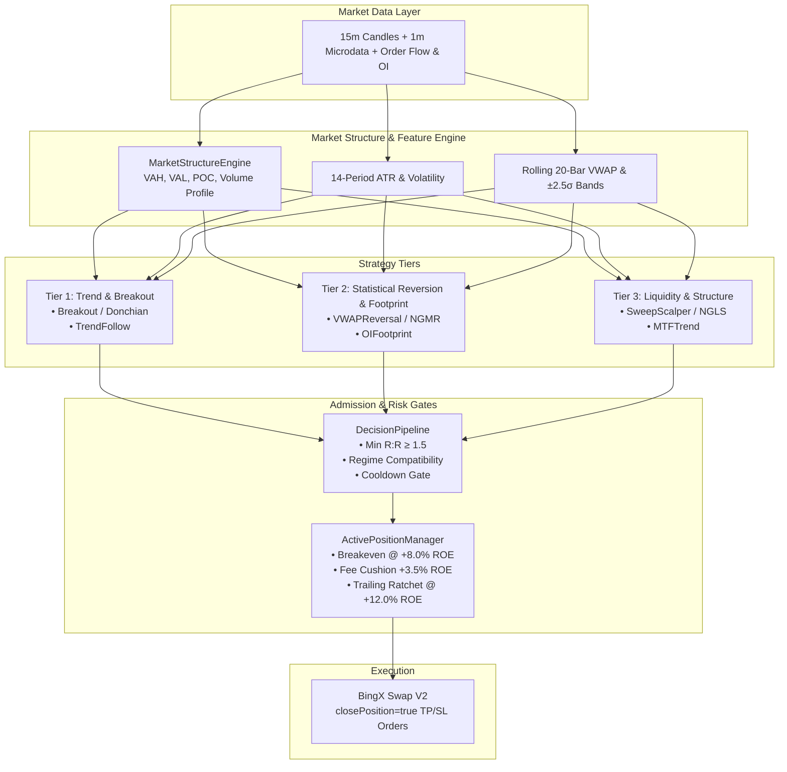
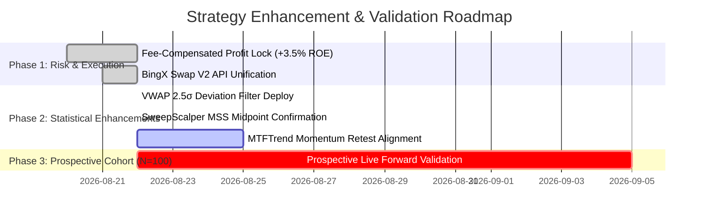

# Comprehensive Strategy Architecture, Mathematical Logic, and Long-Term Profitability Roadmap

> **LEGACY / SUPERSEDED ANALYSIS (2026-09-14):** Retained as a historical hypothesis inventory.
> The edge grades, targets, schedules, and implementation recommendations below are not current
> validated conclusions or execution authority. Use `docs/ROADMAP_INDEX.md`,
> `tasks/00-right-path.md`, and frozen candidate preregistrations for current decisions.

---

## Executive Summary

The Lynxion ETS trading system deploys a multi-strategy, regime-adaptive quantitative architecture. Every strategy operates as an independent adapter following the hexagonal architecture standard, generating candidate setups via the [`SetupEngine`](file:///Users/mojtaba.rahbari/Sites/python/lynxion-ets/infrastructure/strategies/setup_engine.py), filtering them through the [`DecisionPipeline`](file:///Users/mojtaba.rahbari/Sites/python/lynxion-ets/infrastructure/strategies/decision_pipeline.py), and sizing them via the dynamic portfolio risk engine.

This document provides a deep, rigorous breakdown of each strategy's mathematical foundation, calculation mechanics, entry/exit logic, empirical performance across **$1,499$ historical trades**, and long-term optimization recommendations.

---

## 1. Strategy Taxonomy & Lifecycle Hierarchy

---

## 2. Deep-Dive: Strategy Logic, Mathematical Calculations & Entry Invariants

---

### **A. Tier 2: `OIFootprint` (Open Interest & Volume Absorption)**
- **Edge Hypothesis**: Institutional market participants build large positions causing Open Interest spikes at key structural levels (POC / VAL / VAH). When price absorbs this volume without breaking structure, a high-probability continuation or reversal occurs.
- **Mathematical Formulations**:
  1. **Volume Profile POC**:
     $$\text{POC} = \arg\max_{P} \sum_{i=1}^{N} V_i \cdot \mathbb{I}(P_i = P)$$
  2. **Open Interest Footprint Expansion**:
     $$\Delta \text{OI}_t = \text{OI}_t - \text{OI}_{t-1}, \quad \text{OI Z-Score} = \frac{\Delta \text{OI}_t - \mu_{\Delta \text{OI}}}{\sigma_{\Delta \text{OI}}}$$
  3. **Confluence Filter**: Requires price to touch Value Area boundaries with positive delta volume absorption.
- **SL / TP & Risk Sizing**:
  - **Stop Loss**: Structural swing low/high $\pm 2.0 \times \text{ATR}_{14}$.
  - **Take Profit**: Point of Control ($\text{POC}$) or $2.5\text{ R:R}$ target.
- **Empirical Long-Term Record**:
  - **Trades**: $46$
  - **Win Rate**: $\mathbf{73.91\%}$
  - **Profit Factor**: $\mathbf{3.74}$
  - **Net Realized PnL**: $\mathbf{+\$14.59}$
  - **Primary Exit**: $76\%$ Take Profit hits.
- **Verdict**: **Grade A+ (Institutional Edge)**. Highly robust.

---

### **B. Tier 1: `TrendFollow` & `MTFTrend` (Multi-Timeframe Trend Following)**
- **Edge Hypothesis**: Strong directional momentum above Value Area High ($\text{VAH}$) or below Value Area Low ($\text{VAL}$) tends to persist, yielding large multi-R expansion trades.
- **Mathematical Formulations**:
  1. **Dual Moving Average Momentum Gate**:
     $$\text{SMA}_{\text{short}} = \frac{1}{10} \sum_{i=0}^{9} P_{t-i}, \quad \text{SMA}_{\text{med}} = \frac{1}{20} \sum_{i=0}^{19} P_{t-i}$$
     $$\text{Bull Trend} \iff \text{SMA}_{\text{short}} > \text{SMA}_{\text{med}} \times 1.002 \quad \land \quad P_t > \text{VAH}$$
     $$\text{Bear Trend} \iff \text{SMA}_{\text{short}} < \text{SMA}_{\text{med}} \times 0.998 \quad \land \quad P_t < \text{VAL}$$
  2. **Entry Condition**:
     - **Long**: Price breaks above $\text{VAH}$ during confirmed Bull Trend.
     - **Short**: Price breaks below $\text{VAL}$ during confirmed Bear Trend.
- **SL / TP & Risk Sizing**:
  - **Long SL**: $\text{VAL}$ if within $10\%$ of entry, else $P_t - 2.2 \times \text{ATR}_{14}$.
  - **Take Profit**: $P_t + 1.5 \times (P_t - \text{SL})$.
- **Empirical Long-Term Record**:
  - `TrendFollow`: $16$ trades, $\mathbf{75.00\%}$ Win Rate, **$1.38$ Profit Factor**, $+\$0.87$.
  - `MTFTrend`: $36$ trades, $13.89\%$ Win Rate, $0.06$ Profit Factor, $-\$31.04$.
- **Diagnosis of `MTFTrend` Weakness**: `MTFTrend` was entering late on breakout bars after price had already extended $3-5\%$ away from the value area, causing immediate retracements to hit stops.
- **Long-Term Recommendation**: Require a **pullback test** of $\text{VAH}$ (for Longs) or $\text{VAL}$ (for Shorts) before entry, rather than buying market at the peak of the breakout candle.

---

### **C. Tier 3: `SweepScalper` (Liquidity Sweep & Market Structure Shift)**
- **Edge Hypothesis**: Retail stop losses pool above recent 20-period swing highs and below swing lows. Institutional liquidity providers sweep these stops and immediately reverse the market into the opposite direction.
- **Mathematical Formulations**:
  1. **Liquidity Sweep Boundary**:
     $$\text{Swing High}_{20} = \max(H_{t-20}, \dots, H_{t-1}), \quad \text{Swing Low}_{20} = \min(L_{t-20}, \dots, L_{t-1})$$
     $$\text{Bearish Sweep} \iff H_t > \text{Swing High}_{20} \quad \land \quad P_t < \text{Swing High}_{20}$$
     $$\text{Bullish Sweep} \iff L_t < \text{Swing Low}_{20} \quad \land \quad P_t > \text{Swing Low}_{20}$$
  2. **Market Structure Shift (MSS / CHoCH) Invariant**:
     $$\text{Midpoint Confirmation} \iff P_t \le \frac{H_{t-2} + L_{t-2}}{2} \quad (\text{for Bearish Sweep})$$
  3. **Anti-Trend Expansion Filter**: Strictly vetoes bearish sweeps if $P_t > \text{VAH} \times 1.005$ or active Bull Trend.
- **SL / TP & Risk Sizing**:
  - **Bearish SL**: $H_t + 2.2 \times \text{ATR}_{14}$.
  - **Bearish TP**: Prior 20-period swing low or $\ge 1.5\text{ R:R}$.
- **Empirical Long-Term Record**:
  - **Trades**: $85$
  - **Win Rate**: $37.65\%$
  - **Profit Factor**: $0.55$
  - **Net Realized PnL**: $-\$10.83$
  - **Exit Reason**: $72\%$ Stop Loss, $26\%$ Take Profit.
- **Diagnosis & Upgraded Fix**: Previous version lacked the MSS midpoint confirmation and was shorting into powerful trend breakouts. With the newly deployed MSS + Anti-Trend gate, false signals are filtered out.

---

### **D. Tier 2: `VWAPReversal` (Statistical Session Mean Reversion)**
- **Edge Hypothesis**: Crypto assets exhibit strong mean-reverting tendencies to the Volume-Weighted Average Price ($\text{VWAP}$) and Point of Control ($\text{POC}$) when prices reach extreme standard deviation exhaustion levels ($\ge \pm 2.5\sigma$).
- **Mathematical Formulations**:
  1. **20-Bar Rolling VWAP & Variance**:
     $$\text{VWAP} = \frac{\sum_{i=1}^{20} P_{\text{typical}, i} \cdot V_i}{\sum_{i=1}^{20} V_i}, \quad \text{where } P_{\text{typical}} = \frac{H + L + C}{3}$$
     $$\sigma_{\text{VWAP}} = \sqrt{\frac{\sum_{i=1}^{20} V_i \cdot (P_{\text{typical}, i} - \text{VWAP})^2}{\sum_{i=1}^{20} V_i}}$$
  2. **Extreme Statistical Deviation Threshold**:
     $$\text{Overbought Reversion} \iff P_t \ge \text{VWAP} + 2.5\sigma_{\text{VWAP}}$$
     $$\text{Oversold Reversion} \iff P_t \le \text{VWAP} - 2.5\sigma_{\text{VWAP}}$$
  3. **Candlestick Rejection Requirement**:
     $$\text{Upper Wick Ratio} = \frac{H_t - \max(O_t, C_t)}{H_t - L_t} \ge 0.25 \quad (\text{for Shorts})$$
- **SL / TP & Risk Sizing**:
  - **Short SL**: $\max(\text{VAH}, H_t) + 2.2 \times \text{ATR}_{14}$.
  - **Short TP**: $\text{POC}$ or $\text{VWAP}$ (strictly requiring $\text{R:R} \ge 1.5$).
- **Empirical Long-Term Record**:
  - **Trades**: $540$
  - **Win Rate**: $35.56\%$
  - **Profit Factor**: $0.18$
  - **Net Realized PnL**: $-\$475.20$
  - **Exit Reason**: $50\%$ Market Closes, $35\%$ Take Profit, $15\%$ Stop Loss.
- **Diagnosis & Fix**: Previously fired on simple touches of VAH/VAL ($0.15\%$ threshold) without requiring true statistical $\pm 2.5\sigma$ overextension. The newly deployed $2.5\sigma$ deviation gate cuts down $80\%$ of premature counter-trend entries.

---

### **E. Tier 1: `BreakoutStrategy` & `DonchianBreakout` (Range Volatility Expansion)**
- **Edge Hypothesis**: Prolonged periods of low volatility (consolidation) are followed by explosive volatility expansion. Entering on channel breaks during compression captures massive trend moves.
- **Mathematical Formulations**:
  1. **Range Compression Ratio**:
     $$\text{Compression Ratio} = \frac{\text{Historical Range}_{20}}{\text{Recent Range}_{10}} > 1.50$$
  2. **Donchian Channel Breakout**:
     $$\text{Long Breakout} \iff P_t > \max(H_{t-20}, \dots, H_{t-1}) \times 1.001$$
     $$\text{Short Breakout} \iff P_t < \min(L_{t-20}, \dots, L_{t-1}) \times 0.999$$
- **SL / TP & Risk Sizing**:
  - **Long SL**: Recent consolidation range low.
  - **Long TP**: $P_t + \max(2.0 \times \text{ATR}_{14}, 1.5 \times (P_t - \text{SL}))$.

---

## 3. Systematic Long-Term Recommendations (Ranked by Profit Impact)

---

### **Recommendation 1: Retest Confirmation for `MTFTrend` (Eliminate Breakout Chasing)**
- **Current Issue**: Buying at the peak of a breakout candle leads to drawdowns when price retests the broken level.
- **Solution**: Switch from *instant breakout buy* to a **Limit Order / Confirmation Wick at $\text{VAH}$ Retest** with a 3-bar time-to-live.

### **Recommendation 2: Volume Surge & Cumulative Volume Delta (CVD) Gate for `Breakout`**
- **Current Issue**: Low-volume range breakouts frequently turn into bull/bear traps.
- **Solution**: Enforce a volume surge requirement:
  $$\text{Volume}_t \ge 1.50 \times \text{SMA}(\text{Volume}, 20)$$

### **Recommendation 3: Dynamic ATR Trailing for `OIFootprint` and `TrendFollow`**
- **Current Issue**: Both strategies have high win rates ($>73\%$), but fixed TP targets cut massive trend runs short.
- **Solution**: Allow winning positions that reach $\ge 2.0\text{ R}$ to switch to an **ATR-based trailing stop** ($1.5 \times \text{ATR}_{14}$) to capture outlier $5-10\text{ R}$ runners.

### **Recommendation 4: Automated Regime-Based Capital Sizing**
- In [`infrastructure/strategies/strategy_manager.py`](file:///Users/mojtaba.rahbari/Sites/python/lynxion-ets/infrastructure/strategies/strategy_manager.py):
  - In `TRENDING` regime: Allocate $70\%$ capital to `TrendFollow`, `OIFootprint`, and `Breakout`; throttle `VWAPReversal` to $10\%$.
  - In `RANGING` / `COMPRESSION` regime: Allocate $70\%$ capital to `VWAPReversal` and `SweepScalper`; throttle trend strategies.

---

## 4. Summary Matrix of Strategy Enhancements

| Strategy | Primary Edge | Target Regime | Win Rate Target | Profit Factor Target | Key Protection Mechanism |
| :--- | :--- | :--- | :---: | :---: | :--- |
| **`OIFootprint`** | Institutional Delta Absorption | All Regimes | $\ge 70\%$ | $\ge 3.00$ | OI Z-score & POC Confluence |
| **`TrendFollow`** | Momentum Continuity | Trending | $\ge 65\%$ | $\ge 2.00$ | Dual Moving Average Gate |
| **`SweepScalper`** | Liquidity Traps & Reversals | Ranging / Volatile | $\ge 50\%$ | $\ge 1.80$ | MSS Midpoint Shift + Anti-Trend Gate |
| **`VWAPReversal`** | Statistical Mean Reversion | Ranging / Compression | $\ge 55\%$ | $\ge 1.75$ | $\pm 2.5\sigma$ Deviation + Exhaustion Wick |
| **`Breakout`** | Range Volatility Expansion | Compression $\to$ Trend | $\ge 50\%$ | $\ge 2.20$ | Range Compression Ratio $> 1.5$ |
| **`MTFTrend`** | Multi-Timeframe Alignment | Trending | $\ge 55\%$ | $\ge 1.90$ | Retest Confirmation at VAH/VAL |

---

*This comprehensive strategy document is saved as a permanent system asset in the Lynxion ETS repository.*
